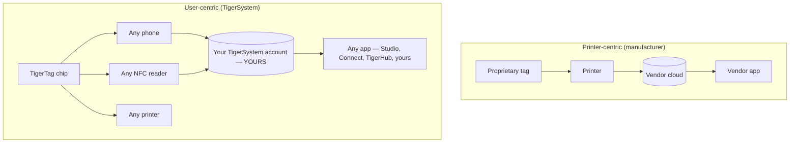

# Ekosystem skupiony na użytkowniku, a nie na drukarce

> **Inteligencja w służbie użytkownika — nie tylko drukarki.**

## Dwie przeciwstawne architektury

W świecie skupionym na drukarce to **drukarka** jest centrum: tag istnieje po to, by służyć
maszynie, a dane płyną do silosu producenta.

W TigerSystem centrum jest **użytkownik**. Użytkownik jest właścicielem:

- **filamentu** — dowolnej marki, dowolnego producenta;
- **metadanych** — materiału, koloru, ustawień druku, zakodowanych na chipie, który kontroluje;
- **magazynu** — przechowywanego na jego własnym koncie w chmurze, z możliwością eksportu;
- **historii** — wag, lokalizacji, zużycia w czasie;
- **synchronizacji** — to samo konto zasila każdą aplikację i urządzenie.

TigerSystem po prostu **łączy ze sobą wszystkie elementy**.

## Dlaczego producenci blokują RFID

Tagi producentów są zwykle blokowane kryptograficznie (szczegóły dla poszczególnych marek
znajdziesz w [sekcji zgodności](../compatibility/README.md): klucze wyprowadzane z UID,
sektory szyfrowane AES, podpisy RSA). Blokada służy producentowi: wiąże zakup materiałów
eksploatacyjnych z maszyną i utrzymuje własnościowy potok danych. Oznacza to także, że
**twój własny magazyn szpul nie należy do ciebie**.

Chipy TigerTag zajmują przeciwne stanowisko: otwarty ładunek NDEF na standardowym
chipie NTAG, publicznie udokumentowany, z otwartymi SDK do jego odczytu i zapisu.

---

**◀ Poprzednia:** [Dlaczego powstał TigerSystem](../vision/why-tigersystem.md) · **▲ [Spis dokumentacji](../../README.md)** · **Następna ▶** [Otwarty ekosystem](./open-ecosystem.md)

**Zobacz też:** [Uniwersalna tożsamość filamentu](../concepts/universal-filament-identity.md), [Zgodność](../compatibility/README.md)
