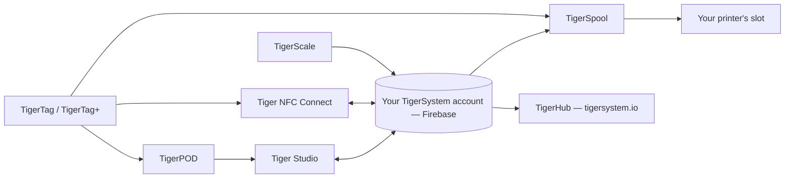

# Produkty

Ekosystem TigerSystem, jedna strona na produkt.

**To są oficjalne produkty** — zaprojektowane i opublikowane przez TigerSystem.
„Oficjalne” oznacza tu *my to zrobiliśmy*, a nie *musisz to mieć*: każdy z nich
jest open source i można go forkować, a ich nazwy (Tiger Studio, TigerHub, TigerScale,
TigerPOD, Tiger NFC Connect) celowo **nie są zastrzeżone jako znaki towarowe**.
Zastrzeżony jest tylko sam znak **TigerTag**, i to wyłącznie dla chipa.

Każdy może zbudować i sprzedawać alternatywę — czytnik, aplikację, wagę, cały
system magazynowy. Zob. [sprzęt firm trzecich](../compatibility/third-party-hardware.md)
i [oprogramowanie zbudowane na TigerTag](../developers/integrations.md), by sprawdzić, co
już istnieje. Produkt firmy trzeciej jest **TigerTag Compatible** po prostu przez to,
że działa; **TigerTag Certified** staje się dopiero wtedy, gdy TigerSystem mu to przyzna
([zasady dotyczące znaku towarowego](../../TRADEMARK.md)).

> **Uwaga:** każdy **skierowany do użytkownika** produkt poniżej — i każdy przyszły — jest
> działającym **dowodem koncepcji**. Ich jedynym celem jest pokazanie potencjału
> otwartego, standardowego, niezależnego od producenta, wieloplatformowego protokołu oraz zainspirowanie
> tego, co inni zbudują na jego podstawie. (Fabryczny zestaw narzędzi do programowania chipów
> to inna historia: klasy przemysłowej, w produkcji.) Zob.
> [Piaskownica z założenia](../vision/why-tigersystem.md).

| Produkt | Czym jest | Typ |
|---|---|---|
|  [TigerData](../concepts/universal-filament-identity.md) | Wirtualny chip — tożsamość w postaci cyfrowej, bez chipa, z możliwością ulepszenia w dowolnej chwili | Koncepcja |
|  [TigerTag](./tigertag.md) | Otwarty chip RFID/NFC + standard tożsamości szpuli | Sprzęt + specyfikacja |
|  [TigerTag+](./tigertag-plus.md) | TigerTag niosący identyfikator produktu katalogowego i opcjonalne wzbogacenie — nadal w 100 % offline; podpisany jest TigerTag+ Certified | Sprzęt + specyfikacja |
|  [Tiger NFC Connect](./tiger-nfc-connect.md) | Aplikacja mobilna (iOS/Android) — skanowanie, kodowanie, przeglądanie | Aplikacja |
|  [Tiger Studio](./tiger-studio.md) | Aplikacja desktopowa — magazyn, regały, czujniki, drukarki | Aplikacja |
|  [TigerHub](./tigerhub.md) | Webowy dom ekosystemu — wizytówka, listy życzeń, znajomi i udostępnianie pod adresem `tigersystem.io` | Web |
|  [TigerPOD](./tigerpod.md) | Drukowany w 3D stojak na dwa czytniki NFC | Sprzęt |
|  [TigerScale](./tigerscale.md) | Otwartoźródłowa waga do filamentu na ESP32 | Sprzęt |
|  [TigerSpool](./tigerspool.md) | Otwartoźródłowa skrzynka na ESP32 obok drukarki — dotknij szpulą, wybierz slot, dowolna marka | Sprzęt |
|  [Tiger Touch](./tigertouch.md) | Otwartoźródłowy firmware do ekranu BIGTREETECH Panda Touch / K-Touch — drukarki każdej marki, na żywo, na jednym ekranie | Firmware |
|  [TigerTag Factory i Manager](./factory-suite.md) | Przemysłowe narzędzia do programowania chipów i bazy filamentów dla fabryk — **niepubliczne**, klasy produkcyjnej | Przemysłowe |

---

**◀ Poprzednia:** [Przepływ danych](../architecture/data-flow.md) · **▲ [Spis dokumentacji](../../README.md)** · **Następna ▶** [TigerTag](./tigertag.md)
