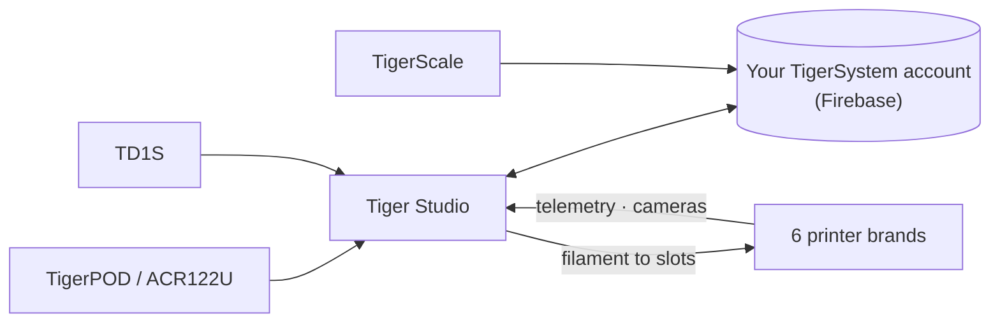

# Tiger Studio (aplikacja desktopowa)

## Cel

**Tiger Studio to centrum dowodzenia twoim filamentem.** Każda szpula, każdy
regał, każda drukarka na jednym ekranie — zeskanuj chip, a jego szpula się otworzy,
zaktualizuj masę, a zsynchronizuje się wszędzie, zerknij na drukarkę i zobacz, co
robi w tej chwili. Open source, na Windows / macOS / Linux.

*Tiger Studio na biurku, aplikacja w kieszeni, czytnik obok — ten sam
magazyn, gdziekolwiek go dotkniesz.*

<a class="ts-cta-primary" href="https://tigersystem.io/download">Pobierz Tiger Studio — za darmo</a>

<a href="https://github.com/TigerTag-Project/TigerTag-Studio-Manager"> Źródła</a>

To celowo **laboratorium, a nie cel ostateczny** — demonstracja tego,
co umożliwia otwarty protokół, czytelna, możliwa do forkowania i swobodnie kopiowana
([filozofia](../philosophy/open-ecosystem.md)).

## Gdzie się mieści

## Funkcje (najważniejsze)

- **Magazyn** — synchronizacja Firestore w czasie rzeczywistym, widoki tabeli/siatki, panel szczegółów,
 śledzenie masy, kalibracja pojemników, cyfrowe szpule (TigerData) z
 atomowym awansem do chipa.
- **Drukarki** — integracje na żywo dla **6 marek** (telemetria, filament w każdym
 slocie, postęp zadania, kamery, a dla niektórych marek pełne panele sterowania). Zob.
 [zgodność](../compatibility/README.md).
- **Regały** — mapowanie fizycznego przechowywania metodą przeciągnij i upuść.
- **Znajomi i udostępnianie** — kody wykrywania, magazyny znajomych tylko do odczytu.
- **Urządzenia** — własne: [TigerPOD](./tigerpod.md) i
 [TigerScale](./tigerscale.md); firm trzecich: czytnik NFC ACR122U,
 analizatory **AJAX-3D TD-1 i TD1s** (TD + kolor prosto do profilu
 szpuli) oraz **wagi USB HID** (seria DYMO M i dowolna zgodna waga) —
 pełna lista: [zgodny sprzęt firm trzecich](../compatibility/third-party-hardware.md).
- **11 wersji językowych** — EN · FR · DE · ES · IT · NL · PL · PT-BR · PT-PT · RU · 中文.

Kompletny, zawsze aktualny katalog znajduje się w pliku
[FEATURES.md](https://github.com/TigerTag-Project/TigerTag-Studio-Manager/blob/main/FEATURES.md) w repozytorium aplikacji.

## Architektura

Electron + czysty JS, bez bundlera. Połączenia z drukarkami używają **natywnego
protokołu LAN** każdego producenta bezpośrednio (MQTT / WebSocket / HTTP) — notatki o protokołach dla każdej marki są
utrzymywane w repozytorium aplikacji (`renderer/printers/<brand>/PROTOCOL.md`).

## W obrazach

## Linki

- Repozytorium + pobrania: [TigerTag-Studio-Manager](https://github.com/TigerTag-Project/TigerTag-Studio-Manager) (MIT)
- Pełny katalog funkcji: [FEATURES.md](https://github.com/TigerTag-Project/TigerTag-Studio-Manager/blob/main/FEATURES.md)

---

**◀ Poprzednia:** [Tiger NFC Connect (aplikacja mobilna)](./tiger-nfc-connect.md) · **▲ [Spis dokumentacji](../../README.md)** · **Następna ▶** [TigerHub](./tigerhub.md)

**Zobacz też:** [Zgodność](../compatibility/README.md), [Architektura](../architecture/overview.md)
