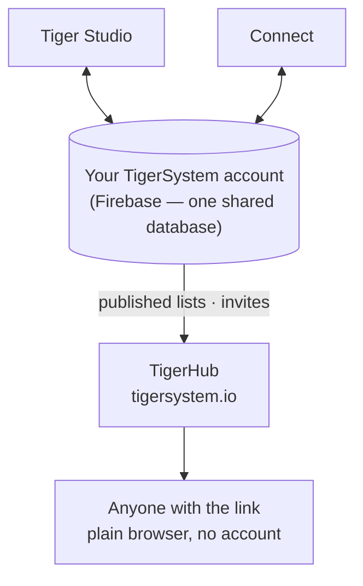

# TigerHub

## Cel

**TigerHub to dom ekosystemu w sieci** — strona pod adresem
**[tigersystem.io](https://tigersystem.io)**. Przedstawia piaskownicę TigerSystem
i to, co umożliwia otwarty protokół TigerTag, a także hostuje
**stronę społecznościową** piaskownicy: udostępnij listę życzeń, zaproś kogoś, by został
znajomym, opublikuj listę tylko do odczytu, którą każdy otworzy w przeglądarce.

## Gdzie się mieści

## Funkcje — wszystkie działają już dziś

- **Wizytówka ekosystemu** — strona główna opowiada całą historię: jak to działa,
 sześć marek drukarek, komponenty i trzy poziomy (TigerData —
 śledzenie wyłącznie programowe · TigerTag — chip offline · TigerTag+ — zweryfikowana
 autentyczność).
- **Twoje konto w sieci** (`/account`) — zaloguj się na swoje konto
 TigerSystem z przeglądarki.
- **Listy życzeń** — publiczne i tylko dla znajomych, obie wdrożone.
- **Kody znajomych i zaproszenia** — dodawajcie się nawzajem do znajomych z poziomu sieci.
- **Publiczne linki do list** — udostępnij listę tylko do odczytu jako
 `https://tigersystem.io/wishlist/<token>`; oglądający nie potrzebuje aplikacji ani
 konta.
- **Katalog materiałów i baza referencyjna** (`/materials`, `/database`) —
 przeglądaj wspólny katalog, względem którego rozwiązują się wszystkie aplikacje.
- **Drukarki i funkcje** (`/printers`, `/features`) — co z czym działa.
- **Modele 3D** (`/models`) — modele do druku (TigerPOD i towarzysze).
- **Dla producentów, deweloperów i prasy** (`/manufacturers`, `/developers`,
 `/press`) — historia B2B, wskazówki integracyjne, materiały medialne.
- **Goodies** (`/goodies`) — oficjalna czapka i polo. Kupno jednego z nich to jeden
 ze sposobów [wsparcia projektu](../support.md).

## Publiczny link do listy w praktyce

Publiczny link do listy to `https://tigersystem.io/wishlist/<token>`. Trzy
rzeczy, które warto wiedzieć, zanim się go gdzieś wklei:

- **Token jest całym kluczem.** Każdy, kto ma link, otwiera listę — bez konta,
  bez aplikacji, bez niczego do udowodnienia. Należy traktować go jak hasło,
  które świadomie się udostępnia: dobre do posta na forum albo dla znajomego,
  nie do listy, której dalsze kopiowanie byłoby kłopotem.
- **To upublicznienie listy tworzy link.** W aplikacji ustawienie listy jako
  *publicznej* generuje jej token i publikuje kopię listy; przywrócenie jej do
  stanu prywatnego usuwa tę kopię i token. Po ponownym upublicznieniu lista
  dostaje **nowy** token, więc wcześniej rozdany link nie ożywa. TigerHub
  wyświetla tylko to, co publikuje aplikacja.
- **Tylko do odczytu, i widać, kto udostępnił.** Oglądający widzi tę jedną
  listę — jej pozycje oraz okazję lub wiadomość, jeśli zostały ustawione — nigdy
  magazyn ani inne listy. Strona pokazuje jednak **nazwę wyświetlaną**, **linki
  do mediów społecznościowych** i przycisk *dodaj do znajomych*, który niesie
  **kod wyszukiwania** udostępniającego.

Link to jeden z dwóch sposobów udostępniania; drugim jest znajomy:

| | Publiczny link do listy | Znajomy |
|---|---|---|
| Kto widzi | każdy, kto ma link | jedna zaakceptowana osoba |
| Wymaga konta | nie | tak |
| Jak | upublicznić listę | wymienić się kodami wyszukiwania |
| Cofnięcie | ustawić listę jako prywatną | usunąć znajomego |

Część o znajomych jest tu streszczona tylko po to, by stała obok linku; zasady
zaproszeń i usuwania oraz ich egzekwowanie po stronie serwera należą do
[Magazyn i synchronizacja z chmurą](../concepts/inventory-and-cloud-sync.md).

## TigerHub nie jest bazą danych

Konta użytkowników i dane stojące za wszystkimi aplikacjami żyją w **zwykłym Firebase**
(Auth + Firestore) — celowo niemarkowej infrastrukturze: **jedna wspólna
baza danych, w jednym miejscu**, aby Tiger Studio, Tiger NFC Connect, TigerScale
i konto TigerSystem współpracowały na tych samych danych. TigerHub to
**powierzchnia webowa** zbudowana na jej szczycie. Zob.
[Magazyn i synchronizacja z chmurą](../concepts/inventory-and-cloud-sync.md).

## Interakcje

| Z | Jak |
|---|---|
| Tiger Studio / Connect | Ustawianie listy jako publicznej lub prywatnej — co tworzy lub usuwa jej link — i wysyłanie zaproszeń do znajomych |
| Firebase (baza danych kont) | Źródło opublikowanych danych |
| Odwiedzający | Zwykła przeglądarka, bez konta |

---

**◀ Poprzednia:** [Tiger Studio (aplikacja desktopowa)](./tiger-studio.md) · **▲ [Spis dokumentacji](../../README.md)** · **Następna ▶** [TigerPOD](./tigerpod.md)

**Zobacz też:** [Magazyn i synchronizacja z chmurą](../concepts/inventory-and-cloud-sync.md), [Architektura](../architecture/overview.md)
