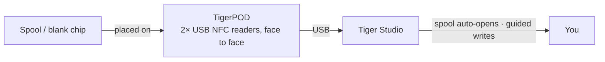

# TigerPOD

## Cel

**Pierwszy „odtwarzacz CD” dla inteligentnych szpul filamentu.** TigerPOD stawia na biurku
skaner szpul — a wydrukujesz go sam.
Darmowy, otwartoźródłowy stojak do druku 3D mieszczący **dwa** czytniki USB NFC **zwrócone
do siebie**: połóż szpulę, a sama się zidentyfikuje w Tiger Studio; połóż pusty
chip, zakoduj go. Tak naturalnie jak dotknięcie telefonu, ale bez rąk na biurku.

*Połóż szpulę; sama się przedstawi.*

<a class="ts-cta-primary" href="https://tigersystem.io/tigerpod">Zdobądź TigerPOD</a>
<a href="https://makerworld.com/fr/models/1289152-tigerpod-for-openspool-tigertag-rfid-filament#profileId-1318958">Wydrukuj go — darmowy STL</a>

<a href="https://github.com/TigerTag-Project/TigerPOD"> Źródła</a>

## Dlaczego dwa czytniki, zwrócone do siebie

To sedno obudowy i jedyna rzecz, którą trzeba zrobić dobrze. **Zawsze zalecamy
dwa czytniki.** Jeden technicznie działa, ale pogarsza
doświadczenie na dwa konkretne sposoby:

- **Odczyt.** Szpula niesie
 [**dwa chipy, na przeciwnych ściankach**](../concepts/tigertag-chip.md). Przy jednym
 czytniku szpulę, która wyląduje „złą” stroną, trzeba podnieść i
 obrócić, zanim zostanie zobaczona. Gdy po każdej stronie jest czytnik, niezależnie od tego, jak opuścisz
 szpulę, chip i tak jest już przed czytnikiem. Nic do obracania, nic
 do celowania.
- **Zapis.** Gdy sam oznaczasz szpulę, zapisujesz **oba** chipy. Jeden
 czytnik oznacza dwa przebiegi i dwie szanse na niezgodność. Dwa czytniki zapisują
 parę **za jednym razem**, a Tiger Studio może je zweryfikować względem siebie.

Pod istnieje, by utrzymać tę geometrię: dwa czytniki, pionowo, zwrócone do siebie, w odległości
szpuli. Cała reszta to obudowa wokół niej.

## Gdzie się mieści

## Dwie obudowy do wydruku — obie darmowe

| | **TigerPOD Mini** — *zalecany* | **TigerPOD (oryginał)** |
|---|---|---|
| |  |  |
| Druk | Szybszy, mniej filamentu | Dłuższy, więcej filamentu |
| Miejsce na biurku | Mniej | Więcej |
| Kable | Prowadzone **wewnątrz** obudowy | Zewnętrzne |
| Tagi | TigerTag **i** OpenSpool (NDEF) | TigerTag **i** OpenSpool (NDEF) |
| Pobieranie | **[MakerWorld — TigerPOD Mini](https://makerworld.com/fr/models/3190348-tigerpod-mini-for-openspool-tigertag-rfid-filament#profileId-3609236)** | **[MakerWorld — oryginalny TigerPOD](https://makerworld.com/fr/models/1289152-tigerpod-for-openspool-tigertag-rfid-filament#profileId-1318958)** |

Obie mieszczą te same dwa czytniki klasy ACR122U zwrócone do siebie. Mini to
przeprojektowany oryginał i po prostu lepszy Pod: zacznij od niego, chyba że
wyraźnie chcesz większej kołyski.

Licencja **CC BY 4.0** — remiksuj i adaptuj swobodnie.

## Z czego jest zrobiony

STL to obudowa; oto części, które trafiają do środka. Nic tu nie jest
wyłączne — działa dowolny czytnik klasy ACR122U i dowolny rozdzielacz USB-C — ale to
kombinacja, wokół której zaprojektowano obudowę:

| Część | Ilość | Czym jest |
|---|---|---|
| **TigerTag Player** | **2** | Czytnik USB NFC — urządzenie klasy ACR122U. Po jednym na stronę, aby oba chipy szpuli były osiągalne w jednym przebiegu. |
| **TigerTag Spliter** | 1 | USB-C na 2× USB-A, aby dwa czytniki łączyły się z komputerem jednym portem i mogły być programowane równolegle. |
| **Drukowana obudowa** | 1 | **Mini** lub oryginał — zob. wyżej. |

### Zdobycie części

Obudowa jest darmowa do pobrania; dwa czytniki i rozdzielacz to część, którą
kupujesz. Są sprzedawane w zestawie, co jest najtańszym sposobem na uzyskanie
właściwej pary:

- **[TigerTag Player Bundle — 2 czytniki + Spliter](https://www.atome3d.com/products/tigertag-player-bundle-2pcs-spliter)** (Atome3D)
- Dostępny także na **[tigertag.io](https://shop.tigertag.io/collections/tigertag-rfid-maker)**

> **Uwaga:** samodzielne złożenie i kupno gotowego prowadzą do
> dokładnie tego samego urządzenia. Wystarczą dowolne dwa czytniki klasy ACR122U — zestaw
> po prostu oszczędza ci szukania ich osobno.

## Zbuduj własny

1. **Wydrukuj obudowę** — Mini lub oryginał, jak wyżej.
2. **Zdobądź dwa czytniki zgodne z ACR122U**, z dowolnego sklepu, i paczkę
 pustych chipów NTAG 213 / 215 / 216 do zapisu.
3. **Wsuń po jednym czytniku w każde gniazdo** — bez śrub, bez kleju, bez okablowania.
4. **Podłącz oba do komputera.** Rozdzielacz daje jeden kabel; dwa porty USB
 działają równie dobrze.
5. **Zainstaluj [Tiger Studio](./tiger-studio.md)** — sam wykryje
 czytniki.

Orientacyjny budżet przy osobnym zakupie — ceny zależą od sklepu i regionu:

| Część | Ilość | Szac. | Gdzie |
|---|---|---|---|
| Czytnik NFC zgodny z ACR122U | 2 | 15–25 € za sztukę | [Amazon](https://amzn.to/4vok3d7) · lub dowolny sklep |
| Puste chipy NTAG 213 / 215 / 216 | 1 paczka | 10–20 € — dwa chipy na szpulę, więc paczka oznaczy wiele | [Amazon](https://amzn.to/3TzxGc7) · [oficjalne chipy](./tigertag.md) |
| Drukowana obudowa | 1 | tylko filament | MakerWorld, wyżej |
| Rozdzielacz USB (2× USB-A żeńskie → 1× USB-A męskie) | 1 | 5–10 €, opcjonalny | [Amazon](https://amzn.to/4plgsv8) |

> Niektóre linki w tej tabeli to **linki afiliacyjne Amazon**: jako partner
> Amazon TigerTag zarabia na kwalifikujących się zakupach, **bez dodatkowych kosztów dla
> ciebie**. Pomaga to finansować otwarty protokół. Kupno tych samych części gdziekolwiek indziej
> działa równie dobrze.

Kupno [zestawu](https://shop.tigertag.io/collections/tigertag-rfid-maker)
kosztuje mniej niż zdobywanie tych samych części jedna po drugiej, czytniki przychodzą
z oficjalnym logo projektu, a to finansuje standard — jeden z
kilku sposobów [wsparcia projektu](../support.md). Ale zbudowanie z
ogólnodostępnych części **nie jest gorszą drogą — to ten sam Pod**. Tak właśnie działa
otwarty protokół.

### Zgodność czytników

ACR122U mówi **PC/SC**, systemowym standardem kart inteligentnych, który implementuje każdy czytnik
tej klasy. Ponieważ Pod opiera się na PC/SC, a nie na sterowniku producenta,
ta sama konfiguracja działa na **Windows, macOS i Linux**, a obsłuży ją dowolna biblioteka PC/SC.

## Funkcje

- Drukowana w 3D obudowa — **darmowe pliki STL na MakerWorld**, w rozmiarze **Mini** i
 **oryginalnym**.
- Mieści dwa czytniki USB klasy ACR122U, twarzą w twarz (stacje odczytu + zapisu).
- Plug-and-play z [Tiger Studio](./tiger-studio.md): zeskanowanie chipa
 automatycznie otwiera pasującą szpulę; prowadzony przepływ aktualizacji chipa używa go do
 zapisów ze sprawdzeniem UID.
- Nie jest związany z TigerTag: te same dwa czytniki obsługują także tagi **OpenSpool** (NDEF).

## Więcej niż TigerTag — uniwersalna stacja NFC

Pod **nie jest związany z protokołem TigerTag**. To, dosłownie, dwa
standardowe czytniki PC/SC w uchwycie w kształcie szpuli: **wszystko, co potrafi ACR122U,
potrafi i Pod.**

Masz pełną kontrolę nad chipem — odczytaj, co jest na nim zapisane, zapisz coś nowego,
zmień to, co jest, wymaż go z powrotem do pustego. Wszystkie cztery, w obie strony. Bez
jednorazowego zapisu, bez drogi jednokierunkowej, bez uzależnienia od dostawcy. A dla filamentu odbywa się to w
trybie **Dual NFC**, oba chipy szpuli obsługiwane razem, na szpulach dowolnej marki.

ACR122U obsługuje znacznie więcej niż NTAG: **ISO 14443 Type A i B**, **MIFARE**
(Classic 1K/4K, Ultralight, DESFire), **FeliCa**, **Topaz/Jewel** oraz **typy tagów NFC
Forum 1–4**. Cokolwiek da się odczytać lub zapisać ACR122U, da się odczytać
lub zapisać w Podzie — w tym tagi [OpenSpool](../compatibility/openspool.md).

To właśnie sprawia, że [drugie życie](../philosophy/second-life.md) jest prawdziwe.
TigerTag nigdy nie jest zablokowany przed zapisem, więc gdy szpula się skończy, możesz wymazać jej
chipy i przepisać je jako nowe TigerTagi — albo zamienić w coś zupełnie innego:
zwykły tag **NDEF** do automatyki domowej, przekazania Wi-Fi, adresu URL, wizytówki.
I z powrotem w TigerTag, kiedy tylko zechcesz. Chip to zasób wielokrotnego użytku, a nie
opakowanie jednorazowe.

## Interakcje

| Z | Jak |
|---|---|
| Chipy TigerTag | Odczyt / kodowanie / weryfikacja — oba chipy szpuli naraz |
| Tiger Studio | Natychmiastowa identyfikacja szpuli, awans i aktualizacja chipa |

## W obrazach

## Linki

- Repozytorium: [TigerPOD](https://github.com/TigerTag-Project/TigerPOD)
- STL — **[TigerPOD Mini](https://makerworld.com/fr/models/3190348-tigerpod-mini-for-openspool-tigertag-rfid-filament#profileId-3609236)** · [oryginalny TigerPOD](https://makerworld.com/fr/models/1289152-tigerpod-for-openspool-tigertag-rfid-filament#profileId-1318958)
- Czytniki: [TigerTag Player Bundle (2 szt. + Spliter)](https://www.atome3d.com/products/tigertag-player-bundle-2pcs-spliter)

---

**◀ Poprzednia:** [TigerHub](./tigerhub.md) · **▲ [Spis dokumentacji](../../README.md)** · **Następna ▶** [TigerScale](./tigerscale.md)

**Zobacz też:** [Przepływ pracy Second Life](../philosophy/second-life.md)
