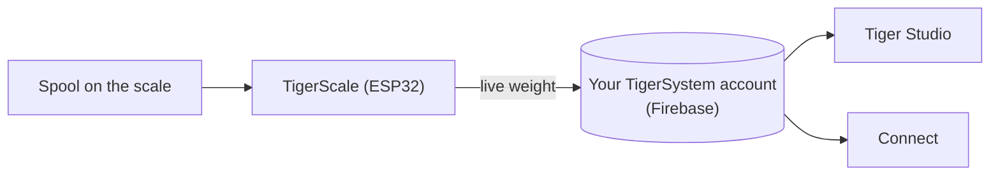

# TigerScale

## Cel

**TigerScale odpowiada na odwieczne pytanie: ile filamentu zostało?** Połóż
szpulę na otwartoźródłowej wadze na ESP32, a masa na żywo trafia prosto do
twojego magazynu — bez ręcznego wpisywania, bez potrząsania szpulą przy uchu.

*Szpula ląduje na wadze, a ta już wie, czym jest: chip podaje
markę, materiał i kolor, tensometr podaje gramy. Nic nie wpisane,
nic nie zgadywane.*

<a class="ts-cta-primary" href="https://tigertag-project.github.io/Tiger-Scale-V3/">Zainstaluj z przeglądarki</a>

<a href="https://tigersystem.io/tigerscale">TigerScale na tigersystem.io</a>
<a href="https://makerworld.com/en/models/3161869-tigerscale-v3-best-smart-filament-scale-with-nfc#profileId-3573543">Wydrukuj obudowę</a>
<a href="https://github.com/TigerTag-Project/Tiger-Scale-V3"> Źródła</a>

> **Chip wie, czym filament *jest*; waga wie, ile go *zostało*.** Razem
> sprawiają, że magazyn jest naprawdę prawdziwy: tożsamość z
> [TigerTag](./tigertag.md), ilość na żywo z TigerScale.

## TigerScale V3 — obecna generacja

[Tiger-Scale-V3](https://github.com/TigerTag-Project/Tiger-Scale-V3), MIT.
To ta, którą warto zbudować.

- **Wie, jaka szpula na niej leży**: **dwa czytniki NFC PN532**, po jednym z każdej
 strony — [szpula z dwoma tagami](../concepts/tigertag-chip.md) jest rozpoznawana
 niezależnie od tego, jak ją odłożysz. Odczytaj tag, zważ, odejmij masę pustej
 szpuli, zsynchronizuj — bez pisania, bez zgadywania.
- **ESP32-S3** (16 MB flash, PSRAM), **3,5″ kolorowy ekran dotykowy 480×320**
 (LVGL) z pełną konfiguracją na ekranie: wybór WiFi + klawiatura, kreator kalibracji,
 autotest sprzętu, aktualizacje OTA.
- **Zasilanie bateryjne** (PMIC AXP2101, stan ładowania na ekranie), kodek audio.
- Precyzyjne ważenie: HX711 + tensometr, filtrowanie medianowe + adaptacyjne EMA —
 dostrojone do odczucia wagi kuchennej.
- **8 języków firmware**, interfejs webowy w 9 językach.
- **Śledzenie masy na żywo** — aktualizacje pojawiają się w czasie rzeczywistym w Tiger Studio i
 Tiger NFC Connect przez Firestore.
- Współpracuje z **kalibracją masy pojemnika** w Tiger Studio, dzięki czemu masa netto filamentu
 pozostaje dokładna dla każdego typu pojemnika.
- **Działa offline.** Identyfikacja marki i materiału pochodzi z bazy
 przechowywanej we flashu urządzenia, odświeżanej najwyżej raz dziennie — wyszukanie tagu
 nigdy nie czeka na sieć.
- **Synchronizacja z chmurą jest opcjonalna.** Waga w pełni działa bez konta.
- **Własny interfejs webowy**, serwowany z urządzenia, przyjazny telefonom, na żywo przez
 WebSocket z częstotliwością 10 Hz — bez aplikacji do instalowania, by sterować nią z telefonu.
- **Bez binarnych bloków**: wszystko kompiluje się ze źródeł.

*Na stole: odłóż szpulę, a sama się zidentyfikuje i zważy.*

## Budowa własnej

> **Nie lubisz elektroniki?** Waga USB i [TigerPOD](./tigerpod.md) robią
> to samo bez niczego do okablowania czy wgrywania —
> [oficjalna alternatywa bez elektroniki](#waga-usb-i-tigerpod-bez-elektroniki).

Waga to konstrukcja DIY, a kroki, które ludzie uważają za trudne, takie nie są:

1. **Wydrukuj obudowę.** Jeden projekt Bambu Studio `.3mf` z już rozmieszczonymi
 płytami — [na MakerWorld](https://makerworld.com/en/models/3161869-tigerscale-v3-best-smart-filament-scale-with-nfc#profileId-3573543).
 Otwórz go w Bambu Studio lub Orca i naciśnij Slice: nic do orientowania, żadnych
 podpór do rozmieszczania.
2. **Okabluj komponenty.** Połącz tensometr, HX711, głośnik i oba
 czytniki PN532 z płytką według [schematu okablowania](#schemat-okablowania)
 poniżej — ten sam układ pinów dla obu wariantów płytki.
3. **Wgraj firmware z przeglądarki.**
 [Instalator webowy](https://tigertag-project.github.io/Tiger-Scale-V3/) zawsze
 serwuje bieżące wydanie; potem waga aktualizuje się sama przez Wi-Fi.

Części są ogólnodostępne:

| Ilość | Komponent | Gdzie |
|---|---|---|
| 1 | Waveshare **ESP32-S3-Touch-LCD-3.5B** — dotykowy IPS 480×320 (wersja **-3.5** bez B też działa) | [-3.5B](https://link.amazon/B0gaANfF5) · [-3.5](https://link.amazon/B0dpgOlOQ) |
| 2 | Moduł NFC **PN532 V3** — wymagane złącze pinów **oraz** przełącznik trybu | [Amazon](https://link.amazon/B0iTXrhjd) |
| 1 | Tensometr 5 kg + HX711 | [Amazon](https://link.amazon/B09LOUuI1) |
| 1 | Kabel USB-C 4-pinowy + złącze | [kabel](https://link.amazon/B0aoW8qQx) · [złącze](https://link.amazon/B0aiEyjLx) |
| 1 | Akumulator Li-ion — **opcjonalny**, waga działa z USB | [Amazon](https://link.amazon/B0etKlE1i) |
| — | Przewody Dupont, wkręty samogwintujące M3 | [przewody](https://link.amazon/B0bl6jvMs) · [wkręty](https://link.amazon/B0ekzxx1E) |
| — | 2× M4×30 i 2× M5×30 (tensometr), 4× M2×6 (wyświetlacz) | dowolny sklep z narzędziami |
| 1 | Mały głośnik | dołączony do płytki ESP32-S3 |

<figure>

<figcaption><strong>Oba warianty działają, ale potrzebują innego firmware.</strong> Odczytaj opis na płytce: <strong>-3.5B</strong> lub <strong>-3.5</strong>. Instalator webowy pyta, który masz; okablowanie i obudowa są w obu przypadkach takie same. Wgraj zły build, a waga uruchomi się idealnie, ale nigdy nie zobaczy tagu, bez niczego na ekranie, co by wyjaśniało dlaczego.</figcaption>
</figure>
<figure>

<figcaption><strong>Ostrzeżenie:</strong> tensometr musi mieć 2× gwintowane otwory M4 i 2× M5, a płytka HX711 musi być identyczna z pokazaną — inaczej nie wejdzie w przeznaczone dla niej gniazdo.</figcaption>
</figure>

> Niektóre linki w tej tabeli to **linki afiliacyjne Amazon**: jako partner
> Amazon TigerTag zarabia na kwalifikujących się zakupach, **bez dodatkowych kosztów dla
> ciebie**. Pomaga to finansować otwarty protokół. Kupno tych samych części gdziekolwiek indziej
> działa równie dobrze.

Pełny wycenione zestawienie materiałowe znajduje się w
[repozytorium](https://github.com/TigerTag-Project/Tiger-Scale-V3).

### Montaż

<figure>

<figcaption>Przód pod kątem</figcaption>
</figure>
<figure>

<figcaption>Tył pod kątem</figcaption>
</figure>
<figure>

<figcaption>Tył pod kątem, z bliska</figcaption>
</figure>
<figure>

<figcaption>Widok z boku</figcaption>
</figure>

<figure>

<figcaption>Położenie i orientacja wagi</figcaption>
</figure>
<figure>

<figcaption>PN532 osadzony w gnieździe</figcaption>
</figure>

### Schemat okablowania

*[Interaktywny schemat w Cirkit Designer](https://app.cirkitdesigner.com/project/c6aa6c0a-9462-498f-8923-9ad4454e0e69)*

### Rozwiązywanie problemów

**Nie wykryto portu COM dla ESP32-S3 w [instalatorze webowym](https://tigertag-project.github.io/Tiger-Scale-V3/)?**

Może brakować sterownika dla twojego systemu. [Skorzystaj z przewodnika instalacji sterownika](../tutorials/tigerscale-serial-port-driver.md).

**Waga zatrzymana na 0 g lub ujemna, dryfujący odczyt, niewykryte czytniki,
utrata WiFi po ponownym wgraniu firmware'u?**

Repozytorium samej wagi prowadzi pełną listę, objaw po objawie:
[rozwiązywanie problemów z Tiger-Scale-V3](https://github.com/TigerTag-Project/Tiger-Scale-V3/blob/main/docs/TROUBLESHOOTING.md).

## Do wykonywania i sprzedawania

**Każdy może produkować i sprzedawać sprzęt TigerScale. Bez opłaty licencyjnej, bez
tantiem, bez rejestracji.** Zbuduj go, wgraj oficjalny firmware, wysyłaj.

Jedynym warunkiem nazwania twojego produktu **TigerScale** jest uruchamianie tego
oficjalnego firmware **bez modyfikacji**, aby każda sztuka zachowywała się identycznie w
ekosystemie. Zrób fork, jeśli chcesz coś zmienić — i nadaj temu forkowi inną
nazwę. To cała umowa.

## Gdzie się mieści

## Dotychczasowa historia

Trzy generacje, a kształt rzeczy zmieniał się w każdej:

| | Odczyt | Ekran | Płytka | Forma |
|---|---|---|---|---|
| **V1** — nigdy nie wydana publicznie | **jeden** PN532 | mini OLED | ESP32 | **uchwyt na szpulę**: centralna podpora przechodząca przez środek szpuli |
| **V2** — [Tiger-Scale](https://github.com/TigerTag-Project/Tiger-Scale), MIT | 2× RC522 | OLED 0,96″ | ESP32-WROOM, zasilanie USB | płaska waga |
| **V3** — [Tiger-Scale-V3](https://github.com/TigerTag-Project/Tiger-Scale-V3), MIT | 2× PN532 | kolorowy ekran dotykowy 3,5″ | ESP32-S3, bateria | płaska waga, samodzielna |

V1 niosła już zasadniczo elektronikę V2 — ESP32, mini OLED,
płytkę HX711 z tensometrem 5 kg — ale **jeden** czytnik i
zupełnie inną obudowę.

> **V3 to inny sprzęt, a nie aktualizacja firmware.** Te dwie nie są
> wymienne: zbudowana już V2 zachowuje własne repozytorium i nadal
> działa. Po prostu nie jest już rozwijana.

Wszystkie trzy są w pełni open source (MIT) na ogólnodostępnych częściach — żywy dowód,
że ESP32 i moduł czytnika NFC (klasy PN532 / RC522) wystarczą, by
zbudować urządzenie odczytujące TigerTag.

## Waga USB i TigerPOD, bez elektroniki

**Oficjalna alternatywa dla każdego, kto nie chce budować wagi.** Standardowa
waga USB i [TigerPOD](./tigerpod.md), oba podłączone do
komputera, a resztę robi Tiger Studio — nic do lutowania, okablowania ani wgrywania.

1. **Podłącz wagę do komputera** przez USB.
2. **Ustaw TigerPOD na niej** — Mini lub oryginał.
3. **Wytaruj wagę**, z TigerPOD na niej.
4. **Otwórz Tiger Studio.**
5. **Połóż szpulę na TigerPOD.** Odczytuje chipy szpuli, a Tiger
 Studio otwiera jej kartę.
6. **Waga ją waży**, a Tiger Studio samo aktualizuje masę szpuli.

### Które wagi działają

Tiger Studio odczytuje standardowe urządzenia **USB „HID Scale”** (strona użycia HID
`0x8D`, użycie `0x20`): począwszy od **DYMO M5** i reszty serii DYMO M
(M10, M25… ten sam protokół) oraz **każdej zgodnej wagi HID Scale**, niezależnie od
marki. Waga jest sprzętem firmy trzeciej, a nie produktem Tiger; konfiguracja wokół
niej jest oficjalna i wspierana.

Protokół, zwalidowany na prawdziwym sprzęcie — 6-bajtowe *Scale Data Reports* z częstotliwością ok. 1 Hz:

| Bajt | Znaczenie |
|---|---|
| `[0]` | identyfikator raportu `0x03` |
| `[1]` | status: 1 usterka · 2 stabilna przy zerze · 3 w ruchu · 4 stabilna · 5 ujemna · 6 przekroczony zakres |
| `[2]` | jednostka (kody HID PoS): `0x02` gram · `0x0B` uncja · `0x0C` funt |
| `[3]` | wykładnik potęgi dziesięciu ze znakiem stosowany do surowej wartości |
| `[4..5]` | masa, LE16 (LSB, MSB) |

Identyfikator producenta DYMO `0x0922`; M5 to pid `0x8009`. Osobliwość: sama pierwsza ramka
zaraz po tarowaniu zgłasza jednostkę `0x00`.

> **DYMO M2 nie jest obsługiwana** — nie ma w ogóle portu USB, więc nie
> ma czego podłączyć do komputera. Protokół nie ma tu znaczenia.

## Interakcje

| Z | Jak |
|---|---|
| Firebase (baza danych kont) | Zapisuje masę na żywo na konto użytkownika |
| Tiger Studio / Connect | Wyświetlają masę na żywo; monitorowanie stanu |

## Linki

- **V3 (obecna)**: [Tiger-Scale-V3](https://github.com/TigerTag-Project/Tiger-Scale-V3) (MIT)
- Wgraj z przeglądarki: [instalator webowy](https://tigertag-project.github.io/Tiger-Scale-V3/)
- Wydrukuj obudowę: [MakerWorld](https://makerworld.com/en/models/3161869-tigerscale-v3-best-smart-filament-scale-with-nfc#profileId-3573543)
- V2, już nierozwijana: [Tiger-Scale](https://github.com/TigerTag-Project/Tiger-Scale) (MIT)

---

**◀ Poprzednia:** [TigerPOD](./tigerpod.md) · **▲ [Spis dokumentacji](../../README.md)** · **Następna ▶** [Zgodność](../compatibility/README.md)

**Zobacz też:** [Magazyn i synchronizacja z chmurą](../concepts/inventory-and-cloud-sync.md)
