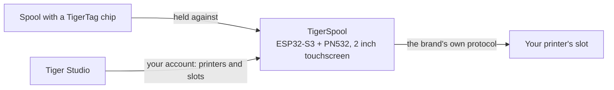

# TigerSpool

**Mała skrzynka obok drukarki. Dotknij slotu, przyłóż do niej szpulę, a
filament zostanie zapisany w tym slocie — w drukarce dowolnej marki.**

*Skrzynka, szpula i własne sloty drukarki na ekranie — każdy pokazuje,
co jest w nim załadowane. Wybierz slot, przyłóż szpulę do skrzynki, gotowe.*

<a class="ts-cta-primary" href="https://tigertag-project.github.io/TigerSpool-RFID/">Zainstaluj z przeglądarki</a>

<a href="https://github.com/TigerTag-Project/TigerSpool-RFID"> Źródła</a>

Twoja drukarka już prowadzi listę slotów. Twoja szpula już niesie własną
[tożsamość](../concepts/universal-filament-identity.md). TigerSpool to te trzydzieści
centymetrów między nimi: bez aplikacji do otwierania, bez klawiatury, bez przepisywania niczego,
co chip już wie.

Open source na licencji **MIT**, ESP32-S3, około **40 €** ogólnodostępnych części.

## Co robi

1. **Dotknij slotu**, którego chcesz, na ekranie dotykowym — z tą samą nazwą slotu, jakiej
 używa sama drukarka.
2. **Przyłóż szpulę do skrzynki.** [Chip TigerTag](../concepts/tigertag-chip.md)
 jest odczytywany przy zetknięciu, a przypisanie od razu trafia do drukarki, przez
 własny protokół danej marki: materiał, marka, kolor i temperatury, w
 właściwym slocie. Nie ma niczego do potwierdzania.
3. **Załaduj szpulę.** Skrzynka mówi ci, do którego slotu trafiła.

Mówi w dziewięciu językach, najpierw pyta o wybór języka i aktualizuje się
sama przez Wi-Fi.

:::caution[Ostrzeżenie]
Zeskanowanie TigerTag na slot na ekranie niczego nie
ładuje — tylko mówi drukarce, czym *jest* szpula. **Nadal musisz
fizycznie włożyć szpulę do tego slotu samodzielnie** — CFS, AMS,
jednostkę ACE lub jak tam dana drukarka nazywa swoją tackę. Pomiń to, a
drukarka zgłosi brak filamentu, bo faktycznie żaden nie jest załadowany.
:::

## Gdzie się mieści

TigerSpool nie jest zapisywarką chipów — to zadanie [TigerPOD](./tigerpod.md),
na biurku. TigerSpool bierze istniejącą już tożsamość i umieszcza ją tam, gdzie
drukarka jej oczekuje.

## Co musi istnieć najpierw

**To właśnie zaskakuje ludzi, dlatego jest przed sprzętem.**

Skrzynka celowo nie ma klawiatury ani możliwości wpisania adresu drukarki.
Czyta twoje drukarki **z twojego konta TigerSystem**, co oznacza, że dwie
rzeczy muszą istnieć, zanim będzie użyteczna:

1. **Konto utworzone w [Tiger Studio](./tiger-studio.md).** Skrzynka loguje się
 do niego — przez e-mail lub przez Google za pomocą kodu QR, więc żadne hasło
 nie jest nigdy wpisywane na dwucalowym ekranie.
2. **Twoje drukarki, dodane w Tiger Studio.** Adres, kod dostępu, marka i
 model — wszystko to mieszka tam.

Jeśli to pominiesz, lista drukarek na skrzynce będzie **pusta**. To nie jest
usterka i nie ma nic do naprawiania na urządzeniu: pokazuje dokładnie to,
co zawiera twoje konto. Dodaj drukarkę w Tiger Studio, a pojawi się przy
następnej synchronizacji.

> **W skrócie:** Tiger Studio → utwórz konto → dodaj swoje drukarki →
> *dopiero potem* skonfiguruj skrzynkę.

## Które drukarki

**Obsługiwanych jest sześć marek, które integruje Tiger Studio** — napisane i przetestowane
na sprzęcie. To nie każda drukarka na rynku, a *„dowolna drukarka”*
pozostaje celem; to każda marka, z którą ten ekosystem rozmawia dziś:

| Marka | Firmware | Transport |
|---|---|---|
| [Creality](../compatibility/creality.md) | zaimplementowany, sprawdzony | WebSocket |
| [FlashForge](../compatibility/flashforge.md) | zaimplementowany, sprawdzony | HTTP |
| [Bambu Lab](../compatibility/bambu-lab.md) | zaimplementowany, sprawdzony | MQTT przez TLS |
| [Snapmaker](../compatibility/snapmaker.md) | zaimplementowany, sprawdzony | Moonraker przez WebSocket |
| [Elegoo](../compatibility/elegoo.md) | zaimplementowany, odczyt sprawdzony — zapis jeszcze niepotwierdzony na drukarce | MQTT |
| [Anycubic](../compatibility/anycubic.md) | zaimplementowany, odczyt sprawdzony — zapis jeszcze niepotwierdzony; tylko tryb LAN | MQTT przez TLS |

Nazwy slotów odpowiadają nazwom drukarki: `Ext.` i `1A`–`1D` w Creality i
FlashForge, `A1`–`A4`, potem `B1`–`B4` w Bambu Lab, `E1`–`E4` w Snapmaker, `S1`–`S4` w
Canvas Elegoo i jedna litera na jednostkę ACE w Anycubic — `A1`, `A2`… potem
`B1`… dla drugiego pudełka.

Sprawdź [status według marek](https://github.com/TigerTag-Project/TigerSpool-RFID/blob/main/docs/PRINTER-COMPATIBILITY.md)
przed zakupem części do konkretnej maszyny.

## Zbuduj własny

Trzy rzeczy do kupienia, cztery przewody, jedna drukowana obudowa — plus dwa dodatki warte
rozważenia. **Elektronika jest identyczna dla każdej marki drukarki** — zmienia się tylko
obudowa, co pozwala zachować jeden firmware i jedną listę części.

| Ilość | Komponent | Gdzie |
|---|---|---|
| 1 | Płytka deweloperska Waveshare **ESP32-S3-Touch-LCD-2** — 2,0" 240×320 IPS z pojemnościowym dotykiem, ESP32-S3**R8**, 16 MB flash, 8 MB oktalnej PSRAM. Ekran, panel dotykowy i MCU na jednej płytce, a 16 MB sprawia, że dwa sloty OTA są wygodne | [Amazon](https://link.amazon/B0c5hr3uf) |
| 1 | Moduł NFC **PN532 V3** — przełączniki DIP, musi obsługiwać **HSU/UART**, oba przełączniki na `0` / OFF. Dwupak kosztuje niewiele więcej niż jedna sztuka | [Amazon](https://link.amazon/B0dyEfwKa) |
| 1 | Kabel USB-C **przenoszący dane** — prędkość nie ma znaczenia, wystarczy dowolny kabel danych USB 2.0 | [Amazon](https://link.amazon/B00Xg3WT4) |
| 1 | Magnetyczne złącze USB-C — **zalecane**: port to część używana codziennie, a to kabel się odpina zamiast gniazda | [Amazon](https://link.amazon/B0bWVIBa0) |
| 1 | Ogniwo LiPo 3,7 V 1000 mAh, PH1.25 — **opcjonalne**, ładowane przez USB; skrzynka działa wtedy bez kabla. Płytka nie wykrywa ogniwa, więc deklarujesz je w Ustawienia › Bateria. Sprawdź polaryzację | [Amazon](https://link.amazon/B0fL0jjf3) |

> Niektóre linki w tej tabeli to **linki afiliacyjne Amazon**: jako partner
> Amazon TigerTag zarabia na kwalifikujących się zakupach, **bez dodatkowych kosztów dla
> ciebie**. Pomaga to finansować otwarty protokół. Kupno tych samych części gdziekolwiek indziej
> działa równie dobrze.

**Cztery przewody połączeniowe są w zestawie z PN532** — 3V3, GND, TX, RX, i to
cała wiązka. Bez konwerterów poziomów: PN532 pracuje na 3V3, tak jak płytka.
Bateria jest **opcjonalna** — skrzynka zwykle stoi obok drukarki, która jest
już podłączona do zasilania, a powyższe ogniwo jest na chwile, gdy tak nie jest.

*Cała wiązka. Na PN532 dwa piny danych są opisane jako `SDA` i
`SCL` — w trybie HSU przenoszą UART: **TX płytki idzie do `SCL`**, jej
**RX do `SDA`**, a oba przełączniki DIP są na `0` / OFF.
[Interaktywny schemat](https://app.cirkitdesigner.com/project/5b546f4e-70b8-4735-afff-be6bd36bc10c).*

**Wgrywanie odbywa się z przeglądarki** — podłącz płytkę, kliknij Install, poczekaj
minutę. Chrome, Edge lub Opera na desktopie; Safari i Firefox nie
implementują WebSerial, podobnie jak żadna przeglądarka mobilna.

**[Zainstaluj z przeglądarki →](https://tigertag-project.github.io/TigerSpool-RFID/)**

### Trzy pułapki warte znajomości przed zamówieniem

- **Czytnik idzie na GPIO43/44, nigdy na GPIO6/7.** Ta para to magistrala I²C
 z rezystorami podciągającymi na tej płytce: PN532 podłączony tam włącza się, odpowiada
 i zwraca losowe UID przy nieudanych odczytach. Wygląda to na zepsuty tag. Tak nie jest,
 a kosztuje to dzień.
- **`TXD` krzyżuje się z RX płytki, `RXD` z jej TX.** Nadawanie łączy się
 z odbiorem. Jeśli czytnik zgłasza przy starcie wersję firmware 0, zamień te dwa
 przed zmianą czegokolwiek innego.
- **Kabel USB tylko do ładowania sprawia, że działająca płytka wygląda na martwą.**
 Ekran się świeci, a port szeregowy nigdy się nie pojawia, więc instalator webowy nie znajduje
 niczego, na co mógłby instalować. Użyj kabla, o którym wiesz, że przesyła pliki.

Waveshare sprzedaje kilka podobnych płytek; wersje 1,28", 1,69" i 3,5" z
tej samej rodziny mają inne kontrolery paneli i rozkłady pinów, i ten firmware
nie będzie na nich działał poprawnie. Sprawdzaj opis na płytce, a nie tytuł oferty.

Pełna lista części, schemat okablowania i lista kontrolna uruchomienia:
[TigerSpool-RFID](https://github.com/TigerTag-Project/TigerSpool-RFID).

## Jak jest dziś

Spisane, a nie odkrywane:

- **Pierwsza drukowana obudowa jest opublikowana**: wolnostojący stojak na biurko,
 ze szpulą po lewej lub po prawej, w
 [Model3D/](https://github.com/TigerTag-Project/TigerSpool-RFID/tree/main/Model3D).
 Obudowy montowane na danej drukarce podlegają tej samej zasadzie — ta sama płytka, ten sam
 czytnik, te same cztery przewody, to samo wejście USB-C — więc jeden obraz firmware działa na
 każdym modelu, a każdy może dołożyć własną bez dotykania kodu.
- **Firmware nie jest podpisany.** Jego połączenie aktualizacyjne jest weryfikowane względem
 magazynu certyfikatów głównych, więc skrzynka wie, z kim rozmawia — ale nie wie, kto
 wytworzył obraz.
- **Naraz połączonych najwyżej dziesięć drukarek** — z 24, które konto może jej
 przekazać — i nie więcej niż trzy rozmawiające przez TLS (Bambu Lab, Anycubic), które kosztują
 najwięcej pamięci.

---

**▲ [Spis dokumentacji](../../README.md)** · **Zobacz też:** [TigerPOD](./tigerpod.md), [Tiger Studio](./tiger-studio.md), [Chip TigerTag (format RFID/NFC)](../concepts/tigertag-chip.md), [Zgodność drukarek](../compatibility/README.md)
