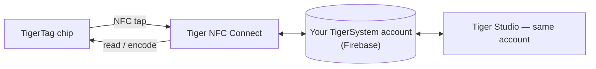

# Tiger NFC Connect (aplikacja mobilna)

## Cel

**Twój telefon już jest czytnikiem TigerTag — Connect go włącza.**
Aplikacja na iOS/Androida odczytuje dowolną szpulę jednym dotknięciem, równie łatwo zapisuje chipy
i trzyma całą twoją kolekcję w kieszeni. To codzienne wejście do
ekosystemu i ucieleśnienie
[mostu ze smartfonem](../philosophy/smartphone-bridge.md).

<strong>iPhone · iPad</strong>
<a class="ts-cta-primary" href="https://apps.apple.com/app/id6745437963">App Store</a>
Zeskanuj aparatem lub dotknij przycisku

<strong>Android</strong>
<a class="ts-cta-primary" href="https://play.google.com/store/apps/details?id=com.tigertag.connect">Google Play</a>
Zeskanuj aparatem lub dotknij przycisku

<a href="https://tigersystem.io/download">Wszystkie pobrania na tigersystem.io</a>
<a href="https://testflight.apple.com/join/jVHhmK4C">Beta TestFlight (iOS)</a>
<a href="https://play.google.com/apps/testing/com.tigertag.connect">Beta Google Play</a>

Za darmo, w obu sklepach. Aplikacja odczytuje chip własnym NFC telefonu — nic
do kupienia, żadnego czytnika, do odczytu nie trzeba konta.

## Gdzie się mieści

## Funkcje

- **Skanowanie NFC w terenie** — dotknij szpuli, zobacz jej pełny profil.
- **Programowanie chipów** — kodowanie i ponowne kodowanie chipów TigerTag z telefonu.
- **Przeglądanie katalogu** — wspólna baza referencyjna marek/materiałów/kolorów.
- **Wspólne konto** — ten sam backend Firebase co Tiger Studio: magazyn,
 znajomi i regały pozostają zsynchronizowani w czasie rzeczywistym między urządzeniami.
- **Akcesoria USB-C** — obsługuje analizator filamentu AJAX-3D **TD-1 / TD1s**
 przez USB-C: zmierz Transmission Distance filamentu (i
 kolor) prosto z telefonu
 ([zgodny sprzęt firm trzecich](../compatibility/third-party-hardware.md)).

## Jak ją zdobyć

- **Wydana** w **App Store (iOS)** i **Google Play (Android)** —
 dziś wersja 1.0.2.
- Dostępne także **publiczne bety** (TestFlight na iOS, otwarta beta na Androidzie).
- Wszystkie linki do pobrania: **[tigersystem.io/download](https://tigersystem.io/download)**
 — kod QR jest też zawsze dostępny na pasku bocznym Tiger Studio.

> **Uwaga o nazwie:** dawniej publikowana jako *„TigerTag RFID Connect”* — przemianowana
> na **Tiger NFC Connect**, by nawiązać do czytnika NFC, który jest już w każdym telefonie.
> Aplikacja jest **darmowa, ale własnościowa** (nie open source) na razie —
> w przeciwieństwie do Tiger Studio, SDK i sprzętu, które są otwarte.

## Architektura

Aplikacja we Flutterze komunikująca się z Firebase (Auth + Firestore) — jedyną wspólną
bazą danych kont stojącą za wszystkimi aplikacjami. Łączność z drukarkami na urządzeniach mobilnych jest zorientowana na chmurę tam, gdzie
pozwalają na to producenci.

## Interakcje

| Z | Jak |
|---|---|
| Chipy TigerTag | Odczyt i zapis dotknięciem NFC |
| Firebase (baza danych kont) | Synchronizacja magazynu / znajomych / preferencji w czasie rzeczywistym |
| Tiger Studio | Towarzysz desktopowy — to samo konto, uzupełniające się funkcje |

## W obrazach

|| | | |
|---|---|---|---|
|  |  |  |  |

---

**◀ Poprzednia:** [TigerTag+ Certified](./tigertag-plus-certified.md) · **▲ [Spis dokumentacji](../../README.md)** · **Następna ▶** [Tiger Studio (aplikacja desktopowa)](./tiger-studio.md)

**Zobacz też:** [Most ze smartfonem](../philosophy/smartphone-bridge.md), [Magazyn i synchronizacja z chmurą](../concepts/inventory-and-cloud-sync.md)
