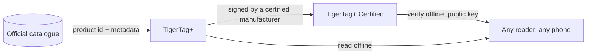

# TigerTag+ Certified

## Cel

**Certified to poziom, który potrafi udowodnić, skąd pochodzi chip.**
[TigerTag+](./tigertag-plus.md), który dodatkowo niesie **podpis
kryptograficzny**, to **TigerTag+ Certified**. Podpis zapisuje
producent posiadający [certyfikację TigerTag+](../developers/README.md), który
w jej ramach otrzymuje narzędzia podpisujące; klucz prywatny przechowuje TigerTag.

To jedyny z trzech poziomów niedostępny dla wszystkich i jedyny,
który odpowiada na pytanie, na które pozostałe dwa nie potrafią: *czy ta szpula jest oryginalna?*

## Trzy poziomy obok siebie

| | TigerTag | TigerTag+ | TigerTag+ Certified |
|---|---|---|---|
| Dane do druku, **na chipie** | ✅ | ✅ | ✅ |
| Działa w pełni offline | ✅ | ✅ | ✅ |
| Identyfikator produktu katalogowego, **na chipie** | — | ✅ | ✅ |
| Metadane wzbogacające, **przez Web API, opcjonalne** | — | ✅ | ✅ |
| Podpis pochodzenia, **na chipie** | — | — | ✅ |
| Kto może go wytworzyć | każdy | każdy | **certyfikowany producent** |

Przeczytaj uważnie lewą kolumnę: metadane wzbogacające to jedyny wiersz, który
**nie** znajduje się na chipie. Są pobierane z katalogu, gdy akurat jesteś
online, i mogą się poprawiać po zapisaniu chipa — dlatego właśnie nigdy nie mogą być czymś, czego chip potrzebuje. Wszystko, czego wymaga drukarka,
jest w wierszach oznaczonych *na chipie*, co sprawia, że wszystkie trzy
poziomy są w 100 % offline.

## Weryfikacja jest darmowa — wystawianie to przywilej certyfikacji

**Weryfikacja** podpisu jest darmowa, offline i bez ograniczeń: klucze publiczne
są opublikowane, a każdy czytnik może sprawdzić podpis bez konta i bez sieci.
**Wystawianie** podpisów to przywilej certyfikacji.

Podpisana wiadomość celowo obejmuje **własny UID** chipa, więc podpisany
ładunek skopiowany na inny chip już do niego nie pasuje: sklonowany tag nie przechodzi
weryfikacji, na telefonie samego klienta. Ta sama właściwość sprawia, że dwa
chipy jednej szpuli niosą dwa *różne* podpisy
([jak te dwa chipy są powiązane](../concepts/tigertag-chip.md)).

## Gdzie się mieści

Układ na poziomie bajtów — identyfikatory typów chipów, 64-bajtowy obszar podpisu na stronach
`0x18`–`0x27` — jest opisany w
[TigerTag-RFID-Guide](https://github.com/TigerTag-Project/TigerTag-RFID-Guide).

## Kto jest certyfikowany

Wiarygodną listą producentów uprawnionych do umieszczania znaku na produkcie jest
[rejestr certyfikowanych partnerów](../certified-partners.md). Logo lub nazwa TigerTag
na chipie dowolnego formatu, nośniku, szpuli lub jej opakowaniu są dozwolone tylko
dla twórców z tej strony.

---

**◀ Poprzednia:** [TigerTag+](./tigertag-plus.md) · **▲ [Spis dokumentacji](../../README.md)** · **Następna ▶** [Tiger NFC Connect (aplikacja mobilna)](./tigertag-connect.md)

**Zobacz też:** [Chip TigerTag (format RFID/NFC)](../concepts/tigertag-chip.md), [Certyfikowani partnerzy](../certified-partners.md), [Dokumentacja dla deweloperów](../developers/README.md)
