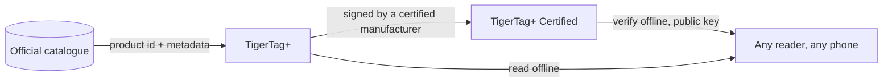

# TigerTag+

## Cel

**Plus oznacza zidentyfikowany.** TigerTag+ to TigerTag, którego tożsamość niesie
**identyfikator produktu z oficjalnego katalogu** — nie wartości, które ktoś wpisał, lecz
dokładny produkt: marka, kolor, materiał, temperatury, średnica, SKU, EAN,
prosto ze źródła. Ponadto może nieść **opcjonalne metadane wzbogacające**,
udostępniane przez Web API i możliwe do ulepszenia po zapisaniu chipa.

Sam chip pozostaje **w 100 % offline**. Wszystko, czego potrzeba do druku, jest na nim,
dokładnie jak na standardowym TigerTag — identyfikator katalogowy dodaje możliwość
wyszukania bogatszych, świeższych danych, *gdy akurat jesteś online*, i nic nie odbiera,
gdy nie jesteś. TigerTag+ odczytany w trybie samolotowym zachowuje się jak każdy inny
TigerTag.

A *„online”* też nie jest wymogiem. Cała baza referencyjna jest opublikowana jako
jeden plik — każdy identyfikator każdego filamentu w bazie, do swobodnego kopiowania
i tworzenia lustra — więc czytnik, który go ma, rozwiązuje identyfikator katalogowy bez żadnej
sieci. Zob. [Web API](../developers/web-api.md).

To ten sam plus co w [TigerData+](../concepts/universal-filament-identity.md):
w obu przypadkach oznacza *ta tożsamość to prawdziwy produkt z katalogu*, i w żadnym
nie oznacza *certyfikowany*.

> **Uwaga o nazwie:** dawniej sprzedawany jako **„TigerTag Pro”** — nazwa to teraz
> **TigerTag+**.

## Co dodaje plus

| | TigerTag | TigerTag+ |
|---|---|---|
| Dane do druku, **na chipie** | ✅ | ✅ |
| Działa w pełni offline | ✅ | ✅ |
| Identyfikator produktu katalogowego, **na chipie** | — | ✅ |
| Metadane wzbogacające, **przez Web API, opcjonalne** | — | ✅ |
| Kto może go wytworzyć | każdy | każdy |

Metadane wzbogacające to jedyny wiersz, który **nie** znajduje się na chipie. Są
pobierane z katalogu, gdy akurat jesteś online, i mogą się
poprawiać po zapisaniu chipa — dlatego właśnie nigdy nie mogą być czymś, czego chip potrzebuje.
Wszystko, czego wymaga drukarka, jest na chipie, co sprawia, że każdy poziom jest w 100 % offline.

## Wariant podpisany

TigerTag+, który dodatkowo niesie podpis kryptograficzny, to
**[TigerTag+ Certified](./tigertag-plus-certified.md)** — poziom, który może
udowodnić pochodzenie szpuli i jedyny ograniczony do certyfikowanych
producentów. Weryfikacja podpisu pozostaje darmowa i offline dla wszystkich.

## Gdzie się mieści

## Kopia zapasowa chipa — osobna funkcja

Tiger Studio może **zarchiwizować dokładną zawartość chipa** na twoim koncie, powiązaną
z jego fizycznym UID, i później przeprogramować go z powrotem do tego stanu. Jest to przydatne
i niezwiązane z plusem: dotyczy każdego chipa, który da się zeskanować, a posiadanie kopii zapasowej
nie czyni chipa TigerTag+.

- **Przywrócenie stanu fabrycznego**: jeśli chip zostanie przypadkowo przepisany lub uszkodzony,
 przywróć go dokładnie takim, jaki był — razem z podpisem, jeśli go miał.
- **Tylko ten sam chip**: przywrócenie jest ważne na oryginalnym chipie, bo
 kopia jest powiązana z jego UID. Zabezpieczenie *tego* chipa, nigdy sposób na klonowanie.
- **Dowód posiadania**: skan zgodny z kopią zapasową pokazuje, że oryginalny chip
 fizycznie jest w twoich rękach.

> **Uwaga:** utworzenie kopii zapasowej wymaga obecnie **Tiger Studio + czytnika USB
> (TigerPOD / ACR122U)**; wsparcie mobilne jest planowane.

## Interakcje

| Z | Jak |
|---|---|
| Tiger Studio + TigerPOD/ACR122U | Odczytuje i weryfikuje podpisy; tworzy i przywraca kopie zapasowe chipów |
| Tiger NFC Connect | Odczytuje i weryfikuje; obsługa kopii zapasowych wkrótce |
| SDK | `tigertag[verify]` sprawdza podpis offline, w Pythonie lub JS |
| Firebase (baza danych kont) | Przechowuje katalog, metadane wzbogacające i kopie zapasowe chipów dla każdego konta |

## Linki

- Oficjalne chipy: **[tigertag.io](https://tigertag.io)** (sklep)

---

**◀ Poprzednia:** [TigerTag](./tigertag.md) · **▲ [Spis dokumentacji](../../README.md)** · **Następna ▶** [TigerTag+ Certified](./tigertag-plus-certified.md)

**Zobacz też:** [Uniwersalna tożsamość filamentu](../concepts/universal-filament-identity.md), [Chip TigerTag (format RFID/NFC)](../concepts/tigertag-chip.md), [Dokumentacja dla deweloperów](../developers/README.md)
