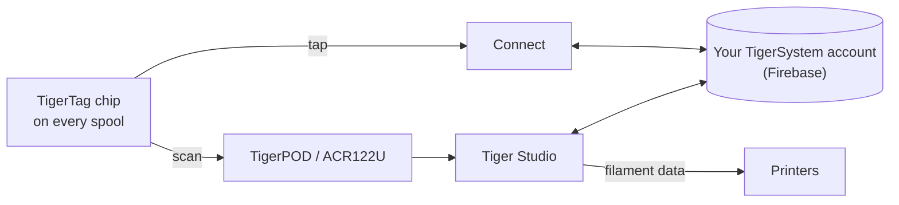

# TigerTag

## Cel

**TigerTag daje każdej szpuli własną pamięć.** Mały chip NFC przechowuje
wszystko o filamencie — markę, materiał, kolor, jak lubi być
drukowany — więc nigdy nie trzeba zgadywać, etykietować ani pamiętać. Dotknij go
telefonem, a szpula sama ci o sobie opowie.

<a class="ts-cta-primary" href="https://tigersystem.io/tigertag">Czym jest TigerTag — na tigersystem.io</a>

<a href="https://github.com/TigerTag-Project/TigerTag-RFID-Guide"> Otwarta specyfikacja chipa</a>

Technicznie to serce ekosystemu: otwarty standard RFID, czytelny
dla każdej zgodnej aplikacji lub czytnika — bez uzależnienia od dostawcy, bez tajnego formatu.

## Gdzie się mieści

## Funkcje

- Standardowy chip **NTAG213 / 215 / 216** (zalecany okrągły 25 mm), 144-bajtowy
 otwarty ładunek NDEF — dobrany tak, by zmieścić się w najmniejszym NTAG213; bez kluczy, bez uzależnienia.
- **Dwa chipy na szpuli, po przeciwnych stronach** — jeden zawsze jest zwrócony do czytnika
 (slot drukarki, AMS, telefon w dłoni), a każdy stanowi kopię zapasową drugiego
 ([dlaczego](../concepts/tigertag-chip.md)).
- Tożsamość rozwiązywana względem wspólnej [bazy referencyjnej](../concepts/universal-filament-identity.md).
- Zapisywalny i **wielokrotnie przepisywalny** — umożliwia [przepływ Second Life](../philosophy/second-life.md);
 oficjalne markowe chipy są dostarczane jako NTAG215, aby sam chip dało się ponownie użyć jako
 zwykły obiekt NDEF (brelok, wizytówka…), gdy szpula jest pusta —
 nigdy elektrośmieci.
- Czytelny dla każdego smartfonu z NFC, czytników ACR122U i [TigerPOD](./tigerpod.md).
- Zarezerwowany **obszar 64 bajtów** (strony `0x18`–`0x27`, zostawiające 80 bajtów danych):
 wolny na **dodatkowe funkcje społeczności** w standardowym TigerTag; w
 [TigerTag+](./tigertag-plus.md) niesie podpis
 pochodzenia — 32 bajty `R`, 32 bajty `S`.

## Architektura

Zob. [Chip TigerTag](../concepts/tigertag-chip.md) — podsumowanie formatu — oraz
[TigerTag-RFID-Guide](https://github.com/TigerTag-Project/TigerTag-RFID-Guide)
— kanoniczną specyfikację na poziomie bajtów.

## Interakcje

| Z | Jak |
|---|---|
| Tiger NFC Connect | Dotknięcie NFC: odczyt, kodowanie |
| Tiger Studio | Skan czytnikiem automatycznie otwiera szpulę; prowadzona aktualizacja chipa |
| SDK | Parsowanie / weryfikacja / kodowanie z JS lub Pythona |
| Drukarki | Pośrednio — przez [most ze smartfonem](../philosophy/smartphone-bridge.md) i połączenia z drukarkami w Studio |

## W obrazach

> **Uwaga o nazwie:** standardowe chipy były dawniej sprzedawane jako **„TigerTag Maker”**
> — nazwa to teraz po prostu **TigerTag**.

## Oficjalne chipy i wszystkie pozostałe

**TigerSystem produkuje oficjalne chipy** i umieszcza na nich logo TigerTag.
Występują w dwóch formatach i oba są dostarczane **puste**:

| Format | Do czego |
|---|---|
| **Naklejka** | dowolnej posiadanej już szpuli — po jednej z każdej strony ([dlaczego dwa](../concepts/tigertag-chip.md)) |
| **Nośnik do refilli** | [refilli](../philosophy/second-life.md) filamentu z tekturowym rdzeniem: jeden nośnik niesie już **oba chipy**, siedzi wewnątrz rdzenia, zanim refill trafi na rolkę wielokrotnego użytku (masterspool), więc chip podróżuje z filamentem, a nie z rolką |

Kto co może powiedzieć, gdy chip jest na sprzedaż:

| Kto | Co sprzedaje | Jak może to nazwać | Logo |
|---|---|---|---|
| **TigerSystem** | chipy, które produkuje | **oficjalne** — zrobione przez nas | tak — nakłada znak |
| **Dowolny odsprzedawca lub dystrybutor** | te same oryginalne chipy | **oficjalne** — towar jest oficjalny | tak — znak już na nich jest |
| **Strona trzecia, którą TigerSystem poddał audytowi** | cokolwiek zbudowała — chipy, inlaye, nośniki, urządzenie, aplikację | **certyfikowane** — przyznane, audytowane, wpisane na listę, możliwe do wycofania | tak, na produkcie |
| **Każdy, kto robi własny chip** | własny zgodny chip | *„zgodny z TigerTag”* — i z **TigerTag+**, jeśli weryfikuje podpisy. Nigdy *„certyfikowany”*, co przyznaje wyłącznie TigerSystem | w swojej aplikacji, dokumentacji i ofercie sklepu; *„Compatible with TigerTag”* zwykłym tekstem na pudełku zgodnego urządzenia — **nigdy logo ani nazwy na chipie (w żadnym formacie), nośniku, szpuli ani opakowaniu** |

To ostatnie rozróżnienie jest całą polityką znaku towarowego i jest węższe, niż
się wydaje. Powiedzenie, że twój produkt *komunikuje się z* TigerTag, to fakt o twoim produkcie,
a pokazanie logo, by to powiedzieć, jest darmowe. Umieszczenie znaku — logo lub nazwy —
**na** chipie dowolnego formatu to oświadczenie o tym, **kto go zrobił** — przestaje znaczyć „to działa z TigerTag”
i zaczyna znaczyć „to *jest* TigerTag”. Tylko to drugie użycie wymaga pisemnej
zgody. Zob. [TRADEMARK.md](../../TRADEMARK.md).

Wyprodukowano ponad **2,5 miliona chipów TigerTag** — większość zintegrowana
w fabryce przez marki filamentów (Rosa3D, eSun, Sunlu, Landu, Jamg He, R3D —
a Filforme, Nanovia i kolejne są w trakcie integracji). Wszystkie to
[certyfikowani partnerzy](../certified-partners.md); ta strona jest rejestrem i
jedynym wiarygodnym sposobem sprawdzenia, czy znak na pudełku jest prawowity.

|| | |
|---|---|---|
|  |  |  |

|| | | |
|---|---|---|---|
|  |  |  |  |

*Pudełka i szpule w środku — kupione w sklepie, a nie ustawione do
zdjęcia. Tak wygląda „najbardziej rozpowszechniony”.* Ale protokół jest
celowo **niezwiązany z oficjalnymi chipami**: każdy tani, pusty chip NTAG kupiony
gdziekolwiek (Amazon, AliExpress, lokalnie) działa tak samo i nic go nie blokuje.
Markowe chipy pomagają wesprzeć prace badawczo-rozwojowe; przyjęcie protokołu jest pierwszą
nagrodą. Inne sposoby pomocy — także te, które nic nie kosztują — są na stronie
[Wesprzyj projekt](../support.md).

Wolność działa w obie strony: **chipy nigdy nie są zablokowane przed zapisem**. TigerTag to
po prostu bazowy protokół, z którym fabryki filamentu wysyłają szpule — jeśli wolisz
inny protokół NFC/RFID (własny lub istniejący), możesz przepisać chip i
przenieść jego dane do niego. Twoja szpula, twój chip, twój format.

## Gdzie je kupić

Oba formaty są dostarczane **puste** i oba sprzedaje TigerSystem oraz jego
odsprzedawcy:

| | **Naklejka** | **Nośnik do refilli** |
|---|---|---|
| Co dostajesz | okrągłe samoprzylepne chipy 25 mm — **po dwa na szpulę**, po jednym z każdej strony | jeden nośnik = **dwa chipy już sparowane**, po jednym na każdym zgiętym końcu, do tekturowego rdzenia |
| Do czego | dowolnej szpuli z kołnierzami | refilli filamentu montowanych na masterspool |
| Oficjalny sklep | [tigertag.io](https://shop.tigertag.io/collections/tigertag-rfid-maker) | [tigertag.io](https://shop.tigertag.io/collections/tigertag-rfid-maker) |
| Odsprzedawca (FR) | [TigerTag Officiel, Atome3D](https://www.atome3d.com/products/tigertag) | [TigerTag Refill Officiel, Atome3D](https://www.atome3d.com/products/tigertag-pro-for-refill-1000-pcs) |

Oba występują w kilku wielkościach opakowań, aż po ilości profesjonalne. Nic z tego nie
jest wymagane: **każdy pusty chip NTAG kupiony gdziekolwiek działa tak samo** — kupowanie
oficjalnych finansuje protokół, nic więcej.

## Linki

- Oficjalne chipy: **[tigertag.io](https://tigertag.io)** (sklep — wspiera prace badawczo-rozwojowe)
- Format chipa: [TigerTag-RFID-Guide](https://github.com/TigerTag-Project/TigerTag-RFID-Guide)

---

**◀ Poprzednia:** [Produkty](./README.md) · **▲ [Spis dokumentacji](../../README.md)** · **Następna ▶** [TigerTag+](./tigertag-plus.md)

**Zobacz też:** [Uniwersalna tożsamość filamentu](../concepts/universal-filament-identity.md), [Second Life](../philosophy/second-life.md)
