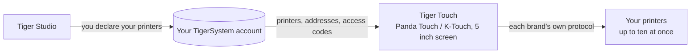

# Tiger Touch

**Twój Panda Touch leży w szufladzie. Daj mu każdą drukarkę, jaką masz.** Darmowy,
otwartoźródłowy firmware, który zamienia BIGTREETECH Panda Touch i K-Touch w jeden
żywy ekran dotykowy dla wszystkich twoich drukarek 3D — bez lutowania, bez komputera.

*Dwie żywe karty drukarek na jednym ekranie: FlashForge AD5X i Bambu Lab X1C.*

<a class="ts-cta-primary" href="https://tigertag-project.github.io/Tiger-Touch/">Zainstaluj z przeglądarki</a>

<a href="https://github.com/TigerTag-Project/Tiger-Touch"> Źródła</a>

BIGTREETECH sprzedaje jeden mały 5-calowy ekran dotykowy pod dwiema nazwami: **Panda Touch**,
stworzony dla drukarek Bambu Lab, i **K-Touch**, stworzony dla drukarek z Klipperem. Ta sama
płytka, dwa firmware'y, każdy związany z jedną rodziną maszyn. Zmień drukarkę, a
ekran ląduje w szufladzie.

**Tiger Touch to nowy firmware dla tego samego ekranu**, napisany od zera. Loguje się
na twoje darmowe konto TigerTag, znajduje każdą zadeklarowaną tam drukarkę
i rozmawia z każdą bezpośrednio, jej własnym protokołem, w tym samym czasie. Jeśli
masz Panda Touch lub K-Touch, który już nie pasuje do twoich drukarek, to
sprzęt, dla którego powstał Tiger Touch.

Open source na licencji **MIT**. Nic do lutowania, nic do drukowania, żadnego Raspberry Pi,
żadnego serwera pośrodku: podłączasz ekran do portu USB, naciskasz **Install** w
przeglądarce i dwie minuty później pokazuje twoje drukarki.

## Co robi

- **Każda marka na jednym ekranie** — Bambu Lab, Creality, Elegoo, Anycubic,
  Snapmaker, FlashForge, Prusa, plus dowolna maszyna z Klipperem (Moonraker) lub OctoPrint.
- **Chmura i LAN** — Bambu Lab przez chmurę Bambu lub w trybie LAN, Anycubic
  przez chmurę Anycubic lub w sieci LAN, pozostałe w twojej sieci lokalnej.
- **Na żywo, wszystkie** — stan, postęp, plik, pozostały czas i godzina zakończenia,
  dysze, stół, komora i jednostki filamentu (AMS, CFS, Station, ACE, tory MMU / AFC),
  z jednoczesnym śledzeniem do **dziesięciu drukarek**.
- **Bezpieczne sterowanie** — pauza, wznowienie, stop (przytrzymanie 1,5 s, aby przypadkowy palec nigdy nie
  zakończył wydruku) i światło drukarki. **Nic więcej nie jest nigdy wysyłane**: żadnego
  grzania, żadnego ruchu, żadnego rozpoczynania wydruku.
- **Aktualizuje się sam** — nowe wersje przychodzą przez Wi-Fi, są weryfikowane przed instalacją,
  same się wycofują, jeśli nie uda się ich uruchomić.
- **Jedenaście języków** — angielski, francuski, niemiecki, hiszpański, włoski, chiński,
  portugalski (Brazylia i Portugalia), polski, rosyjski, niderlandzki.

<figure>

<figcaption><strong>Karty</strong>: jedna żywa karta na drukarkę, przesuń, by zobaczyć kolejne.</figcaption>
</figure>
<figure>

<figcaption><strong>Lista</strong>: wszystkie drukarki na rzut oka. Jedno dotknięcie zmienia widok.</figcaption>
</figure>
<figure>

<figcaption><strong>Snapmaker U1</strong>: cztery głowice narzędziowe, aktywna zakreślona.</figcaption>
</figure>
<figure>

<figcaption><strong>FlashForge AD5X</strong>: zewnętrzna szpula i stacja materiałów.</figcaption>
</figure>

## Gdzie się mieści

## Co musi istnieć najpierw

Tiger Touch czyta twoje drukarki **z twojego konta TigerSystem**, więc nigdy nie
prosi o adres ani kod dostępu na 5-calowym ekranie. Utwórz konto i dodaj
swoje drukarki w **desktopowym** [Tiger Studio](./tiger-studio.md) (Windows,
macOS, Linux), który znajdzie je w twojej sieci — wersja webowa nie może dodawać
drukarek.

> **W skrócie:** Tiger Studio → utwórz konto → dodaj swoje drukarki →
> *dopiero potem* skonfiguruj ekran.

## Które drukarki

Tiger Touch wybiera połączenie według **marki**, a nie modelu: każda drukarka
z tych rodzin, którą Tiger Studio potrafi dodać, Tiger Touch potrafi pokazać. Katalog Tiger Studio
liczy ponad 400 modeli od około 60 producentów.

| Marka | Połączenie | Widziane na prawdziwej maszynie |
|---|---|---|
| [Bambu Lab](../compatibility/bambu-lab.md) (X1, P1, P2S, A1, H2…) | Chmura Bambu lub LAN (MQTT przez TLS) | **Tak** — drukowanie przez chmurę (P2S), bezczynność w trybie LAN (X1C, A1) |
| [Creality](../compatibility/creality.md) (K2, K1, Hi, Ender-3 V4…) | WebSocket w sieci LAN | **Tak** — drukowanie (K2), bezczynność z CFS (Ender-3 V4) |
| [Snapmaker](../compatibility/snapmaker.md) U1 | Moonraker WebSocket | **Tak** — bezczynność, cztery głowice narzędziowe |
| [FlashForge](../compatibility/flashforge.md) (AD5X, Adventurer 5M, Creator 5, Creator 5 Pro) | HTTP w sieci LAN | **Tak** — AD5X: pauza, stop i światło |
| [Anycubic](../compatibility/anycubic.md) (Kobra 3, Kobra X, Kobra S1…) | Chmura Anycubic lub LAN (MQTT przez TLS) | **Tak** — przez chmurę (Kobra X), z ACE: światło, pauza, wznowienie i stop |
| [Elegoo](../compatibility/elegoo.md) Centauri Carbon 1 i 2 | MQTT (CC2), SDCP (CC1) | **Tak** — Centauri Carbon 2 i Centauri Carbon: pauza, wznowienie, stop, a w CC2 światło |
| **Prusa** (MK4, Core One, XL, MINI) | PrusaLink | **Tak** — postęp, temperatury, pauza, wznowienie, stop |
| [Klipper](../compatibility/klipper.md) — Voron, Qidi, Sovol, RatRig… | Moonraker HTTP | **Tak** — na prawdziwej drukarce z Klipperem: pauza, wznowienie, stop i światło |
| **OctoPrint** — dowolna drukarka z Marlinem za nim | REST API OctoPrint | Tylko z drukarką testową Tiger Studio |

OctoPrint spotkał się dotąd tylko z drukarką testową Tiger Studio, a każda marka ma
modele, których nikt jeszcze nie próbował: **zgłoszenie z twojej drukarki jest najbardziej użyteczną
rzeczą, jaką możesz przesłać.** Pauza, wznowienie i stop działają wszędzie tam, gdzie połączenie przyjmuje
polecenia (nie przez chmurę Bambu); światło działa wszędzie poza Prusa,
OctoPrint i Centauri Carbon 1. Każda marka ma własną stronę, z konfiguracją
i pytaniami, na [stronie instalatora](https://tigertag-project.github.io/Tiger-Touch/).
Każde pole i każdy test są w
[statusie według marek](https://github.com/TigerTag-Project/Tiger-Touch/blob/main/docs/PRINTER-COMPATIBILITY.md).

**Drukarka pokazuje „offline”?** Najpierw sprawdź jej tryb LAN: jest domyślnie wyłączony w
Creality, FlashForge i Bambu Lab.

## Jeden ekran, każda marka

Firmware'y dostarczane z ekranem znają każdy **jedną** rodzinę drukarek.

| | **Tiger Touch** | Firmware Panda Touch | Firmware K-Touch |
|---|---|---|---|
| Rodziny drukarek na jednym ekranie | **9** | 1 (Bambu Lab) | 1 (Klipper) |
| Drukarki na żywo naraz | **do 10**, wszystkie aktualizują się razem | kilka Bambu Lab, zwalnia od około 3 w naszym użyciu | **1** naraz (50 zapisanych, przełączanie między nimi) |
| Konfiguracja drukarek | z twojego konta TigerTag, nic nie wpisywane na ekranie | IP, numer seryjny, kod dostępu | IP i port lub skan |
| Aktualizacje przez Wi-Fi | Tak, zweryfikowane, z automatycznym wycofaniem | Nie | Nie |

Firmware'y BIGTREETECH dają pełną kontrolę nad ich jedną rodziną — rozpoczynanie wydruków,
temperatury, ruchy — czego Tiger Touch celowo nie robi. Możesz do nich wrócić
w dowolnej chwili.

*Kolumny Panda Touch i K-Touch pochodzą z własnego wiki BIGTREETECH (odczytanego
2026-10-16); „zwalnia od około 3” to doświadczenie zespołu TigerTag, a nie
liczba BIGTREETECH.*

## Instalacja w dwie minuty

1. **Zadeklaruj swoje drukarki** w Tiger Studio, jak wyżej.
2. **Wgraj ekran z przeglądarki.** Otwórz
   **<https://tigertag-project.github.io/Tiger-Touch/>** w **Chrome lub Edge** na
   komputerze (WebSerial: nie Safari, nie Firefox, nie telefon), podłącz ekran
   kablem USB-C **do danych**, naciśnij **Install** i wybierz jego port. Zastępując
   firmware BIGTREETECH: zaznacz **Erase device**. Aktualizując Tiger Touch przez
   USB: zostaw niezaznaczone, twoje Wi-Fi i konto zostaną zachowane.
3. **Postępuj według ekranu.** Język, Wi-Fi, potem twoje konto TigerTag — e-mail
   i hasło lub **Continue with Google** z kodem QR zeskanowanym
   telefonem. Włącz drukarki, które chcesz śledzić, i to wszystko. *Później* jest
   zawsze odpowiedzią: ekran startuje od razu i łączy się w tle.

Potem nie ma już nic do roboty: ekran raz dziennie sprawdza nową wersję
i instaluje ją dwoma dotknięciami.

Pierwszy raz? [Przewodnik instalacji](https://github.com/TigerTag-Project/Tiger-Touch/blob/main/docs/INSTALL.md)
opisuje sterownik USB (wymagany na macOS), zachowanie kopii firmware
BIGTREETECH, by można było wrócić, i jedno pole do zaznaczenia.

## Sprzęt

**BIGTREETECH Panda Touch** i **K-Touch** są zaprojektowane i wykonane przez
**BIGTREETECH** (BIQU): 5-calowy ekran dotykowy IPS 800×480 wokół ESP32-S3 z 8 MB
PSRAM i 16 MB flash, Wi-Fi, USB-C i baterią. Tiger Touch działa na nim
bez modyfikacji i opiera się na obsłudze płytki opublikowanej przez BIGTREETECH na licencji
MIT. K-Touch to ta sama płytka co Panda Touch, więc ten sam
obraz jest dla niego przeznaczony — ale Tiger Touch uruchomiono dotąd tylko na Panda Touch:
zgłoszenie z K-Touch jest mile widziane.

Tiger Touch to niezależny projekt, niewykonany ani niepopierany przez BIGTREETECH, BIQU
ani żadnego z wymienionych tu producentów drukarek.

Zbuduj go samodzielnie za pomocą ESP-IDF 5.5 — kroki są w
[repozytorium](https://github.com/TigerTag-Project/Tiger-Touch#build-it-yourself).

---

**▲ [Spis dokumentacji](../../README.md)** · **Zobacz też:** [Tiger Studio (aplikacja desktopowa)](./tiger-studio.md), [TigerSpool](./tigerspool.md), [Zgodność drukarek](../compatibility/README.md)
