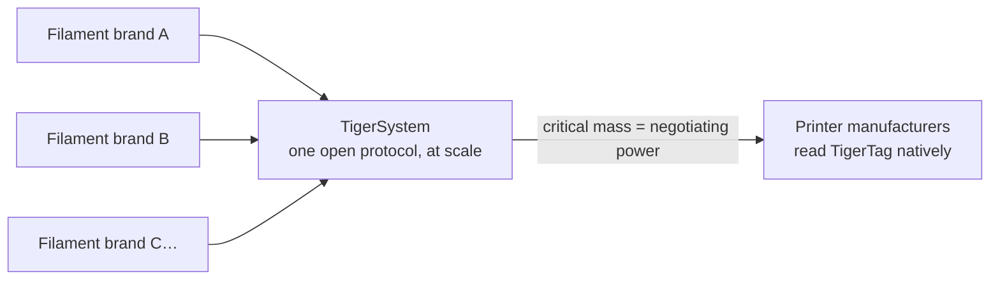

# Dla producentów filamentu

> **Uczyń swoje szpule inteligentnymi i połączonymi.**

## Inteligentna szpula się dzieje — jedyny otwarty sposób jest tutaj

Drukarki coraz częściej oczekują inteligentnego filamentu: systemów klasy AMS, wykrywania
materiału w każdym slocie, automatycznych ustawień. Każdy producent drukarek odpowiada
**zamkniętym tagiem, zablokowanym na jego maszyny, zasilającym jego chmurę** — zero
interoperacyjności, zero wartości dla twojej marki poza jego murami. A każdy
zablokowany tag służy jeszcze drugiemu celowi: **kierowaniu twoich klientów
ku filamentowi samego producenta drukarek.** TigerTag powstał w 2023 roku właśnie po to,
aby marki z zewnątrz miały lepszą odpowiedź — szpule inteligentniejsze niż
własnościowe, bez ogrodzonego ogrodu.

**TigerTag to najbardziej rozpowszechniony protokół RFID firm trzecich na świecie** —
i dziś jedyne realne otwarte rozwiązanie inteligentnej szpuli dostarczane w skali: otwarty,
standardowy, niezależny od producenta, wieloplatformowy protokół z ponad
**2,5 miliona wyprodukowanych chipów**, zintegrowanych w fabryce przez marki
takie jak Rosa3D, eSun, Sunlu, Landu, Jamg He, R3D, Filforme, Lotactree,
Smart3DPT i Nanovia.

## Integracja w fabryce: dni, nie miesiące

Mamy doświadczenie i technologię, by wprowadzić chipy TigerTag na twoją
linię produkcyjną **szybko, łatwo i bardzo tanio — uruchomienie nawet w
5 dni**, zapisując **każdy chip w około 1 sekundę** (tysiące
szpul dziennie, jedno kliknięcie):

- Standardowy sprzęt NTAG (bez własnościowych komponentów, bez uzależnienia od oprzyrządowania),
 pozyskiwany w skali i po koszcie dobranych pod jeden niepodlegający negocjacjom cel: **dodać
 technologię, nie dodając ani grosza do ceny szpuli dla użytkownika końcowego.**
- Sprawdzony podręcznik integracji, już wdrożony w wielu fabrykach,
 oparty na przemysłowym zestawie [TigerTag Factory i Manager](../products/factory-suite.md):
 z jednej strony twoja baza filamentów, z drugiej masowy zapis z prędkością linii
 do każdej szpuli — z **podpisem fabrycznym
 potwierdzającym pochodzenie każdego produktu**.
- Wspólna baza referencyjna nadaje twoim produktom precyzyjną, uniwersalną
 tożsamość, którą każda zgodna aplikacja rozwiązuje identycznie.

Marki dostarczające TigerTagi w swoich produktach mogą nosić znak **TigerTag
Certified** — widoczny sygnał dla klientów, że szpula jest inteligentna i
otwarta.

> Napisz na **[tigertag@tigertag.io](mailto:tigertag@tigertag.io)** (lub
> przez [organizację GitHub](https://github.com/TigerTag-Project)), aby
> rozpocząć rozmowę.

## Dziękujemy, integratorzy

Marki poniżej uczyniły otwartą szpulę prawdziwą — każda na swoim poziomie
zaangażowania, i każda zasługuje na uznanie. Poziomy tworzą
**drabinę**: im dalej marka się angażuje, tym wyraźniej się pojawia —
tutaj i na każdej powierzchni ekosystemu. Najlepsi stoją najwyżej.

### Platinum — szczyt

**TigerTag+ w całej produkcji**: każdy format szpuli, podpisane chipy
jako standard na każdej szpuli opuszczającej fabrykę. Nic opcjonalnego,
nic częściowego — pełne doświadczenie otwartej szpuli, dla każdego klienta, domyślnie.
Integratorzy Platinum dostają **pierwsze miejsce wszędzie**: wymienieni jako pierwsi,
największe logo, opowiedziana ich historia.

**[Rosa3D](https://rosa3d.pl)** — **pierwszy na świecie** integrator, który wprowadził
TigerTag+ w całej swojej produkcji. Wzór, za którym gonią wszyscy inni.

### Gold — zaangażowani, w skali

**Integracja na życzenie w czasie produkcji**, z już wyprodukowanymi dużymi ilościami,
wysokim poziomem integracji i **oficjalnym publicznym
zobowiązaniem**. Jeden krok od szczytu: uczynić podpisane chipy standardem
w całej linii i dołączyć do Platinum.

&nbsp;&nbsp;&nbsp;&nbsp;

**[R3D](https://r3dprint.com)** · **[eSun](https://www.esun3d.com)**

### Silver — na pokładzie

**Technologia zintegrowana na życzenie** — pierwszy krok, już prawdziwy:
ich klienci mogą dziś kupić szpule wyposażone w TigerTag. Kolejnym szczeblem
jest Gold: zwiększyć wolumeny i uczynić zobowiązanie publicznym.

&nbsp;&nbsp;&nbsp;&nbsp;&nbsp;&nbsp;&nbsp;&nbsp;

**[Sunlu](https://www.sunlu.com)** · **[Landu](https://www.landustore.com)** · **[Jamg He](https://www.jamghe.com)** · **[Filforme](https://www.filforme.com)** · **[Lotactree](https://www.lotactree.com)** · **[Smart3DPT](https://smart3d.pt)**

…a także na linii produkcyjnej —
[Nanovia](https://nanovia.tech) — z kolejnymi w drodze.

**Chcesz swoje logo na tej drabinie — i większe?** Linia produkcyjna uruchamia
TigerTag nawet w 5 dni:
[tigertag@tigertag.io](mailto:tigertag@tigertag.io).

## Ogłosili to sami

Publiczne wpisy na własnych kanałach marek — nie nasz komunikat prasowy
(źródła i pełne ogłoszenia:
[tigersystem.io/en/manufacturers](https://tigersystem.io/en/manufacturers)).
**Kliknij dowolny obraz, aby otworzyć oryginalny wpis:**

|| | |
|---|---|---|
|  |  |  |

> **ROSA 3D FILAMENTS** — *„oficjalnie zintegrowaliśmy otwarty protokół RFID
> TigerTag w 100 % naszej produkcji filamentu.”* Ponad 250 000
> szpul już wyprodukowanych z TigerTag.
> ([oryginalny wpis](https://www.instagram.com/p/DVyeOZajZSm/))

> **R3D Filament** — *„oficjalnie rozpoczął wdrażanie na dużą skalę otwartego
> protokołu RFID TigerTag w swojej produkcji filamentu w Europie.”*
> ([oryginalny wpis](https://www.instagram.com/reel/DVoAMqTk5ck/))

> **eSUN** — *„oficjalnie zintegrował technologię TigerTag RFID!”* — pilotaż
> na rynku francuskim, rozszerzenie na Europę.
> ([oryginalny wpis](https://www.instagram.com/p/DUjydNXkc1W/))

## Jak tagi trafiają do twoich szpul

<table>
<tr>
<td align="center" width="55%">
<strong>Przód</strong> 
 
<strong>Tył</strong> 

</td>
<td align="center">

</td>
</tr>
</table>

*Przód — dwa markowe chipy, z przemysłowym klejem 3M
(468MP / 200MP) pośrodku. Tył — dwie niezależne anteny NFC, po jednej
na każdym końcu. Założony na refill: jeden chip z każdej strony, operator zdejmuje i
przykleja — nic innego na linii się nie zmienia.*

## Już na półkach

|| | |
|---|---|---|
|  |  |  |

*Rosa3D, eSun, Sunlu — prawdziwe pudełka, wysyłane z TigerTag w środku.*

|| | | |
|---|---|---|---|
|  |  |  |  |

*Sam filament: Rosa3D, eSUN, Sunlu, R3D — każda z tych szpul jest wysyłana
z chipami TigerTag.*

## Co twoi klienci dostają od pierwszego dnia

Szpulę, która identyfikuje się dla **dowolnego telefonu z NFC**, pełny ekosystem
magazynowy (mobilny, desktopowy, webowy), integrację na żywo z sześcioma markami drukarek,
śledzenie masy, udostępnianie — doświadczenie **znacznie wykraczające poza to, co oferuje jakiekolwiek zamknięte
środowisko jednego dostawcy**, które działa z każdą drukarką, jaką posiadają
klienci, a nie tylko z jedną marką.

## Aktualizuj dane nawet po opuszczeniu fabryki

Wydrukowana etykieta jest zamrożona w dniu wydruku. Szpula TigerTag nie jest:
ponieważ chipy rozwiązują swoją tożsamość względem **wspólnej bazy
referencyjnej**, możesz doprecyzować lub poprawić dane produktu — ustawienia,
opisy, obrazy — **nawet dla szpul już sprzedanych i leżących w
domach twoich klientów**. TigerTag to jedyna technologia na tym rynku, która utrzymuje
dane twojego produktu aktualizowalne po opuszczeniu fabryki.

## Gra zespołowa

Każda marka filamentu, która dołącza do TigerSystem, wzmacnia wszystkie pozostałe:

Sama żadna marka filamentu nie przekona producentów drukarek do odczytu swoich tagów.
**Razem, za jednym otwartym protokołem, możemy.** A prośba jest mała: producent
drukarek może dodać odczyt TigerTag do swojego firmware w **mniej niż 3 dni**. Im więcej marek dostarcza
TigerTag, tym mocniejszy argument za natywną, na poziomie firmware, obsługą TigerTag
w samych drukarkach — a każdy uczestnik korzysta z tej
dźwigni.

---

**▲ [Spis dokumentacji](../../README.md)** · **Zobacz też:** [Dlaczego powstał TigerSystem](./why-tigersystem.md), [Zgodność](../compatibility/README.md), [FAQ — Producenci](../faq/README.md)
