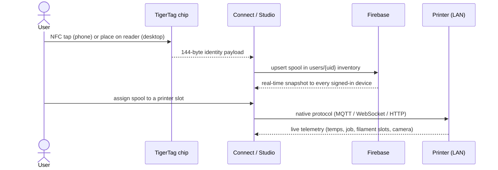
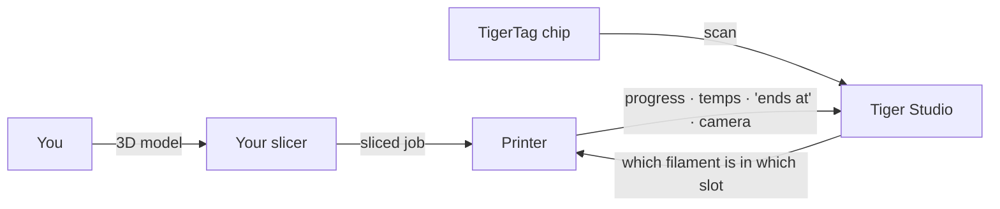

# Fluxo de dados

## Do toque à impressão

O percurso completo de uma bobina através do sistema:

## Onde vive cada tipo de dados

| Dados | Onde vivem | Notas |
|---|---|---|
| Identidade da bobina | O chip + o inventário na nuvem do utilizador | O chip é a fonte de referência para uso offline |
| Base de dados de referência (marcas, materiais…) | `cdn.tigertag.io` (mesmo projeto Firebase) | Incluída nas aplicações, atualizada a partir da CDN |
| Imagens de bobinas (incl. fotografias de produto TigerTag+) | `cdn.tigertag.io` (mesmo projeto Firebase) | Servidas a todas as aplicações |
| Inventário, racks, amigos, preferências | Firestore `users/{uid}/…` | Apenas o proprietário, por predefinição, imposto pelas regras |
| Códigos públicos de descoberta | Firestore `publicKeys/{code}` | Pesquisa de amigos em O(1) |
| Credenciais e telemetria da impressora | **Apenas local** (computador) | O tráfego da LAN nunca passa pela nuvem |
| Peso em direto (TigerScale) | Dispositivo → Firestore | Aparece em direto em todos os clientes |

## Onde se encaixa o seu slicer

O TigerSystem **não substitui o seu slicer** — completa o quadro à sua volta:

- Fatia e lança trabalhos exatamente como antes, com qualquer slicer.
- O Tiger Studio indica à impressora **que filamento está em que slot** (AMS / CFS / Canvas / ACE / IFS), de modo que a informação do lado da máquina corresponda à realidade.
- Seja o que for que tenha iniciado a impressão, o trabalho aparece em direto no Tiger Studio — progresso, temperaturas, hora de conclusão, câmara.
- O chip contém as definições de impressão recomendadas do filamento; **hoje não existe importação automática de perfis do slicer** — é você que as reproduz no perfil do seu slicer.

## Dois planos, deliberadamente separados

- **Plano da nuvem** — identidade, inventário, partilha. Internet, Firebase, imposto pelas regras.
- **Plano da LAN** — controlo das impressoras e câmaras. Apenas rede local, protocolos nativos dos fabricantes, zero dependência da nuvem (a aplicação de computador continua a funcionar com as impressoras quando está offline).

> **Nota:** a exceção é o **modo na nuvem** da Anycubic, em que a própria ligação à impressora passa pelo MQTT na nuvem do fabricante — ver [compatibilidade com a Anycubic](../compatibility/anycubic.md).

---

**◀ Anterior:** [Visão geral da arquitetura](./overview.md) · **▲ [Índice da documentação](../../README.md)** · **Seguinte ▶** [Produtos](../products/README.md)

**Ver também:** [Inventário e sincronização na nuvem](../concepts/inventory-and-cloud-sync.md), [Compatibilidade](../compatibility/README.md)
