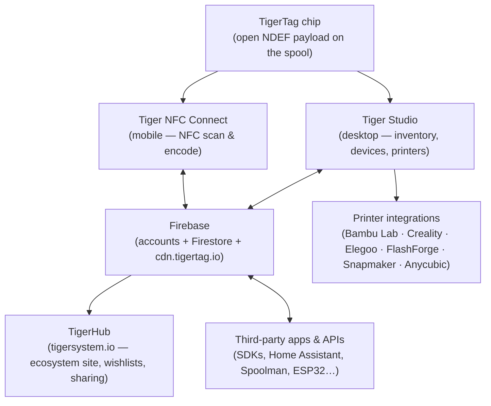
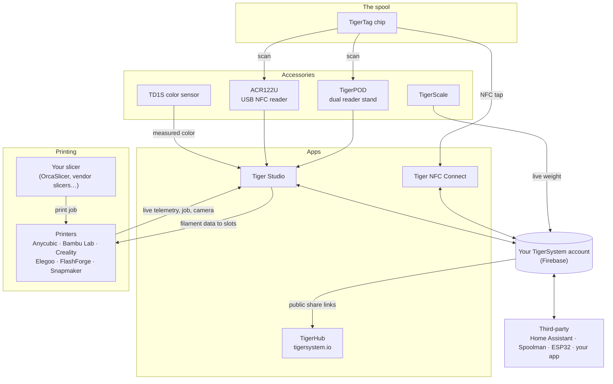

# Visão geral da arquitetura

## A pilha, de cima a baixo

## Camadas

| Camada | Função | Documentação de referência |
|---|---|---|
| **Chip TigerTag** | Identidade aberta e portátil da bobina física | [Formato do chip](../concepts/tigertag-chip.md) |
| **Tiger NFC Connect** | A ponte do telemóvel: ler, codificar, navegar | [Página do produto](../products/tiger-nfc-connect.md) |
| **Firebase** | Uma base de dados partilhada — contas, inventário, sincronização; o ponto de interoperabilidade da sandbox | [Inventário e sincronização na nuvem](../concepts/inventory-and-cloud-sync.md) |
| **TigerHub** | A casa web do ecossistema: montra, listas de desejos, amigos, partilha | [Página do produto](../products/tigerhub.md) |
| **Tiger Studio** | Bancada de trabalho para computador: inventário, racks, sensores, impressoras | [Página do produto](../products/tiger-studio.md) |
| **Integrações de impressoras** | Ligações LAN em direto a seis marcas de impressoras | [Compatibilidade](../compatibility/README.md) |
| **APIs de terceiros** | SDKs + superfície Firestore documentada para qualquer pessoa | [Programadores](../developers/README.md) |

## O mapa completo — cada elemento e as suas ligações

Acessórios, aplicações, nuvem, impressoras, slicers e integrações de terceiros, numa só imagem:

Leia-o da esquerda para a direita: o **chip** identifica a bobina; os **acessórios** captam a realidade (leituras, peso, cor); as **aplicações** e a **nuvem** mantêm tudo sincronizado; a **impressora** recebe os dados do filamento e responde em direto. O seu **slicer mantém o seu trabalho** — o TigerSystem não fatia, garante que todos (você, a máquina, as aplicações) sabem exatamente que filamento está onde.

## Princípios de conceção

1. **O chip é autossuficiente.** Uma bobina identifica-se sem nuvem, sem conta, sem rede — o payload é completo e aberto.
2. **A nuvem pertence ao utilizador, não ao sistema.** Todo o estado vive sob a conta do utilizador; são as regras de segurança do lado do servidor — e não o código do cliente — que impõem o acesso.
3. **Todas as camadas são opcionais.** A utilização só com telemóvel, só com computador, só com chip ou só com API funciona; os componentes acrescentam valor, mas nunca se condicionam uns aos outros.
4. **As integrações falam o protocolo nativo da impressora.** Sem modificações de firmware, sem desvios pela nuvem: o Tiger Studio fala MQTT/WebSocket/HTTP diretamente na LAN (ver [fluxo de dados](./data-flow.md)).

---

**◀ Anterior:** [Inventário e sincronização na nuvem](../concepts/inventory-and-cloud-sync.md) · **▲ [Índice da documentação](../../README.md)** · **Seguinte ▶** [Fluxo de dados](./data-flow.md)

**Ver também:** [Produtos](../products/README.md), [Programadores](../developers/README.md)
