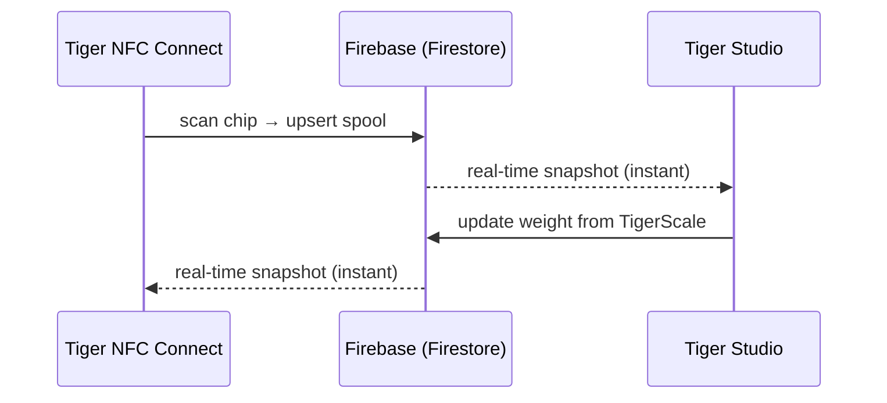

# Inventário e sincronização na nuvem

## Uma conta, todos os dispositivos

O inventário de um utilizador vive na **sua conta TigerSystem**, assente em **Firebase** simples (Auth + Firestore) — uma infraestrutura deliberadamente sem marca, cuja função é simples: **uma base de dados partilhada, num só local**, para que todos os elementos da sandbox (computador, telemóvel, balança, web) interoperem sobre os mesmos dados. Todos os clientes — telemóvel, computador, web — subscrevem os mesmos documentos em tempo real:

Não há nenhum «botão de sincronização»: as alterações propagam-se através dos listeners em direto do Firestore e os clientes mantêm uma cache local para leituras offline.

## O que se sincroniza

- **Inventário** — um documento por bobina (identidade, peso, contentor, imagem…).
- **Racks** — disposição física das prateleiras e colocação das bobinas.
- **Amigos e partilha** — ligações de amizade, pedidos recebidos, notificações.
- **Preferências** — idioma, definições por conta.
- **Cópias de segurança de chips** — registos de chips [TigerTag+](../products/tigertag-plus.md).

O modelo de dados campo a campo, de referência, está documentado no [repositório de integração Firebase](https://github.com/TigerTag-Project/TigerTag_Firebase_Integration) (`docs/03-data-model.md`) — a referência para integradores de terceiros.

## O que sai da sua bancada e o que fica

O ecossistema diz em toda a parte que a nuvem é opcional. Eis o que isso significa realmente e o que custa quando diz que não.

**A identificação é local por conceção.** Um dispositivo não pergunta a um servidor o que é uma etiqueta. As tabelas de marcas e materiais vivem no seu próprio armazenamento e são atualizadas a partir do [repositório de referência](https://github.com/TigerTag-Project/TigerTag-RFID-Guide) **público** no máximo uma vez por dia. Assim, uma consulta nunca espera pela rede e funciona com a internet em baixo.

**Sem conta, perde exatamente uma coisa: a sincronização entre dispositivos.** Uma [TigerScale](../products/tigerscale.md) continua a pesar, a ler etiquetas, a identificar a marca e o material, a servir a sua própria interface web na sua LAN. Nada no chip em si precisa de nós — é esse todo o sentido de escrever os dados [no chip](./tigertag-chip.md).

**Com conta, eis o que um dispositivo envia realmente.** Tomando a balança como exemplo concreto, a cada pesagem concluída e num sinal periódico de presença escreve, sob o seu próprio documento de utilizador: os UIDs das etiquetas da bobina, o peso líquido/bruto/do contentor, a versão do firmware, o sinal WiFi e o IP, o fator de calibração, a hora do último sinal de presença, o estado da bateria e o estado do ecrã. Diagnósticos e medições — nada mais. Cada campo está documentado na [referência da própria balança](https://github.com/TigerTag-Project/Tiger-Scale-V3/blob/main/docs/TELEMETRY.md).

**E eis o que guarda localmente, o que importa mais.** Um dispositivo com sessão iniciada guarda um token de atualização, o seu id de utilizador e as suas credenciais WiFi. Nunca guarda a sua palavra-passe — o início de sessão troca-a por tokens. Mas trate um dispositivo configurado como **detentor de uma credencial**: antes de o emprestar, vender ou oferecer, termine a sessão *e* esqueça o WiFi. Uma simples regravação do firmware não apaga nenhuma das duas — esse armazenamento é preservado de propósito para que uma atualização de firmware não lhe custe a sua configuração.

**Duas escolhas deliberadas que convém conhecer.** A API LAN de um dispositivo **não tem autenticação**: qualquer pessoa que já esteja na sua rede pode ler o seu estado e acionar uma tara. É uma simplificação para uma rede doméstica — coloque-o numa VLAN de convidados se não confia na sua. E a chave Firebase visível no código-fonte é um **identificador público do projeto**, não um segredo; todos os clientes Firebase a incluem, e o controlo de acesso é imposto por regras do lado do servidor face ao utilizador com sessão iniciada, não por esconder uma cadeia de caracteres.

Para a balança, tudo isto está documentado na íntegra em [`docs/CLOUD.md`](https://github.com/TigerTag-Project/Tiger-Scale-V3/blob/main/docs/CLOUD.md), que é a referência.

## Modelo de partilha (resumo)

- Cada utilizador tem um **código de descoberta** público (`XXX-XXX`) para pesquisa de amigos em O(1).
- A amizade é **bidirecional e baseada em consentimento**: pedido → aceitação; qualquer das partes pode removê-la. O acesso de leitura ao inventário de um amigo é imposto do lado do servidor pelas regras de segurança do Firestore — nunca pelo cliente.
- Um inventário também pode ser marcado como **público**, ou partilhado como lista web só de leitura através de ligações do [TigerHub](../products/tigerhub.md).

## Modelo de segurança (resumo)

- Todos os dados por utilizador são, por predefinição, apenas do proprietário; o acesso entre utilizadores exige sempre uma relação prévia (amizade, pedido), imposta por regras do lado do servidor.
- A configuração do projeto Firebase é intencionalmente pública (padrão corrente); **a segurança está nas regras, não no segredo**. Ver [API de conta e integração](../developers/account-api.md).

---

**◀ Anterior:** [O chip TigerTag](./tigertag-chip.md) · **▲ [Índice da documentação](../../README.md)** · **Seguinte ▶** [Visão geral da arquitetura](../architecture/overview.md)

**Ver também:** [TigerHub](../products/tigerhub.md), [Programadores — API de conta](../developers/account-api.md)
