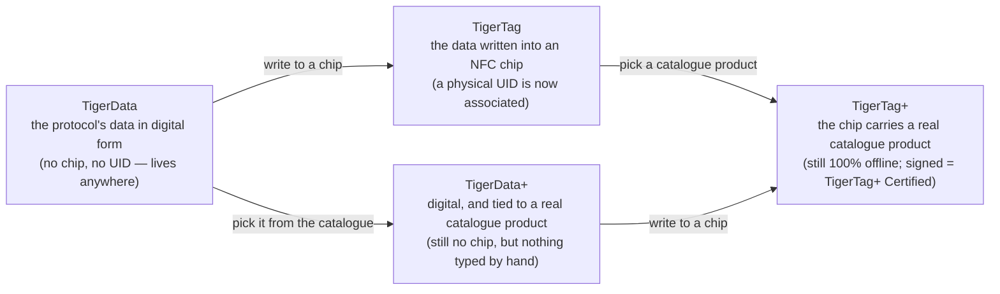

# Identidade universal do filamento

## Uma identidade, legível em toda a parte

Um chip TigerTag dá a uma bobina uma **identidade universal**: um único registo aberto do que o filamento *é*, independentemente de quem o fabricou, de quem o vende e de que impressora o vai fundir.

A identidade abrange (lista não exaustiva):

| Família de campos | Exemplos |
|---|---|
| **Marca** | qualquer fabricante de filamento, a partir de uma lista de referência partilhada |
| **Material / tipo** | PLA, PETG, ABS, TPU… + subtipo |
| **Aspeto / cor** | valor da cor, acabamento |
| **Geometria** | diâmetro (1,75 / 2,85 mm) |
| **Definições de impressão** | temperaturas recomendadas |
| **Ciclo de vida** | peso, data de fabrico |

## A base de dados de referência partilhada

As identidades não são texto livre: marcas, materiais, aspetos, tipos, diâmetros e unidades provêm de uma **base de dados de referência partilhada** servida em `cdn.tigertag.io` (alojada no mesmo projeto Firebase das contas). Todas as aplicações resolvem os mesmos IDs para o mesmo significado, pelo que um chip codificado por uma ferramenta é lido de forma idêntica em todas as outras.

> **TODO:** ligar o endpoint público de navegação da base de dados / o formato de exportação assim que o guia RFID o documentar. Os dados de referência são incluídos no Tiger Studio (`assets/db/tigertag/`) e atualizam-se a partir da CDN.

## Uma identidade, quatro estados

A identidade é o *registo*, não o *chip* — e passa por quatro estados:

- **TigerData** é o protocolo *antes* do chip: a mesma identidade, guardada em formato digital — num inventário, numa base de dados, num ficheiro, em qualquer lado. O protocolo TigerTag pode viver inteiramente fora de um chip RFID. Esta noção de **chip virtual é uma inovação do TigerSystem — não existe em mais lado nenhum**: gerir um inventário completo sem nenhum chip NFC, enviar uma identidade para um chip mais tarde ou nunca, e a interoperabilidade do protocolo é preservada nos dois casos.
- **TigerData+** é um TigerData que sabe *exatamente que produto é*. Continua sem chip, continua sem nada para comprar — mas em vez do que o seu proprietário escreveu, traz um produto real do catálogo oficial: a marca, a cor, o material, as temperaturas, o diâmetro, o SKU e o EAN exatos, diretamente da fonte. É o que se obtém ao escolher um produto em vez de o descrever.
 >**Não** é um TigerTag+ e nunca afirma sê-lo: sem chip, sem UID. O `+`
 >significa *identificado*, não *certificado*. Para programadores: uma bobina é um TigerData+
 >quando não tem chip **e** traz um id de produto real — esse par é a
 >definição, e fica refletido no registo como `protocol: "TigerData+"`, para
 >poder lê-lo diretamente. Ver a
 >[estrutura de dados do Firestore](https://github.com/TigerTag-Project/TigerTag_Firebase_Backend#-firestore-data-structure).
- No momento em que esses dados são **escritos num chip NFC**, tornam-se um **TigerTag**: um **UID físico fica finalmente associado** à identidade.
- Escreva nesse chip um **produto do catálogo** em vez de valores escritos à mão e é um [**TigerTag+**](../products/tigertag-plus.md) — o mesmo `+` do TigerData+, com o mesmo significado: *identificado*. Assinado por um fabricante certificado, torna-se um **TigerTag+ Certified**. Em qualquer dos casos, o chip continua legível a 100 % offline.

Um TigerData pode ficar digital para sempre, ou ser **promovido a um chip real de forma atómica** quando estiver pronto (o Tiger Studio fá-lo num só passo). E os quatro estados viajam como ficheiros: o [**formato de intercâmbio `.ttag`**](../developers/ttag-format.md) transporta um ou mais materiais do inventário — TigerData, TigerData+, TigerTag ou TigerTag+ — numa unidade USB, num e-mail, entre ferramentas.

## Promoção: de um registo a um chip

*Promover* uma bobina é a passagem da esquerda do diagrama para a direita: um registo TigerData ou TigerData+ existente é escrito num chip NTAG virgem, e a bobina passa a transportar ela própria a sua identidade, offline.

O que sai depende apenas do que entrou:

| Promove… | Obtém… | Porque |
|---|---|---|
| um **TigerData** — valores escolhidos pelo seu dono | um **TigerTag** | um UID físico fica agora associado à identidade |
| um **TigerData+** — um produto real do catálogo | um **TigerTag+** | o chip passa a transportar o ID de produto do catálogo: *continua identificado, continua sem assinatura* |

Essa segunda linha é todo o vocabulário do `+` numa só linha. A promoção muda o *estado* — de digital para chip — e nunca o significado do `+`. Só a assinatura de um fabricante certificado faz de um chip um [TigerTag+ Certified](../products/tigertag-plus.md), e nenhuma promoção produz um.

A promoção também não é uma porta de sentido único. Os chips nunca ficam bloqueados contra escrita: um chip promovido pode ser apagado a partir do [Tiger NFC Connect](../products/tigertag-connect.md) ou do Tiger Studio e escrito de novo ([o chip TigerTag](./tigertag-chip.md)). A identidade é o registo; o chip é apenas o sítio onde ela vive neste momento.

---

**◀ Anterior:** [Fluxo de trabalho Second Life](../philosophy/second-life.md) · **▲ [Índice da documentação](../../README.md)** · **Seguinte ▶** [O chip TigerTag](./tigertag-chip.md)

**Ver também:** [Página do produto TigerTag](../products/tigertag.md), [Inventário e sincronização na nuvem](./inventory-and-cloud-sync.md)
