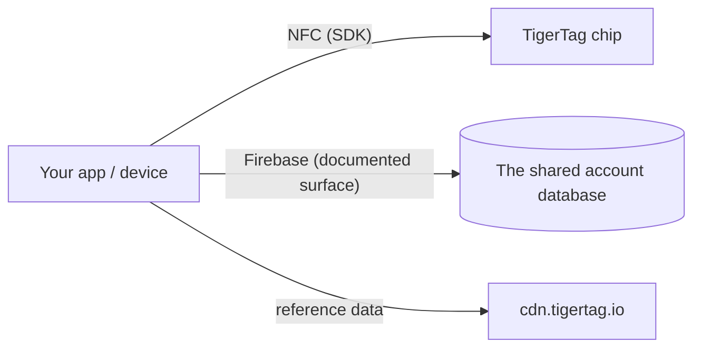

# Documentação para programadores

Construa sobre o TigerSystem: leia chips, comunique com a nuvem ou integre o seu próprio hardware e software. Nada exige autorização — o protocolo é aberto.

## O que pode construir?

Ler um TigerTag requer **qualquer telemóvel NFC**, um **leitor USB ACR122U** ligado a um computador ou um **dispositivo DIY — um simples ESP32 com um módulo leitor PN532 ou RC522** (a abordagem que a TigerScale usa). Hardware corrente, sem equipamento proprietário. A partir dessa única leitura, integre onde quer que uma identidade seja útil:

- **ERP / gestão de stocks** — ligue a identidade e as quantidades das bobinas ao sistema de inventário já existente na sua empresa.
- **Acompanhamento de utilização** — registe que material foi para que trabalho, máquina ou encomenda de cliente.
- **Painéis e automatização à medida** — monitorização de quintas de impressão, alertas de stock baixo, gatilhos de reposição.
- **Sistemas de empréstimo** — fablabs, escolas, makerspaces a registar a entrada e saída de material.
- **Projetos de I&D, privados ou públicos** — um suporte de identidade aberto, regravável e documentado com que experimentar.

Nenhum destes casos precisa das nossas aplicações nem da nossa nuvem: o chip + um SDK chegam. Acrescente a [superfície de conta](./account-api.md) apenas se quiser contas e sincronização.

Construa-o e é **TigerTag Compatible**: gratuito, autodeclarado, sem auditoria e sem autorização. Submeta-o à auditoria e pode tornar-se **TigerTag Certified** — aberto a tudo o que um terceiro construa, hardware ou software, em dois âmbitos (**TigerTag** e **TigerTag+**). A fronteira entre os níveis não é o que o seu produto é; é se alguém o verificou. Compatible diz *«funciona»* com a sua palavra, Certified diz *«testámo-lo»* com a nossa ([critérios](https://github.com/TigerTag-Project/TigerTag-RFID-Guide/blob/main/CERTIFICATION.md), contacte-nos através da [organização GitHub](https://github.com/TigerTag-Project)).

A governação tem deliberadamente duas barreiras: **qualquer pessoa** pode implementar o protocolo e dizer «compatível com o TigerTag» — sem autorização, nunca — e mostrar o logótipo TigerTag, sem alterações, para o dizer: na sua aplicação, na sua documentação, na página da sua loja. Essa utilização referencial é livre. Só os **parceiros certificados** (listados no registo de certificados) podem pôr a marca — logótipo **ou nome** — **num chip de qualquer formato (chip, inlay, autocolante, etiqueta, suporte), numa bobina ou na sua embalagem**, onde deixa de descrever compatibilidade e passa a afirmar origem; o texto simples *«Compatível com o TigerTag»* na caixa de um leitor, impressora ou aplicação compatível continua livre, e só eles podem emitir **assinaturas TigerTag+** (o TigerTag detém a chave privada). A barreira da marca é de marketing; a barreira da assinatura é técnica; **nenhuma restringe o protocolo numa única linha** — um chip não certificado funciona na perfeição, apenas não consegue provar a sua origem.

Dois detalhes que convém ter exatamente certos. A afirmação de compatibilidade abrange **também o nível `+`**: verificar uma assinatura TigerTag+ é livre, offline e sem restrições — as chaves públicas estão publicadas — pelo que um leitor que as verifique pode dizer *«compatível com o TigerTag+»*. O que não pode fazer é chamar TigerTag+ a **uma etiqueta**, a não ser que essa etiqueta traga realmente uma assinatura emitida pelo TigerTag. E a palavra **«certificado» nunca é autoaplicada**: o TigerSystem concede-a, ninguém a reivindica.

É deliberadamente o modelo que o Zigbee e o Matter usam — um nível *Compatible* livre, onde qualquer pessoa pode entrar, e um nível *Certified* concedido, que significa algo para um comprador precisamente por ser concedido. Política completa, níveis de certificação e recursos da marca: [TRADEMARK.md](https://github.com/TigerTag-Project/TigerTag-RFID-Guide/blob/main/TRADEMARK.md) e [CERTIFICATION.md](https://github.com/TigerTag-Project/TigerTag-RFID-Guide/blob/main/CERTIFICATION.md).

## Comece aqui

| Quero… | Ler |
|---|---|
| Ver quem já construiu sobre o TigerTag | [Integrações de terceiros](./integrations.md) |
| Compreender as peças | [Visão geral da arquitetura](../architecture/overview.md) |
| Saber que repositório faz o quê | [Repositórios](./repositories.md) |
| Ler/escrever chips TigerTag | [SDKs](./sdks.md) |
| Trocar inventários como ficheiros | [O formato `.ttag`](./ttag-format.md) |
| Mostrar a cor de uma bobina como todas as outras aplicações | [A amostra de material](./material-swatch.md) — e o seu [renderizador de referência em direto](./material-swatch-playground.html) |
| Gerar o id de uma bobina sem chip, imprimir a etiqueta QR de uma bobina ou voltar a lê-la | [Ids de bobina e ligações QR](./spool-ids-and-qr-links.md) |
| Sincronizar com o inventário do utilizador na nuvem | [API de conta e integração](./account-api.md) |
| Compreender o payload do chip | [O chip TigerTag](../concepts/tigertag-chip.md) |

## Vias de integração

1. **Só chip** — analise e codifique chips com um SDK. Sem conta, sem rede.
2. **Ligado à nuvem** — autentique a *conta do próprio utilizador* e leia/escreva os dados dele dentro das regras de segurança do lado do servidor ([contrato de integração](./account-api.md)).
3. **Hardware** — existem exemplos funcionais para ESP32/Arduino, Home Assistant e uma ponte Spoolman (ver os [exemplos do repositório de integração](https://github.com/TigerTag-Project/TigerTag_Firebase_Integration/tree/main/examples)).

## Convenções

- **Versões** — as versões dos produtos usam SemVer; o payload do chip leva a sua própria versão do formato para compatibilidade retroativa.
- **Nomes** — nomes autoexplicativos em vez de codificados ou engenhosos; sem valores mágicos de vários estados.
- **IDs, nunca etiquetas** — qualquer lógica que dependa de um valor das tabelas de referência (`id_aspect`, `id_brand`, `id_material`, `id_type`, `id_diameter`, `id_measure_unit`, `id_version`…) compara o seu **ID numérico**, nunca a etiqueta como cadeia de caracteres. Uma etiqueta é texto de apresentação: é traduzida, pode ser renomeada ou corrigida na base de dados de referência e lê-se de forma diferente em cada idioma — um ID nunca muda. Mantenha o ID junto da etiqueta, dê nome aos IDs sobre os quais ramifica (p. ex. aspeto `Tricolor 24`, `Rainbow 145`, `Bicolor 252`) e use as etiquetas apenas para apresentação.
- **Cor** — a cor de uma bobina é guardada como dados, não como imagem, pelo que cada superfície tem de transformar esses dados na mesma imagem: [a convenção da amostra de material](./material-swatch.md) é normativa e vem com um [renderizador de referência](./material-swatch-playground.html) com o qual pode confrontar a sua própria implementação.
- **Contribuições** — cada repositório tem o seu próprio guia; as contribuições para a documentação seguem o [CONTRIBUTING.md](../../CONTRIBUTING.md) daqui.

---

**◀ Anterior:** [OpenSpool](../compatibility/openspool.md) · **▲ [Índice da documentação](../../README.md)** · **Seguinte ▶** [Repositórios](./repositories.md)
