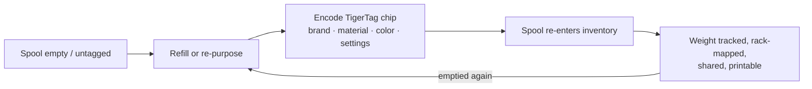

# O fluxo Segunda Vida

## O problema das bobinas «inteligentes» de hoje

Quando uma bobina com etiqueta de um fabricante acaba, a etiqueta morre com ela: descrevia uma bobina cheia de fábrica, no formato de um só fornecedor, e não pode ser reutilizada. O suporte da bobina é deitado fora ou recarregado «burro».

## Segunda Vida: voltar a identificar, não deitar fora

Um chip TigerTag é **gravável e regravável**. Quando uma bobina é esvaziada e recarregada — ou quando uma bobina de qualquer marca não tem qualquer etiqueta útil — o utilizador codifica um chip TigerTag com o perfil real do novo filamento e cola-o. A bobina ganha uma *segunda vida* como objeto de primeira classe que se identifica a si próprio:

*Mesmo um refil sem bobina leva a sua identidade — o chip viaja no próprio rolo.*

## Como se faz a codificação

- **Tiger NFC Connect** (móvel) — programe chips com um toque NFC.
- **Tiger Studio** (computador) — atualização guiada do chip com um leitor ACR122U / [TigerPOD](../products/tigerpod.md): coloque o chip, verificação da correspondência do UID, gravação verificada.
- **Primeiro o digital** — o *TigerData* do Tiger Studio permite-lhe criar agora uma bobina totalmente digital (sem chip) e **promovê-la a um chip real mais tarde, de forma atómica**.

> **Nota:** o catálogo de marcas, materiais e cores usado na codificação é servido pela [base de dados de referência](../concepts/universal-filament-identity.md) partilhada, pelo que um chip recodificado é tão preciso como um de fábrica.

## A segunda vida do próprio chip — zero lixo eletrónico

A bobina não é a única a ter uma segunda vida: **os chips também.** Cada bobina leva [dois chips](../concepts/tigertag-chip.md) — por isso, cada quilo de filamento que imprime deixa-lhe **dois chips NTAG standard** para aproveitar. Descole-os e recodifique-os como NDEF simples para o que quiser: um porta-chaves inteligente, um cartão de visita NFC, um objeto ligado seu — o editor está integrado na aplicação. Pode até regravar um chip **no formato que as impressoras Elegoo esperam**: o seu chip, a sua escolha.

É exatamente por isso que a produção oficial de chips de marca passou para **NTAG215**: mais margem de memória significa mais possibilidades de reutilização quando a bobina está vazia. O objetivo é simples — **o chip de uma bobina nunca deve tornar-se lixo eletrónico.**

---

**◀ Anterior:** [Ponte do smartphone](./smartphone-bridge.md) · **▲ [Índice da documentação](../../README.md)** · **Seguinte ▶** [Identidade universal do filamento](../concepts/universal-filament-identity.md)

**Ver também:** [TigerTag](../products/tigertag.md), [TigerTag+](../products/tigertag-plus.md)
