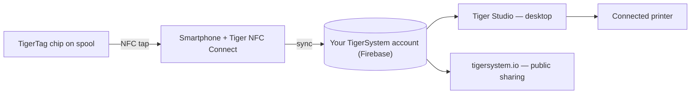

# O conceito da ponte do telemóvel

## A constatação

> Na China, perguntávamos sempre: *«Onde estão os leitores RFID?»* Todos respondiam: *«Nas Bambu Labs.»* Falso — os leitores da Bambu estão no AMS, não na impressora; a máquina não consegue detetar de todo uma bobina de terceiros. **Os leitores RFID estão nos seus bolsos** — em cada telemóvel, prontos a usar, sem que sequer o saiba.

Todos os telemóveis modernos contêm um leitor NFC. Isto significa que **todos os utilizadores de impressão 3D já possuem hardware TigerTag** — sem leitor proprietário, sem atualização da impressora, sem qualquer compra para começar.

O telemóvel funciona como a **ponte** entre a bobina física e o inventário digital:

1. **Aproximar** — o perfil do chip (marca, material, cor, parâmetros) é lido com um só gesto.
2. **Sincronizar** — a bobina aparece instantaneamente no inventário do utilizador na nuvem.
3. **Em todo o lado** — a aplicação de secretária, a web e as impressoras ligadas passam a conhecer a bobina.

## RFID nativo vs a ponte

Algumas impressoras leem etiquetas de forma nativa (no seu próprio formato proprietário); a maioria não lê nada. A ponte torna irrelevantes as capacidades da impressora:

| Caminho | Requer | Funciona com |
|---|---|---|
| **RFID nativo** | Uma impressora que leia a etiqueta bloqueada desse fabricante | Apenas uma marca |
| **Ponte do telemóvel** | Qualquer telemóvel com NFC | **Todas as impressoras**, todas as marcas, mesmo máquinas totalmente offline |

Com a ponte, os dados do filamento chegam à impressora através das [integrações de impressoras do Tiger Studio](../compatibility/README.md) (seis marcas disponíveis hoje) — a bobina identifica-se junto do *sistema*, e o sistema fala com a máquina.

A prova pelo exemplo: **as impressoras FlashForge não têm qualquer leitor RFID** — e, através da ponte, funcionam agora na mesma com filamento identificado por NFC. Uma capacidade totalmente nova, acrescentada às máquinas de outros, **totalmente gratuita para o utilizador** ([o caso FlashForge](../compatibility/flashforge.md)).

---

**◀ Anterior:** [Ecossistema aberto](./open-ecosystem.md) · **▲ [Índice da documentação](../../README.md)** · **Seguinte ▶** [Fluxo Second Life](./second-life.md)

**Ver também:** [Tiger NFC Connect](../products/tigertag-connect.md), [Visão geral da arquitetura](../architecture/overview.md)
