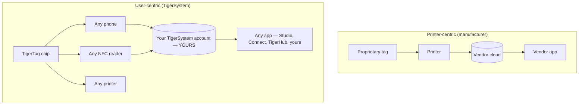

# Centrado no utilizador vs centrado na impressora

> **A inteligência ao serviço do utilizador — e não apenas da impressora.**

## Duas arquiteturas opostas

Num mundo centrado na impressora, o centro é a **impressora**: a etiqueta existe para servir a máquina, e os dados fluem para o silo do fabricante.

No TigerSystem, o centro é o **utilizador**. O utilizador é o dono:

- **do filamento** — qualquer marca, qualquer fabricante;
- **dos metadados** — material, cor, parâmetros de impressão, codificados num chip que controla;
- **do inventário** — guardado na sua própria conta na nuvem, exportável;
- **do histórico** — pesos, localizações, utilização ao longo do tempo;
- **da sincronização** — a mesma conta alimenta todas as aplicações e dispositivos.

O TigerSystem limita-se a **ligar todos os componentes entre si**.

## Porque é que os fabricantes bloqueiam o RFID

As etiquetas dos fabricantes estão normalmente bloqueadas por criptografia (consulte a [secção de compatibilidade](../compatibility/README.md) para os detalhes de cada fabricante: chaves derivadas do UID, setores encriptados com AES, assinaturas RSA). O bloqueio serve o fabricante: liga a compra de consumíveis à máquina e mantém o circuito de dados proprietário. Significa também que **o seu próprio inventário de bobinas não é seu**.

Os chips TigerTag adotam a posição oposta: um payload NDEF aberto num chip NTAG padrão, documentado publicamente, com SDKs abertos para o ler e escrever.

---

**◀ Anterior:** [Porque é que o TigerSystem existe](../vision/why-tigersystem.md) · **▲ [Índice da documentação](../../README.md)** · **Seguinte ▶** [Ecossistema aberto](./open-ecosystem.md)

**Ver também:** [Identidade universal do filamento](../concepts/universal-filament-identity.md), [Compatibilidade](../compatibility/README.md)
