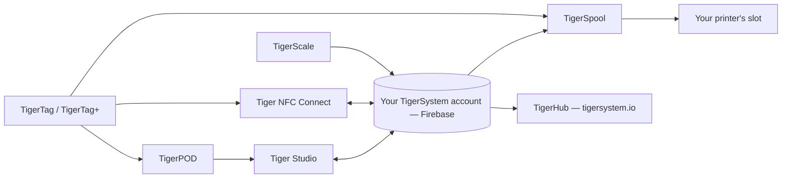

# Produtos

O ecossistema TigerSystem, uma página por produto.

**Estes são os produtos oficiais** — concebidos e publicados pelo TigerSystem. «Oficial» aqui significa *fomos nós que o fizemos*, não *precisa dele*: todos são de código aberto e podem ser bifurcados, e os seus nomes (Tiger Studio, TigerHub, TigerScale, TigerPOD, Tiger NFC Connect) **não são reivindicados como marcas registadas**, de propósito. Apenas a própria marca **TigerTag** está reservada, e só para o chip.

Qualquer pessoa pode construir e vender uma alternativa — um leitor, uma aplicação, uma balança, um sistema de inventário completo. Veja o [hardware de terceiros](../compatibility/third-party-hardware.md) e o [software construído sobre o TigerTag](../developers/integrations.md) para saber o que já existe. Um produto de terceiros é **TigerTag Compatible** simplesmente por funcionar; só passa a **TigerTag Certified** quando o TigerSystem o concede ([política de marcas](../../TRADEMARK.md)).

> **Nota:** todos os produtos **virados para o utilizador** abaixo — e todos os futuros — são **provas de conceito** funcionais. O seu único objetivo é mostrar o potencial de um protocolo de código aberto, padrão, agnóstico e multiplataforma, e inspirar o que outros irão construir com ele. (A cadeia de ferramentas de programação de chips do lado da fábrica é outra história: de nível industrial, em produção.) Veja [Uma caixa de areia, de propósito](../vision/why-tigersystem.md).

| Produto | O que é | Tipo |
|---|---|---|
|  [TigerData](../concepts/universal-filament-identity.md) | O chip virtual — a identidade em forma digital, sem necessidade de chip, atualizável em qualquer altura | Conceito |
|  [TigerTag](./tigertag.md) | Chip RFID/NFC aberto + norma para a identidade da bobina | Hardware + especificação |
|  [TigerTag+](./tigertag-plus.md) | Um TigerTag com um ID de produto do catálogo e enriquecimento opcional — continua 100% offline; assinado, é TigerTag+ Certified | Hardware + especificação |
|  [Tiger NFC Connect](./tiger-nfc-connect.md) | Aplicação móvel (iOS/Android) — ler, codificar, explorar | Aplicação |
|  [Tiger Studio](./tiger-studio.md) | Aplicação de computador — inventário, racks, sensores, impressoras | Aplicação |
|  [TigerHub](./tigerhub.md) | A casa do ecossistema na web — montra, listas de desejos, amigos e partilha em `tigersystem.io` | Web |
|  [TigerPOD](./tigerpod.md) | Suporte de leitor NFC duplo imprimível em 3D | Hardware |
|  [TigerScale](./tigerscale.md) | Balança de filamento ESP32 de código aberto | Hardware |
|  [TigerSpool](./tigerspool.md) | Caixa ESP32 de código aberto junto à impressora — toque numa bobina, escolha um slot, qualquer marca | Hardware |
|  [Tiger Touch](./tigertouch.md) | Firmware de código aberto para o ecrã BIGTREETECH Panda Touch / K-Touch — todas as marcas de impressoras, em direto, num só ecrã | Firmware |
|  [TigerTag Factory & Manager](./factory-suite.md) | Ferramentas industriais de programação de chips e de bases de dados de filamento para fábricas — **não públicas**, de nível de produção | Industrial |

---

**◀ Anterior:** [Fluxo de dados](../architecture/data-flow.md) · **▲ [Índice da documentação](../../README.md)** · **Seguinte ▶** [TigerTag](./tigertag.md)
