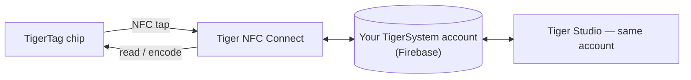

# Tiger NFC Connect (aplicação móvel)

## Finalidade

**O seu telemóvel já é um leitor TigerTag — o Connect liga-o.** A aplicação iOS/Android lê qualquer bobina com um toque, escreve chips com igual facilidade e mantém toda a sua coleção no bolso. É a porta de entrada do dia a dia no ecossistema e a concretização da [ponte do smartphone](../philosophy/smartphone-bridge.md).

<strong>iPhone · iPad</strong>
<a class="ts-cta-primary" href="https://apps.apple.com/app/id6745437963">App Store</a>
Leia com a câmara ou toque no botão

<strong>Android</strong>
<a class="ts-cta-primary" href="https://play.google.com/store/apps/details?id=com.tigertag.connect">Google Play</a>
Leia com a câmara ou toque no botão

<a href="https://tigersystem.io/download">Todas as transferências em tigersystem.io</a>
<a href="https://testflight.apple.com/join/jVHhmK4C">Beta no TestFlight (iOS)</a>
<a href="https://play.google.com/apps/testing/com.tigertag.connect">Beta no Google Play</a>

Gratuita, nas duas lojas. A aplicação lê um chip com o NFC do próprio telemóvel — nada para comprar, sem leitor, sem necessidade de conta para ler.

## Onde se encaixa

## Funcionalidades

- **Leitura NFC em movimento** — toque numa bobina, veja o seu perfil completo.
- **Programação de chips** — codifique e recodifique chips TigerTag a partir do telemóvel.
- **Exploração do catálogo** — a base de dados de referência partilhada de marcas/materiais/cores.
- **Conta partilhada** — o mesmo backend Firebase do Tiger Studio: inventário, amigos e racks mantêm-se sincronizados em tempo real entre dispositivos.
- **Acessórios USB-C** — suporta o analisador de filamento **TD-1 / TD1s** da AJAX-3D por USB-C: meça a Transmission Distance (e a cor) de um filamento diretamente a partir do telemóvel ([hardware de terceiros compatível](../compatibility/third-party-hardware.md)).

## Obtê-la

- **Lançada** na **App Store (iOS)** e no **Google Play (Android)** — versão 1.0.2 atualmente.
- **Betas públicos** também disponíveis (TestFlight no iOS, beta aberto no Android).
- Todas as ligações de transferência: **[tigersystem.io/download](https://tigersystem.io/download)** — um código QR está também sempre disponível na barra lateral do Tiger Studio.

> **Nota sobre o nome:** anteriormente publicada como *«TigerTag RFID Connect»* — renomeada **Tiger NFC Connect** para evocar o leitor NFC que já existe em todos os telemóveis. A aplicação é **gratuita mas proprietária** (não é de código aberto) por agora — ao contrário do Tiger Studio, dos SDKs e do hardware, que são abertos.

## Arquitetura

Aplicação Flutter que fala com o Firebase (Auth + Firestore) — a base de dados de contas única e partilhada por trás de todas as aplicações. A conectividade com impressoras no telemóvel é orientada para a nuvem sempre que os fabricantes o permitem.

## Interações

| Com | Como |
|---|---|
| Chips TigerTag | Ler e escrever por toque NFC |
| Firebase (base de dados da conta) | Sincronização em tempo real de inventário / amigos / preferências |
| Tiger Studio | Companheiro de computador — mesma conta, funcionalidades complementares |

## Em imagens

|| | | |
|---|---|---|---|
|  |  |  |  |

---

**◀ Anterior:** [TigerTag+ Certified](./tigertag-plus-certified.md) · **▲ [Índice da documentação](../../README.md)** · **Seguinte ▶** [Tiger Studio](./tiger-studio.md)

**Ver também:** [Ponte do smartphone](../philosophy/smartphone-bridge.md), [Inventário e sincronização na nuvem](../concepts/inventory-and-cloud-sync.md)
