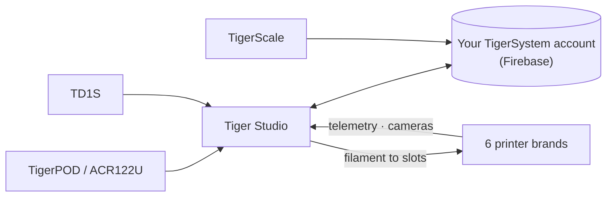

# Tiger Studio (aplicação de computador)

## Finalidade

**O Tiger Studio é o centro de controlo do seu filamento.** Todas as bobinas, todos os racks, todas as impressoras num só ecrã — leia um chip e a respetiva bobina abre-se, atualize um peso e sincroniza em todo o lado, olhe para uma impressora e veja o que está a fazer neste momento. Código aberto, em Windows / macOS / Linux.

*O Tiger Studio na secretária, a aplicação no bolso, um leitor ao lado — o mesmo inventário, onde quer que lhe toque.*

<a class="ts-cta-primary" href="https://tigersystem.io/download">Transferir o Tiger Studio — gratuito</a>

<a href="https://github.com/TigerTag-Project/TigerTag-Studio-Manager"> Código-fonte</a>

É deliberadamente **um laboratório, não o destino** — uma demonstração do que o protocolo aberto torna possível, legível, bifurcável e livre de copiar ([filosofia](../philosophy/open-ecosystem.md)).

## Onde se encaixa

## Funcionalidades (destaques)

- **Inventário** — sincronização Firestore em tempo real, vistas em tabela/grelha, painel de detalhe, controlo do peso, calibração de contentores, bobinas digitais (TigerData) com promoção atómica a chip.
- **Impressoras** — integrações em direto para **6 marcas** (telemetria, filamento por slot, progresso dos trabalhos, câmaras e, em algumas marcas, painéis de controlo completos). Veja a [compatibilidade](../compatibility/README.md).
- **Racks** — mapeamento do armazenamento físico por arrastar e largar.
- **Amigos e partilha** — códigos de descoberta, inventários de amigos só de leitura.
- **Dispositivos** — próprios: [TigerPOD](./tigerpod.md) e [TigerScale](./tigerscale.md); de terceiros: o leitor NFC ACR122U, os analisadores **AJAX-3D TD-1 e TD1s** (TD + cor diretamente para o perfil da bobina) e as **balanças USB HID** (DYMO série M e qualquer balança compatível) — lista completa: [hardware de terceiros compatível](../compatibility/third-party-hardware.md).
- **11 idiomas** — EN · FR · DE · ES · IT · NL · PL · PT-BR · PT-PT · RU · 中文.

O catálogo completo e sempre atual está no [FEATURES.md](https://github.com/TigerTag-Project/TigerTag-Studio-Manager/blob/main/FEATURES.md) do repositório da aplicação.

## Arquitetura

Electron + JS puro, sem empacotador. As ligações às impressoras falam diretamente o **protocolo LAN nativo** de cada fabricante (MQTT / WebSocket / HTTP) — as notas de protocolo por marca são mantidas no repositório da aplicação (`renderer/printers/<brand>/PROTOCOL.md`).

## Em imagens

## Ligações

- Repositório + transferências: [TigerTag-Studio-Manager](https://github.com/TigerTag-Project/TigerTag-Studio-Manager) (MIT)
- Catálogo completo de funcionalidades: [FEATURES.md](https://github.com/TigerTag-Project/TigerTag-Studio-Manager/blob/main/FEATURES.md)

---

**◀ Anterior:** [Tiger NFC Connect](./tiger-nfc-connect.md) · **▲ [Índice da documentação](../../README.md)** · **Seguinte ▶** [TigerHub](./tigerhub.md)

**Ver também:** [Compatibilidade](../compatibility/README.md), [Arquitetura](../architecture/overview.md)
