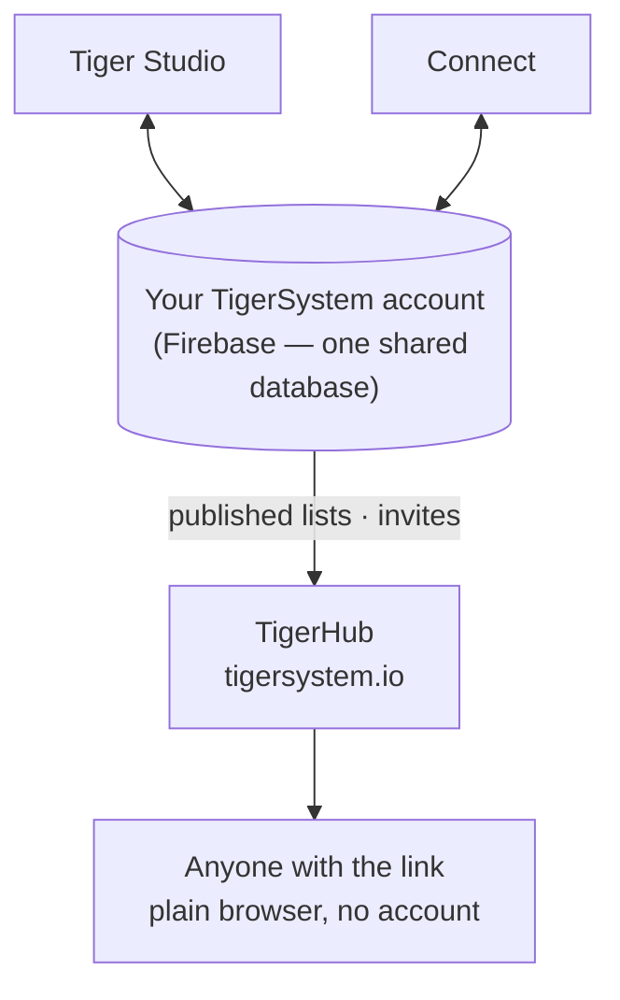

# TigerHub

## Finalidade

**O TigerHub é a casa do ecossistema na web** — o site em **[tigersystem.io](https://tigersystem.io)**. Apresenta a caixa de areia do TigerSystem e o que o protocolo aberto TigerTag torna possível, e aloja o **lado social** dessa caixa de areia: partilhar uma lista de desejos, convidar alguém para ser amigo, publicar uma lista só de leitura que qualquer pessoa pode abrir num navegador.

## Onde se encaixa

## Funcionalidades — todas ativas hoje

- **Montra do ecossistema** — a página inicial conta a história completa: como funciona, as seis marcas de impressoras, os componentes e os três níveis (TigerData — acompanhamento só por software · TigerTag — o chip offline · TigerTag+ — autenticidade verificada).
- **A sua conta na web** (`/account`) — inicie sessão na sua conta TigerSystem a partir de um navegador.
- **Listas de desejos** — públicas e só para amigos, ambas disponíveis.
- **Códigos de amigo e convites** — adicionem-se mutuamente como amigos a partir da web.
- **Ligações de listas públicas** — partilhe uma lista só de leitura como `https://tigersystem.io/wishlist/<token>`; quem a vê não precisa de aplicação nem de conta.
- **Catálogo de materiais e base de dados de referência** (`/materials`, `/database`) — explore o catálogo partilhado com que todas as aplicações trabalham.
- **Impressoras e funcionalidades** (`/printers`, `/features`) — o que funciona com o quê.
- **Modelos 3D** (`/models`) — modelos imprimíveis (o TigerPOD e companhia).
- **Para fabricantes, programadores e imprensa** (`/manufacturers`, `/developers`, `/press`) — a história B2B, indicações de integração, recursos de media.
- **Brindes** (`/goodies`) — o boné e a polo oficiais. Comprar um é uma das formas de [apoiar o projeto](../support.md).

## Uma ligação de lista pública, na prática

Uma ligação de lista pública é `https://tigersystem.io/wishlist/<token>`. Três coisas a saber antes de colar uma em algum lado:

- **O token é a chave inteira.** Quem tiver a ligação abre a lista — sem conta, sem aplicação, nada a provar. Trate-a como uma palavra-passe que decidiu partilhar: serve para uma publicação num fórum ou para um amigo, não para uma lista que não gostaria de ver copiada mais adiante.
- **Tornar uma lista pública é o que cria a ligação.** Na aplicação, definir uma lista como *pública* gera o seu token e publica uma cópia da lista; voltar a defini-la como privada apaga essa cópia e o token. Se a tornar pública outra vez, recebe um token **novo**, pelo que uma ligação distribuída antes não volta a funcionar. O TigerHub apenas mostra o que a aplicação publica.
- **Só de leitura, e diz quem a partilhou.** Quem a vê vê apenas essa lista — os seus itens, e a ocasião ou a mensagem, se tiver definido uma — nunca o seu inventário nem as suas outras listas. A página mostra, no entanto, o seu **nome de apresentação**, as suas **ligações para redes sociais** e um botão *adicionar como amigo* que transporta o seu **código de descoberta**.

Uma ligação é uma de duas formas de partilhar; a outra é um amigo:

| | Ligação de lista pública | Amigo |
|---|---|---|
| Quem a vê | qualquer pessoa com a ligação | uma pessoa que aceitou |
| Precisa de conta | não | sim |
| Como | tornar uma lista pública | trocar códigos de descoberta |
| Desfazer | tornar a lista privada | remover o amigo |

A parte dos amigos é resumida aqui apenas para ficar ao lado da ligação; as regras de pedido e de remoção, e a sua aplicação do lado do servidor, pertencem a [Inventário e sincronização na nuvem](../concepts/inventory-and-cloud-sync.md).

## O TigerHub não é a base de dados

As contas de utilizador e os dados por trás de todas as aplicações vivem no **Firebase simples** (Auth + Firestore) — infraestrutura deliberadamente sem marca: **uma única base de dados partilhada, num único sítio**, para que o Tiger Studio, o Tiger NFC Connect, a TigerScale e a conta TigerSystem interoperem todos sobre os mesmos dados. O TigerHub é a **superfície web** construída por cima. Veja [Inventário e sincronização na nuvem](../concepts/inventory-and-cloud-sync.md).

## Interações

| Com | Como |
|---|---|
| Tiger Studio / Connect | Tornar uma lista pública ou privada — o que cria ou apaga a sua ligação — e enviar convites de amizade |
| Firebase (base de dados da conta) | Fonte dos dados publicados |
| Visitantes | Navegador simples, sem necessidade de conta |

---

**◀ Anterior:** [Tiger Studio](./tiger-studio.md) · **▲ [Índice da documentação](../../README.md)** · **Seguinte ▶** [TigerPOD](./tigerpod.md)

**Ver também:** [Inventário e sincronização na nuvem](../concepts/inventory-and-cloud-sync.md), [Arquitetura](../architecture/overview.md)
