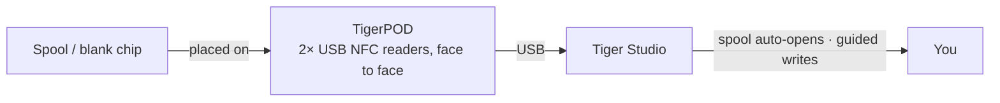

# TigerPOD

## Finalidade

**O primeiro «leitor de CD» para bobinas de filamento inteligentes.** O TigerPOD põe um leitor de bobinas na sua secretária — e imprime-o você mesmo. Um suporte gratuito, de código aberto e imprimível em 3D, que aloja **dois** leitores NFC USB **frente a frente**: pouse uma bobina e ela identifica-se no Tiger Studio; pouse um chip virgem e codifique-o. Tão natural como tocar com um telemóvel, mas de mãos livres na secretária.

*Pouse a bobina; ela apresenta-se.*

<a class="ts-cta-primary" href="https://tigersystem.io/tigerpod">Obter um TigerPOD</a>
<a href="https://makerworld.com/fr/models/1289152-tigerpod-for-openspool-tigertag-rfid-filament#profileId-1318958">Imprima-o — STL gratuito</a>

<a href="https://github.com/TigerTag-Project/TigerPOD"> Código-fonte</a>

## Porquê dois leitores, frente a frente

Este é todo o objetivo da caixa, e a única coisa que tem de ficar certa. **Recomendamos sempre dois leitores.** Um leitor funciona tecnicamente, mas degrada a experiência de duas formas concretas:

- **Leitura.** Uma bobina leva [**dois chips, em faces opostas**](../concepts/tigertag-chip.md). Com um único leitor, uma bobina que fique virada para o lado «errado» tem de ser levantada e virada antes de ser vista. Com um leitor de cada lado, seja qual for a forma como larga a bobina, já há um chip diante de um leitor. Nada para virar, nada para apontar.
- **Escrita.** Quando etiqueta uma bobina você mesmo, escreve **ambos** os chips. Um leitor significa duas passagens, e duas oportunidades de os desemparelhar. Dois leitores escrevem o par **de uma só vez**, e o Tiger Studio consegue verificá-los um contra o outro.

O Pod existe para manter essa geometria: dois leitores, na vertical, de frente um para o outro, à distância de uma bobina. Tudo o resto é uma caixa à volta disso.

## Onde se encaixa

## Duas caixas para imprimir — ambas gratuitas

| | **TigerPOD Mini** — *recomendado* | **TigerPOD (original)** |
|---|---|---|
| |  |  |
| Impressão | Mais rápida, menos filamento | Mais demorada, mais filamento |
| Espaço na secretária | Menos | Mais |
| Cabos | Encaminhados **por dentro** da caixa | Externos |
| Etiquetas | TigerTag **e** OpenSpool (NDEF) | TigerTag **e** OpenSpool (NDEF) |
| Transferência | **[MakerWorld — TigerPOD Mini](https://makerworld.com/fr/models/3190348-tigerpod-mini-for-openspool-tigertag-rfid-filament#profileId-3609236)** | **[MakerWorld — TigerPOD original](https://makerworld.com/fr/models/1289152-tigerpod-for-openspool-tigertag-rfid-filament#profileId-1318958)** |

Ambas alojam os mesmos dois leitores do tipo ACR122U frente a frente. O Mini é uma reformulação do original e é simplesmente o melhor Pod: comece por ele, a menos que queira especificamente o berço maior.

Licenciado sob **CC BY 4.0** — remisture e adapte livremente.

## De que é feito

O STL é a caixa; estas são as peças que vão lá dentro. Nada aqui é exclusivo — qualquer leitor do tipo ACR122U e qualquer divisor USB-C servem — mas esta é a combinação em torno da qual a caixa foi concebida:

| Peça | Quantidade | O que é |
|---|---|---|
| **TigerTag Player** | **2** | O leitor NFC USB — um dispositivo do tipo ACR122U. Um de cada lado, para que ambos os chips da bobina sejam alcançados numa só passagem. |
| **TigerTag Spliter** | 1 | USB-C para 2× USB-A, para que os dois leitores cheguem ao computador numa só porta e possam ser programados em paralelo. |
| **A caixa impressa** | 1 | **Mini** ou original — veja acima. |

### Obter as peças

A caixa é uma transferência gratuita; os dois leitores e o divisor são a parte que compra. Vendem-se em pack, que é a forma mais barata de ficar com o par certo:

- **[TigerTag Player Bundle — 2 leitores + Spliter](https://www.atome3d.com/products/tigertag-player-bundle-2pcs-spliter)** (Atome3D)
- Também disponível em **[tigertag.io](https://shop.tigertag.io/collections/tigertag-rfid-maker)**

> **Nota:** montar um você mesmo e comprar um já montado dão exatamente o mesmo dispositivo. Servem quaisquer dois leitores do tipo ACR122U — o pack apenas poupa-lhe a procura separada.

## Construa um

1. **Imprima uma caixa** — o Mini ou o original, acima.
2. **Arranje dois leitores compatíveis com o ACR122U**, em qualquer loja que prefira, e um pack de chips NTAG 213 / 215 / 216 virgens para escrever.
3. **Deslize um leitor para cada ranhura** — sem parafusos, sem cola, sem cablagem.
4. **Ligue ambos ao computador.** Um divisor reduz a um só cabo; duas portas USB funcionam igualmente bem.
5. **Instale o [Tiger Studio](./tiger-studio.md)** — ele deteta os leitores sozinho.

Orçamento aproximado, com fontes separadas — os preços variam consoante a loja e a região:

| Peça | Qtd. | Aprox. | Onde |
|---|---|---|---|
| Leitor NFC compatível com o ACR122U | 2 | 15–25 € cada | [Amazon](https://amzn.to/4vok3d7) · ou qualquer loja |
| Chips NTAG 213 / 215 / 216 virgens | 1 pack | 10–20 € — dois chips por bobina, por isso um pack etiqueta muitas | [Amazon](https://amzn.to/3TzxGc7) · [chips oficiais](./tigertag.md) |
| A caixa impressa | 1 | só filamento | MakerWorld, acima |
| Divisor USB (2× USB-A fêmea → 1× USB-A macho) | 1 | 5–10 €, opcional | [Amazon](https://amzn.to/4plgsv8) |

> Algumas ligações desta tabela são **ligações de afiliado da Amazon**: como Associado da Amazon, a TigerTag ganha com as compras elegíveis, **sem custo adicional para si**. Ajuda a financiar o protocolo aberto. Comprar as mesmas peças noutro lado funciona exatamente tão bem.

Comprar o [kit](https://shop.tigertag.io/collections/tigertag-rfid-maker) custa menos do que arranjar as mesmas peças uma a uma, os leitores chegam com o logótipo oficial do projeto, e financia a norma — uma de várias formas de [apoiar o projeto](../support.md). Mas construir um com peças genéricas **não é um caminho menor — é o mesmo Pod**. É isso que significa um protocolo aberto.

### Compatibilidade dos leitores

O ACR122U fala **PC/SC**, a norma de cartões inteligentes ao nível do sistema operativo que todos os leitores desta classe implementam. Como o Pod assenta no PC/SC e não num controlador de fornecedor, a mesma instalação funciona em **Windows, macOS e Linux**, e qualquer biblioteca PC/SC o consegue controlar.

## Funcionalidades

- Caixa imprimível em 3D — **STL gratuitos no MakerWorld**, num tamanho **Mini** e num **original**.
- Aloja dois leitores USB do tipo ACR122U, frente a frente (postos de leitura + escrita).
- Plug-and-play com o [Tiger Studio](./tiger-studio.md): ler um chip abre automaticamente a bobina correspondente; o fluxo guiado de atualização do chip usa-o para escritas com verificação do UID.
- Sem dependência do TigerTag: os mesmos dois leitores tratam também de etiquetas **OpenSpool** (NDEF).

## Mais do que TigerTag — uma estação NFC universal

O Pod **não está preso ao protocolo TigerTag**. São, literalmente, dois leitores PC/SC padrão num suporte em forma de bobina: **tudo o que um ACR122U faz, o Pod faz.**

Controla o chip por completo — ler o que lá está, escrever algo novo, alterar o que existe, apagá-lo de volta a virgem. Os quatro, nos dois sentidos. Sem escrita única, sem sentido único, sem dependência de fornecedor. E para o filamento isso acontece em **Dual NFC**, os dois chips de uma bobina tratados em conjunto, em bobinas de qualquer marca.

O ACR122U trata de muito mais do que NTAG: **ISO 14443 Tipo A e B**, **MIFARE** (Classic 1K/4K, Ultralight, DESFire), **FeliCa**, **Topaz/Jewel** e os **tipos 1–4 de etiquetas NFC Forum**. Tudo o que consegue ler ou escrever com um ACR122U, consegue ler ou escrever no Pod — incluindo etiquetas [OpenSpool](../compatibility/openspool.md).

É isso também que torna real a [segunda vida](../philosophy/second-life.md). Um TigerTag nunca fica bloqueado contra escrita, por isso, quando uma bobina acaba, pode apagar os chips e regravá-los como TigerTags novos — ou transformá-los noutra coisa: uma etiqueta **NDEF** simples para domótica, uma passagem de Wi-Fi, um URL, um cartão de visita. E de volta a TigerTag sempre que quiser. O chip é um ativo reutilizável, não uma embalagem de uso único.

## Interações

| Com | Como |
|---|---|
| Chips TigerTag | Ler / codificar / verificar — os dois chips de uma bobina ao mesmo tempo |
| Tiger Studio | Identificação instantânea da bobina, promoção e atualização do chip |

## Em imagens

## Ligações

- Repositório: [TigerPOD](https://github.com/TigerTag-Project/TigerPOD)
- STL — **[TigerPOD Mini](https://makerworld.com/fr/models/3190348-tigerpod-mini-for-openspool-tigertag-rfid-filament#profileId-3609236)** · [TigerPOD original](https://makerworld.com/fr/models/1289152-tigerpod-for-openspool-tigertag-rfid-filament#profileId-1318958)
- Leitores: [TigerTag Player Bundle (2 unidades + Spliter)](https://www.atome3d.com/products/tigertag-player-bundle-2pcs-spliter)

---

**◀ Anterior:** [TigerHub](./tigerhub.md) · **▲ [Índice da documentação](../../README.md)** · **Seguinte ▶** [TigerScale](./tigerscale.md)

**Ver também:** [Fluxo Segunda Vida](../philosophy/second-life.md)
