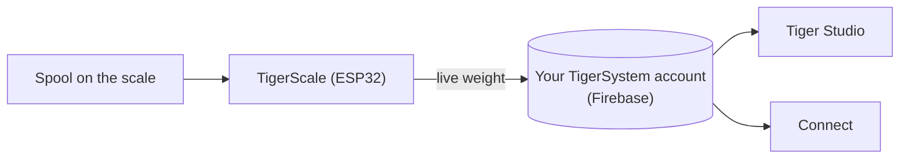

# TigerScale

## Finalidade

**A TigerScale responde à eterna pergunta: quanto filamento resta?** Ponha uma bobina na balança ESP32 de código aberto e o peso em direto flui diretamente para o seu inventário — sem introdução manual, sem abanar a bobina junto ao ouvido.

*A bobina é pousada e a balança já sabe o que ela é: o chip dá a marca, o material e a cor, a célula de carga dá os gramas. Nada escrito, nada adivinhado.*

<a class="ts-cta-primary" href="https://tigertag-project.github.io/Tiger-Scale-V3/">Instalar a partir do navegador</a>

<a href="https://tigersystem.io/tigerscale">TigerScale em tigersystem.io</a>
<a href="https://makerworld.com/en/models/3161869-tigerscale-v3-best-smart-filament-scale-with-nfc#profileId-3573543">Imprimir a caixa</a>
<a href="https://github.com/TigerTag-Project/Tiger-Scale-V3"> Código-fonte</a>

> **O chip sabe o que o filamento *é*; a balança sabe quanto *resta*.** Juntos tornam o inventário realmente verdadeiro: a identidade vem do [TigerTag](./tigertag.md), a quantidade em direto vem da TigerScale.

## TigerScale V3 — a geração atual

[Tiger-Scale-V3](https://github.com/TigerTag-Project/Tiger-Scale-V3), MIT. É esta a que deve construir.

- **Sabe qual é a bobina que está em cima**: **dois leitores NFC PN532**, um de cada lado — uma [bobina com chip duplo](../concepts/tigertag-chip.md) é identificada seja qual for a posição em que a pousa. Ler a etiqueta, pesar, subtrair o peso da bobina vazia, sincronizar — sem escrever, sem adivinhar.
- **ESP32-S3** (16 MB de flash, PSRAM), **ecrã tátil a cores de 3,5″ 480×320** (LVGL) com configuração completa no ecrã: seletor de Wi-Fi + teclado, assistente de calibração, autoteste do hardware, atualizações OTA.
- **Alimentada por bateria** (PMIC AXP2101, estado de carga no ecrã), codec de áudio.
- Pesagem de precisão: HX711 + célula de carga, filtragem por mediana + EMA adaptativo — afinada para a sensação de uma balança de cozinha.
- **8 idiomas de firmware**, interface web em 9 idiomas.
- **Acompanhamento do peso em direto** — as atualizações aparecem em tempo real no Tiger Studio e no Tiger NFC Connect através do Firestore.
- Funciona com a **calibração do peso do contentor** do Tiger Studio, para que o peso líquido do filamento se mantenha exato por tipo de contentor.
- **Funciona offline.** A identificação de marca e material vem de uma base de dados guardada na própria flash do dispositivo, atualizada no máximo uma vez por dia — a leitura de uma etiqueta nunca espera pela rede.
- **A sincronização na nuvem é opcional.** A balança é totalmente utilizável sem conta.
- **A sua própria interface web**, servida pelo dispositivo, adaptada a telemóveis, em direto por WebSocket a 10 Hz — sem aplicação para instalar para a controlar a partir de um telemóvel.
- **Sem blobs binários**: tudo compila a partir do código-fonte.

*Na bancada: pouse a bobina, ela identifica-se e pesa-se sozinha.*

## Construir uma

> **Não gosta de eletrónica?** Uma balança USB e um [TigerPOD](./tigerpod.md) fazem o mesmo trabalho sem nada para ligar ou gravar — a [alternativa oficial sem eletrónica](#uma-balança-usb-e-um-tigerpod-sem-eletrónica).

A balança é uma construção DIY, e os passos que se espera serem difíceis não o são:

1. **Imprima a caixa.** Um projeto Bambu Studio `.3mf` com as placas já organizadas — [no MakerWorld](https://makerworld.com/en/models/3161869-tigerscale-v3-best-smart-filament-scale-with-nfc#profileId-3573543). Abra-o no Bambu Studio ou no Orca e carregue em Slice: nada para orientar, nenhum suporte para colocar.
2. **Ligue os componentes.** Ligue a célula de carga, o HX711, o altifalante e os dois leitores PN532 à placa seguindo o [esquema de ligações](#esquema-de-ligações) abaixo — a mesma disposição de pinos para qualquer das variantes da placa.
3. **Grave a partir do navegador.** O [instalador web](https://tigertag-project.github.io/Tiger-Scale-V3/) serve sempre a versão atual; depois disso a balança atualiza-se sozinha por via aérea.

As peças são comuns:

| Qtd. | Componente | Onde |
|---|---|---|
| 1 | Waveshare **ESP32-S3-Touch-LCD-3.5B** — tátil IPS 480×320 (o **-3.5** sem o B também serve) | [-3.5B](https://link.amazon/B0gaANfF5) · [-3.5](https://link.amazon/B0dpgOlOQ) |
| 2 | Módulo NFC **PN532 V3** — são necessários pinos **e** interruptor de modo | [Amazon](https://link.amazon/B0iTXrhjd) |
| 1 | Célula de carga de 5 kg + HX711 | [Amazon](https://link.amazon/B09LOUuI1) |
| 1 | Cabo USB-C de 4 pinos + conector | [cabo](https://link.amazon/B0aoW8qQx) · [conector](https://link.amazon/B0aiEyjLx) |
| 1 | Bateria de iões de lítio — **opcional**, a balança funciona por USB | [Amazon](https://link.amazon/B0etKlE1i) |
| — | Fios Dupont, parafusos auto-roscantes M3 | [fios](https://link.amazon/B0bl6jvMs) · [parafusos](https://link.amazon/B0ekzxx1E) |
| — | 2× M4×30 e 2× M5×30 (célula de carga), 4× M2×6 (ecrã) | qualquer loja de ferragens |
| 1 | Um pequeno altifalante | acompanha a placa ESP32-S3 |

<figure>

<figcaption><strong>Ambas as variantes funcionam, mas precisam de firmware diferente.</strong> Leia a serigrafia: <strong>-3.5B</strong> ou <strong>-3.5</strong>. O instalador web pergunta qual tem; a cablagem e a caixa são iguais nos dois casos. Se gravar a versão errada, a balança arranca na perfeição mas nunca vê uma etiqueta, sem nada no ecrã a explicar porquê.</figcaption>
</figure>
<figure>

<figcaption><strong>Aviso:</strong> a célula de carga tem de ter 2 furos roscados M4 e 2 M5, e a placa HX711 tem de ser idêntica à mostrada — caso contrário não caberá na ranhura que lhe é destinada.</figcaption>
</figure>

> Algumas ligações desta tabela são **ligações de afiliado da Amazon**: como Associado da Amazon, a TigerTag ganha com as compras elegíveis, **sem custo adicional para si**. Ajuda a financiar o protocolo aberto. Comprar as mesmas peças noutro lado funciona exatamente tão bem.

A lista completa de materiais com custos está no [repositório](https://github.com/TigerTag-Project/Tiger-Scale-V3).

### Montagem

<figure>

<figcaption>Três quartos frontal</figcaption>
</figure>
<figure>

<figcaption>Três quartos traseira</figcaption>
</figure>
<figure>

<figcaption>Três quartos traseira, de perto</figcaption>
</figure>
<figure>

<figcaption>Vista lateral</figcaption>
</figure>

<figure>

<figcaption>Posição e orientação da balança</figcaption>
</figure>
<figure>

<figcaption>PN532 encaixado na ranhura</figcaption>
</figure>

### Esquema de ligações

*[Esquema interativo no Cirkit Designer](https://app.cirkitdesigner.com/project/c6aa6c0a-9462-498f-8923-9ad4454e0e69)*

### Resolução de problemas

**Nenhuma porta COM detetada para o ESP32-S3 no [instalador web](https://tigertag-project.github.io/Tiger-Scale-V3/)?**

Pode faltar um controlador no seu sistema. [Siga o guia de instalação do controlador](../tutorials/tigerscale-serial-port-driver.md).

## Sua para fazer e vender

**Qualquer pessoa pode fabricar e vender hardware TigerScale. Sem taxa de licença, sem royalties, sem registo.** Construa-o, grave o firmware oficial, venda-o.

A única condição para chamar **TigerScale** ao seu produto é executar esse firmware oficial **sem modificações**, para que cada unidade se comporte de forma idêntica dentro do ecossistema. Faça um fork se quiser alterá-lo — e dê ao fork um nome diferente. É este o acordo todo.

## Onde se encaixa

## A história até agora

Três gerações, e a forma da coisa mudou em cada uma:

| | Leitura | Ecrã | Placa | Formato |
|---|---|---|---|---|
| **V1** — nunca lançada publicamente | **um** PN532 | mini OLED | ESP32 | um **suporte de bobina**: um apoio central que atravessa o meio da bobina |
| **V2** — [Tiger-Scale](https://github.com/TigerTag-Project/Tiger-Scale), MIT | 2× RC522 | OLED de 0,96″ | ESP32-WROOM, alimentada por USB | uma balança plana |
| **V3** — [Tiger-Scale-V3](https://github.com/TigerTag-Project/Tiger-Scale-V3), MIT | 2× PN532 | ecrã tátil a cores de 3,5″ | ESP32-S3, bateria | uma balança plana, autónoma |

A V1 já levava essencialmente a eletrónica da V2 — ESP32, mini OLED, uma placa HX711 com uma célula de carga de 5 kg — mas com **um único** leitor e um corpo completamente diferente.

> **A V3 é hardware diferente, não uma atualização de firmware.** As duas não são intercambiáveis: uma V2 que já tenha construído mantém o seu próprio repositório e continua a funcionar. Simplesmente já não é desenvolvida.

As três são totalmente de código aberto (MIT) sobre peças comuns — a prova viva de que um ESP32 e um módulo leitor NFC (classe PN532 / RC522) bastam para construir um dispositivo que lê TigerTag.

## Uma balança USB e um TigerPOD, sem eletrónica

A **alternativa oficial para quem não quer construir uma balança**. Uma balança USB normal e um [TigerPOD](./tigerpod.md), ambos ligados ao computador, e o Tiger Studio faz o resto — nada para soldar, ligar ou gravar.

1. **Ligue a balança ao computador** por USB.
2. **Pouse o TigerPOD em cima dela** — o Mini ou o original.
3. **Tare a balança**, com o TigerPOD em cima.
4. **Abra o Tiger Studio.**
5. **Pouse uma bobina no TigerPOD.** Ele lê os chips da bobina e o Tiger Studio abre a respetiva ficha.
6. **A balança pesa-a**, e o Tiger Studio atualiza sozinho o peso da bobina.

### Que balanças funcionam

O Tiger Studio lê dispositivos **USB «HID Scale»** padrão (página de utilização HID `0x8D`, utilização `0x20`): a começar pela **DYMO M5** e o resto da série DYMO M (M10, M25… mesmo protocolo), e **qualquer HID Scale compatível**, seja qual for a marca. A balança é hardware de terceiros, não um produto Tiger; a configuração à sua volta é oficial e suportada.

Protocolo, validado em hardware real — *Scale Data Reports* de 6 bytes a ~1 Hz:

| Byte | Significado |
|---|---|
| `[0]` | id do relatório `0x03` |
| `[1]` | estado: 1 falha · 2 estável a zero · 3 em movimento · 4 estável · 5 negativo · 6 acima da capacidade |
| `[2]` | unidade (códigos HID PoS): `0x02` grama · `0x0B` onça · `0x0C` libra |
| `[3]` | expoente de potência de dez com sinal aplicado ao valor bruto |
| `[4..5]` | peso, LE16 (LSB, MSB) |

ID de fabricante DYMO `0x0922`; a M5 é pid `0x8009`. Particularidade: a primeiríssima trama logo após uma tara indica a unidade `0x00`.

> **A DYMO M2 não é suportada** — não tem qualquer porta USB, pelo que não há nada para ligar a um computador. O protocolo é irrelevante.

## Interações

| Com | Como |
|---|---|
| Firebase (base de dados da conta) | Escreve o peso em direto na conta do utilizador |
| Tiger Studio / Connect | Mostram o peso em direto; monitorização do estado |

## Ligações

- **V3 (atual)**: [Tiger-Scale-V3](https://github.com/TigerTag-Project/Tiger-Scale-V3) (MIT)
- Grave-a a partir do navegador: [instalador web](https://tigertag-project.github.io/Tiger-Scale-V3/)
- Imprimir a caixa: [MakerWorld](https://makerworld.com/en/models/3161869-tigerscale-v3-best-smart-filament-scale-with-nfc#profileId-3573543)
- V2, já não desenvolvida: [Tiger-Scale](https://github.com/TigerTag-Project/Tiger-Scale) (MIT)

---

**◀ Anterior:** [TigerPOD](./tigerpod.md) · **▲ [Índice da documentação](../../README.md)** · **Seguinte ▶** [Compatibilidade](../compatibility/README.md)

**Ver também:** [Inventário e sincronização na nuvem](../concepts/inventory-and-cloud-sync.md)
