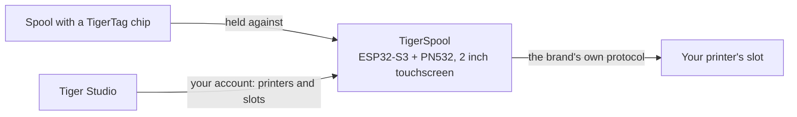

# TigerSpool

**Uma pequena caixa junto à impressora. Toque num slot, encoste uma bobina à caixa e o filamento fica escrito nesse slot — em qualquer marca de impressora.**

*A caixa, uma bobina e os próprios slots da impressora no ecrã — cada um a mostrar o que lá está carregado. Escolha um slot, encoste a bobina à caixa, pronto.*

<a class="ts-cta-primary" href="https://tigertag-project.github.io/TigerSpool-RFID/">Instalar a partir do navegador</a>

<a href="https://github.com/TigerTag-Project/TigerSpool-RFID"> Código-fonte</a>

A sua impressora já mantém uma lista de slots. A sua bobina já leva a sua própria [identidade](../concepts/universal-filament-identity.md). O TigerSpool são os trinta centímetros entre as duas: sem aplicação para abrir, sem teclado, nada a reescrever que o chip já saiba.

Código aberto sob **MIT**, ESP32-S3, cerca de **40 €** em peças comuns.

## O que faz

1. **Toque no slot** que quer no ecrã tátil — os mesmos nomes de slot que a própria impressora usa.
2. **Encoste a bobina à caixa.** O [chip TigerTag](../concepts/tigertag-chip.md) é lido ao contacto, e a atribuição segue de imediato para a impressora, pelo protocolo próprio dessa marca: material, marca, cor e temperaturas, no slot certo. Não há nada para confirmar.
3. **Carregue a bobina.** A caixa diz-lhe a que slot foi parar.

Fala nove idiomas, pergunta qual antes de mais nada, e atualiza-se sozinho por via aérea.

:::caution[Aviso]
Ler um TigerTag para um slot no ecrã não carrega nada — apenas diz à impressora o que a bobina *é*. **Continua a ter de colocar fisicamente a bobina nesse slot** — o CFS, o AMS, a unidade ACE, ou como quer que essa impressora chame ao seu tabuleiro. Se não o fizer, a impressora indica que não há filamento, porque de facto não há nenhum carregado.
:::

## Onde se encaixa

O TigerSpool não é um gravador de chips — essa é a tarefa do [TigerPOD](./tigerpod.md), na secretária. O TigerSpool pega numa identidade que já existe e coloca-a onde a impressora a espera.

## O que tem de existir primeiro

**É aqui que as pessoas tropeçam, por isso vem antes do hardware.**

A caixa não tem teclado nem forma de escrever o endereço de uma impressora, de propósito. Lê as suas impressoras **a partir da sua conta TigerSystem**, o que significa que duas coisas têm de existir antes de ser útil:

1. **Uma conta, criada no [Tiger Studio](./tiger-studio.md).** A caixa inicia sessão nela — por e-mail, ou com o Google através de um código QR, para que nunca seja escrita uma palavra-passe num ecrã de duas polegadas.
2. **As suas impressoras, adicionadas no Tiger Studio.** O endereço, o código de acesso, a marca e o modelo vivem todos lá.

Se saltar isto, a lista de impressoras na caixa fica **vazia**. Não é uma avaria e não há nada para reparar no dispositivo: está a mostrar-lhe exatamente o que a sua conta contém. Adicione a impressora no Tiger Studio e ela aparece na sincronização seguinte.

> **Em resumo:** Tiger Studio → criar uma conta → adicionar as suas impressoras → *depois* configurar a caixa.

## Que impressoras

**As seis marcas que o Tiger Studio integra estão cobertas** — escritas e testadas em hardware. Não são todas as impressoras do mercado, e *«qualquer impressora»* continua a ser o objetivo; são todas as marcas com que este ecossistema fala hoje:

| Marca | Firmware | Transporte |
|---|---|---|
| [Creality](../compatibility/creality.md) | implementado, comprovado | WebSocket |
| [FlashForge](../compatibility/flashforge.md) | implementado, comprovado | HTTP |
| [Bambu Lab](../compatibility/bambu-lab.md) | implementado, comprovado | MQTT sobre TLS |
| [Snapmaker](../compatibility/snapmaker.md) | implementado, comprovado | Moonraker sobre WebSocket |
| [Elegoo](../compatibility/elegoo.md) | implementado, leitura comprovada — escrita ainda não confirmada numa impressora | MQTT |
| [Anycubic](../compatibility/anycubic.md) | implementado, leitura comprovada — escrita ainda não confirmada; apenas modo LAN | MQTT sobre TLS |

Os nomes dos slots seguem os da própria impressora: `Ext.` e `1A`–`1D` na Creality e na FlashForge, `A1`–`A4` e depois `B1`–`B4` na Bambu Lab, `E1`–`E4` na Snapmaker, `S1`–`S4` no Canvas da Elegoo, e uma letra por unidade ACE na Anycubic — `A1`, `A2`… depois `B1`… para uma segunda caixa.

Consulte o [estado por marca](https://github.com/TigerTag-Project/TigerSpool-RFID/blob/main/docs/PRINTER-COMPATIBILITY.md) antes de comprar peças para uma máquina específica.

## Construir uma

Três coisas para comprar, quatro fios, uma caixa impressa — mais dois extras que vale a pena considerar. **A eletrónica é idêntica para todas as marcas de impressoras** — só a caixa muda, o que mantém um só firmware e uma só lista de peças.

| Qtd. | Componente | Onde |
|---|---|---|
| 1 | Placa de desenvolvimento Waveshare **ESP32-S3-Touch-LCD-2** — tátil capacitivo IPS de 2,0" 240×320, ESP32-S3**R8**, 16 MB de flash, 8 MB de PSRAM octal. Ecrã, painel tátil e MCU numa só placa, e os 16 MB é o que torna confortáveis dois slots OTA | [Amazon](https://link.amazon/B0c5hr3uf) |
| 1 | Módulo NFC **PN532 V3** — interruptores DIP, tem de suportar **HSU/UART**, ambos os interruptores em `0` / OFF. Um pack de dois custa pouco mais do que um | [Amazon](https://link.amazon/B0dyEfwKa) |
| 1 | Um cabo USB-C **que transporte dados** — a velocidade é irrelevante, serve qualquer cabo de dados USB 2.0 | [Amazon](https://link.amazon/B00Xg3WT4) |
| 1 | Conector USB-C magnético — **recomendado**: a porta é a peça manuseada todos os dias, e o cabo solta-se em vez da ficha | [Amazon](https://link.amazon/B0bWVIBa0) |
| 1 | Célula LiPo de 3,7 V 1000 mAh, PH1.25 — **opcional**, carregada por USB; a caixa passa a funcionar sem cabo. A placa não consegue detetar uma célula, por isso declara-a em Definições › Bateria. Verifique a polaridade | [Amazon](https://link.amazon/B0fL0jjf3) |

> Algumas ligações desta tabela são **ligações de afiliado da Amazon**: como Associado da Amazon, a TigerTag ganha com as compras elegíveis, **sem custo adicional para si**. Ajuda a financiar o protocolo aberto. Comprar as mesmas peças noutro lado funciona exatamente tão bem.

Os **quatro fios de ligação vêm com o PN532** — 3V3, GND, TX, RX, e é toda a cablagem. Sem conversores de nível: o PN532 funciona a 3V3, tal como a placa. A bateria é **opcional** — a caixa fica normalmente junto a uma impressora que já está ligada à corrente, e a célula acima serve para as vezes em que não está.

*Toda a cablagem. No PN532, os dois pinos de dados estão serigrafados como `SDA` e `SCL` — em modo HSU transportam a UART: o **TX da placa vai para `SCL`**, o seu **RX para `SDA`**, e ambos os interruptores DIP ficam em `0` / OFF. [Esquema interativo](https://app.cirkitdesigner.com/project/5b546f4e-70b8-4735-afff-be6bd36bc10c).*

**A gravação faz-se a partir do navegador** — ligue a placa, clique em Install, espere um minuto. Chrome, Edge ou Opera num computador; o Safari e o Firefox não implementam o WebSerial, e nenhum navegador móvel o faz.

**[Instale-o a partir do navegador →](https://tigertag-project.github.io/TigerSpool-RFID/)**

### Três armadilhas a conhecer antes de encomendar

- **O leitor vai nos GPIO43/44, nunca nos GPIO6/7.** Esse par é um barramento I²C com pull-ups nesta placa: um PN532 ligado aí arranca, responde e devolve UIDs aleatórios com leituras falhadas. Parece uma etiqueta má. Não é, e custa um dia.
- **`TXD` cruza para o RX da placa, `RXD` para o seu TX.** Quem transmite fala com quem recebe. Se o leitor indicar a versão de firmware 0 no arranque, troque estes dois antes de mudar o que quer que seja.
- **Um cabo USB só de carga faz uma placa a funcionar parecer morta.** O ecrã acende e nunca aparece uma porta série, por isso o instalador web não encontra nada onde instalar. Use um cabo que saiba que transfere ficheiros.

A Waveshare vende várias placas semelhantes; as de 1,28", 1,69" e 3,5" da mesma família têm controladores de painel e pinagens diferentes, e este firmware não funcionará corretamente nelas. Verifique a serigrafia, não o título do anúncio.

Lista completa de peças, esquema de ligações e lista de verificação do arranque: [TigerSpool-RFID](https://github.com/TigerTag-Project/TigerSpool-RFID).

## Onde estamos hoje

Escrito em vez de descoberto:

- **A primeira caixa impressa está publicada**: um suporte de secretária independente, com a bobina à esquerda ou à direita, em [Model3D/](https://github.com/TigerTag-Project/TigerSpool-RFID/tree/main/Model3D). As caixas que montam numa dada impressora seguem a mesma regra — mesma placa, mesmo leitor, os mesmos quatro fios, a mesma entrada USB-C — pelo que uma só imagem de firmware corre em todos os modelos e qualquer pessoa pode contribuir com uma sem tocar no código.
- **O firmware não é assinado.** A sua ligação de atualização é verificada contra o armazenamento de certificados de raiz, pelo que a caixa sabe com quem está a falar — mas não quem produziu a imagem.
- **No máximo dez impressoras ligadas ao mesmo tempo** — das 24 que uma conta lhe pode entregar — e não mais de três que falem TLS (Bambu Lab, Anycubic), que são as que mais memória custam.

---

**▲ [Índice da documentação](../../README.md)** · **Ver também:** [TigerPOD](./tigerpod.md), [Tiger Studio](./tiger-studio.md), [O chip TigerTag](../concepts/tigertag-chip.md), [Compatibilidade de impressoras](../compatibility/README.md)
