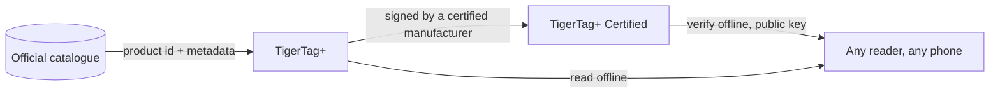

# TigerTag+ Certified

## Finalidade

**Certified é o nível que consegue provar de onde veio um chip.** Um [TigerTag+](./tigertag-plus.md) que leva adicionalmente uma **assinatura criptográfica** é um **TigerTag+ Certified**. A assinatura é escrita por um fabricante que detém a [certificação TigerTag+](../developers/README.md), a quem são dadas as ferramentas de assinatura como parte dela; o TigerTag detém a chave privada.

É o único dos três níveis que não está aberto a todos, e o único que responde a uma pergunta que os outros dois não conseguem: *esta bobina é genuína?*

## Os três níveis, lado a lado

| | TigerTag | TigerTag+ | TigerTag+ Certified |
|---|---|---|---|
| Dados de impressão, **no chip** | ✅ | ✅ | ✅ |
| Funciona totalmente offline | ✅ | ✅ | ✅ |
| ID de produto do catálogo, **no chip** | — | ✅ | ✅ |
| Metadados de enriquecimento, **via Web API, opcionais** | — | ✅ | ✅ |
| Assinatura de origem, **no chip** | — | — | ✅ |
| Quem pode produzir um | todos | todos | **um fabricante certificado** |

Leia atentamente a coluna da esquerda: os metadados de enriquecimento são a única linha que **não** vive no chip. São consultados no catálogo quando está online e podem melhorar depois de o chip ser escrito — que é precisamente a razão pela qual nunca podem ser algo de que o chip precise. Tudo o que a impressora exige está nas linhas marcadas *no chip*, o que mantém os três níveis 100 % offline.

## Verificar é gratuito — emitir é o que a certificação concede

**Verificar** uma assinatura é gratuito, offline e sem restrições: as chaves públicas estão publicadas, e qualquer leitor pode verificar uma sem conta nem rede. **Emitir** uma é o que a certificação concede.

A mensagem assinada abrange deliberadamente o **próprio UID** do chip, pelo que uma carga útil assinada copiada para outro chip deixa de lhe corresponder: uma etiqueta clonada falha a verificação, no próprio telemóvel do cliente. A mesma propriedade é a razão pela qual os dois chips de uma bobina levam duas assinaturas *diferentes* ([como os dois chips ficam ligados](../concepts/tigertag-chip.md)).

## Onde se encaixa

A disposição ao nível do byte — ids de tipo de chip, a área de assinatura de 64 bytes nas páginas `0x18`–`0x27` — está especificada no [TigerTag-RFID-Guide](https://github.com/TigerTag-Project/TigerTag-RFID-Guide).

## Quem é certificado

A lista de referência dos fabricantes autorizados a colocar a marca num produto é o [registo de parceiros certificados](../certified-partners.md). O logótipo ou o nome TigerTag num chip de qualquer formato, num suporte, numa bobina ou na sua embalagem só é autorizado aos fabricantes dessa página.

---

**◀ Anterior:** [TigerTag+](./tigertag-plus.md) · **▲ [Índice da documentação](../../README.md)** · **Seguinte ▶** [Tiger NFC Connect](./tiger-nfc-connect.md)

**Ver também:** [O chip TigerTag](../concepts/tigertag-chip.md), [Parceiros certificados](../certified-partners.md), [Documentação para programadores](../developers/README.md)
