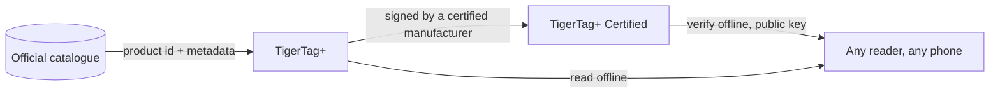

# TigerTag+

## Finalidade

**O `+` significa identificado.** Um TigerTag+ é um TigerTag cuja identidade leva um **ID de produto do catálogo oficial** — não valores que alguém escreveu, mas o produto exato: marca, cor, material, temperaturas, diâmetro, SKU, EAN, diretamente da fonte. Além disso, pode levar **metadados de enriquecimento opcionais**, servidos pela Web API e melhoráveis depois de o chip ser escrito.

O próprio chip continua **100 % offline**. Tudo o que é necessário para imprimir está nele, exatamente como num TigerTag padrão — o ID do catálogo acrescenta a capacidade de consultar dados mais ricos e mais recentes *quando está online*, e não retira nada quando não está. Um TigerTag+ lido em modo de avião comporta-se como qualquer outro TigerTag.

E «online» também não é um requisito. Toda a referência é publicada num único ficheiro — todos os ids de todos os filamentos da base de dados, livres para qualquer pessoa copiar e espelhar — pelo que um leitor que o tenha resolve um ID do catálogo sem qualquer rede. Veja [a Web API](../developers/web-api.md).

É o mesmo `+` do [TigerData+](../concepts/universal-filament-identity.md): em ambos significa *esta identidade é um produto real do catálogo*, e em nenhum significa *certificado*.

> **Nota sobre o nome:** anteriormente vendido como **«TigerTag Pro»** — o nome é agora **TigerTag+**.

## O que o `+` acrescenta

| | TigerTag | TigerTag+ |
|---|---|---|
| Dados de impressão, **no chip** | ✅ | ✅ |
| Funciona totalmente offline | ✅ | ✅ |
| ID de produto do catálogo, **no chip** | — | ✅ |
| Metadados de enriquecimento, **via Web API, opcionais** | — | ✅ |
| Quem pode produzir um | todos | todos |

Os metadados de enriquecimento são a única linha que **não** vive no chip. São consultados no catálogo quando está online e podem melhorar depois de o chip ser escrito — que é precisamente a razão pela qual nunca podem ser algo de que o chip precise. Tudo o que a impressora exige está no chip, o que mantém todos os níveis 100 % offline.

## A variante assinada

Um TigerTag+ que leva adicionalmente uma assinatura criptográfica é um **[TigerTag+ Certified](./tigertag-plus-certified.md)** — o nível que consegue provar a origem de uma bobina, e o único restrito a fabricantes certificados. Verificar uma assinatura continua gratuito e offline para todos.

## Onde se encaixa

## Fazer cópia de segurança de um chip — uma funcionalidade à parte

O Tiger Studio consegue **guardar na sua conta o conteúdo exato de um chip**, associado ao seu UID físico, e mais tarde reprogramá-lo para esse estado. É útil e não tem relação com o `+`: aplica-se a qualquer chip que consiga ler, e ter uma cópia de segurança não faz de um chip um TigerTag+.

- **Restauro ao estado de fábrica**: se um chip for regravado ou corrompido por acidente, ponha-o exatamente como estava — assinatura incluída, se tinha uma.
- **Apenas o mesmo chip**: o restauro é válido no chip original, porque a cópia de segurança está ligada ao seu UID. Uma salvaguarda para *esse* chip, nunca uma forma de clonar.
- **Prova de posse**: uma leitura que corresponda à cópia de segurança mostra que o chip original está fisicamente nas suas mãos.

> **Nota:** criar uma cópia de segurança exige atualmente o **Tiger Studio + um leitor USB (TigerPOD / ACR122U)**; o suporte móvel está previsto.

## Interações

| Com | Como |
|---|---|
| Tiger Studio + TigerPOD/ACR122U | Lê e verifica assinaturas; cria e restaura cópias de segurança de chips |
| Tiger NFC Connect | Lê e verifica; suporte de cópia de segurança a caminho |
| SDKs | `tigertag[verify]` verifica uma assinatura offline, em Python ou JS |
| Firebase (base de dados da conta) | Guarda o catálogo, os metadados de enriquecimento e as cópias de segurança de chips por conta |

## Ligações

- Chips oficiais: **[tigertag.io](https://tigertag.io)** (loja)

---

**◀ Anterior:** [TigerTag](./tigertag.md) · **▲ [Índice da documentação](../../README.md)** · **Seguinte ▶** [TigerTag+ Certified](./tigertag-plus-certified.md)

**Ver também:** [Identidade universal do filamento](../concepts/universal-filament-identity.md), [O chip TigerTag](../concepts/tigertag-chip.md), [Documentação para programadores](../developers/README.md)
