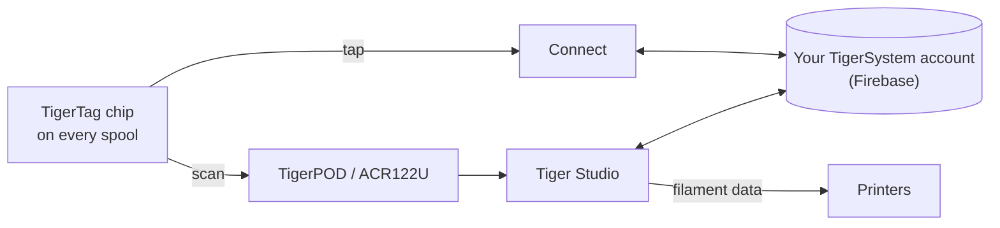

# TigerTag

## Finalidade

**O TigerTag dá a cada bobina uma memória própria.** Um pequeno chip NFC guarda tudo sobre o filamento — marca, material, cor, a forma como gosta de ser impresso — para nunca ter de adivinhar, etiquetar ou recordar. Toque-lhe com o telemóvel e a bobina diz-lhe ela própria.

<a class="ts-cta-primary" href="https://tigersystem.io/tigertag">O que é o TigerTag — em tigersystem.io</a>

<a href="https://github.com/TigerTag-Project/TigerTag-RFID-Guide"> A especificação aberta do chip</a>

Tecnicamente, é o coração do ecossistema: uma norma RFID aberta, legível por qualquer aplicação ou leitor compatível — sem dependência de fornecedor, sem formato secreto.

## Onde se encaixa

## Funcionalidades

- Chip **NTAG213 / 215 / 216** padrão (recomendado redondo de 25 mm), carga útil NDEF aberta de 144 bytes — dimensionada para caber no NTAG213 mais pequeno; sem chaves, sem dependência.
- **Dois chips por bobina, em lados opostos** — um fica sempre virado para o leitor (slot da impressora, AMS, telemóvel na mão) e cada um serve de cópia de segurança ao outro ([porquê](../concepts/tigertag-chip.md)).
- Identidade resolvida com a [base de dados de referência](../concepts/universal-filament-identity.md) partilhada.
- Gravável e **regravável** — permite o [fluxo Segunda Vida](../philosophy/second-life.md); os chips oficiais de marca são fornecidos como NTAG215, para que o próprio chip possa ser reutilizado como um objeto NDEF simples (porta-chaves, cartão de visita…) quando a bobina estiver vazia — nunca lixo eletrónico.
- Legível por qualquer smartphone com NFC, leitores ACR122U e pelo [TigerPOD](./tigerpod.md).
- Uma **área reservada de 64 bytes** (páginas `0x18`–`0x27`, deixando 80 bytes de dados): livre para **funções adicionais da comunidade** num TigerTag padrão; transporta a assinatura de origem — 32 bytes de `R`, 32 de `S` — num [TigerTag+](./tigertag-plus.md).

## Arquitetura

Veja [O chip TigerTag](../concepts/tigertag-chip.md) para o resumo do formato e o [TigerTag-RFID-Guide](https://github.com/TigerTag-Project/TigerTag-RFID-Guide) para a especificação canónica ao nível do byte.

## Interações

| Com | Como |
|---|---|
| Tiger NFC Connect | Toque NFC: ler, codificar |
| Tiger Studio | A leitura no leitor abre automaticamente a bobina; atualização guiada do chip |
| SDKs | Analisar / verificar / codificar a partir de JS ou Python |
| Impressoras | Indiretamente — através da [ponte do smartphone](../philosophy/smartphone-bridge.md) e das ligações às impressoras do Studio |

## Em imagens

> **Nota sobre o nome:** os chips padrão eram antes vendidos como **«TigerTag Maker»** — o nome é agora simplesmente **TigerTag**.

## Os chips oficiais e os de todos os outros

**O TigerSystem fabrica os chips oficiais** e coloca neles o logótipo TigerTag. Existem em dois formatos, e ambos são fornecidos **virgens**:

| Formato | Para |
|---|---|
| **Autocolante** | qualquer bobina que já tenha — um em cada lado ([porquê dois](../concepts/tigertag-chip.md)) |
| **Suporte de refil** | [refils](../philosophy/second-life.md) de filamento com núcleo de cartão: um suporte já leva **os dois chips**, fica dentro do núcleo antes de o refil ser montado numa masterspool reutilizável, para que o chip viaje com o filamento e não com o carretel |

Quem pode dizer o quê quando um chip está à venda:

| Quem | O que vende | Pode chamar-lhe | Logótipo |
|---|---|---|---|
| **TigerSystem** | os chips que fabrica | **oficial** — feito por nós | sim — aplica a marca |
| **Qualquer revendedor ou distribuidor** | esses mesmos chips genuínos | **oficial** — os produtos são-no | sim — a marca já está neles |
| **Um terceiro que o TigerSystem auditou** | tudo o que construiu — chips, inlays, suportes, um dispositivo, uma aplicação | **certificado** — concedido, auditado, listado, retirável | sim, no produto |
| **Quem fabrica o seu próprio chip** | o seu próprio chip compatível | *«compatível com o TigerTag»* — e com o **TigerTag+** se verificar assinaturas. Nunca *«certificado»*, que só o TigerSystem concede | na sua aplicação, documentação e página da loja; *«Compatible with TigerTag»* em texto simples na caixa de um dispositivo compatível — **nunca o logótipo nem o nome no chip (em qualquer formato), suporte, bobina ou embalagem** |

Esta última distinção é toda a política de marcas, e é mais estreita do que parece. Dizer que o seu produto *fala com* o TigerTag é um facto sobre o seu produto, e mostrar o logótipo para o dizer é livre. Colocar a marca — logótipo ou nome — **num** chip de qualquer formato é uma afirmação sobre **quem o fez** — deixa de significar «isto funciona com o TigerTag» e passa a significar «isto *é* um TigerTag». Só esta segunda utilização exige autorização escrita. Veja [TRADEMARK.md](../../TRADEMARK.md).

Foram produzidos mais de **2,5 milhões de chips TigerTag** — a maioria integrada de fábrica por marcas de filamento (Rosa3D, eSun, Sunlu, Landu, Jamg He, R3D — com a Filforme, a Nanovia e outras em integração). Todas são [parceiros certificados](../certified-partners.md); essa página é o registo, e a única forma fiável de verificar que uma marca numa caixa é legítima.

|| | |
|---|---|---|
|  |  |  |

|| | | |
|---|---|---|---|
|  |  |  |  |

*As caixas e as bobinas lá dentro — compradas numa loja, não encenadas para uma fotografia. É isto que significa «o mais implementado».* Mas o protocolo **não está ligado aos chips oficiais**, de propósito: qualquer chip NTAG virgem e barato comprado em qualquer lado (Amazon, AliExpress, localmente) funciona de forma idêntica, e nada o impede. Os chips de marca ajudam a financiar a I&D; a adoção do protocolo é a primeira recompensa. Outras formas de ajudar — incluindo as que não custam nada — estão em [Apoiar o projeto](../support.md).

A liberdade vai nos dois sentidos: **os chips nunca ficam bloqueados contra escrita**. O TigerTag é simplesmente o protocolo de base com que as fábricas de filamento fornecem as bobinas — se preferir outro protocolo NFC/RFID (personalizado ou existente), pode regravar o chip e migrar os seus dados para ele. A sua bobina, o seu chip, o seu formato.

## Onde os comprar

Ambos os formatos são fornecidos **virgens**, e ambos são vendidos pelo TigerSystem e pelos seus revendedores:

| | **Autocolante** | **Suporte de refil** |
|---|---|---|
| O que recebe | chips adesivos redondos de 25 mm — **dois por bobina**, um em cada lado | um suporte = **dois chips já emparelhados**, um por extremidade dobrada, para o núcleo de cartão |
| Para | qualquer bobina com flanges | refils de filamento montados numa masterspool |
| Loja oficial | [tigertag.io](https://shop.tigertag.io/collections/tigertag-rfid-maker) | [tigertag.io](https://shop.tigertag.io/collections/tigertag-rfid-maker) |
| Revendedor (FR) | [TigerTag Officiel, Atome3D](https://www.atome3d.com/products/tigertag) | [TigerTag Refill Officiel, Atome3D](https://www.atome3d.com/products/tigertag-pro-for-refill-1000-pcs) |

Ambos existem em vários tamanhos de pack, até quantidades profissionais. E nada disto é obrigatório: **qualquer chip NTAG virgem comprado em qualquer lado funciona de forma idêntica** — comprar os oficiais financia o protocolo, nada mais.

## Ligações

- Chips oficiais: **[tigertag.io](https://tigertag.io)** (loja — apoia a I&D)
- Formato do chip: [TigerTag-RFID-Guide](https://github.com/TigerTag-Project/TigerTag-RFID-Guide)

---

**◀ Anterior:** [Produtos](./README.md) · **▲ [Índice da documentação](../../README.md)** · **Seguinte ▶** [TigerTag+](./tigertag-plus.md)

**Ver também:** [Identidade universal do filamento](../concepts/universal-filament-identity.md), [Segunda Vida](../philosophy/second-life.md)
