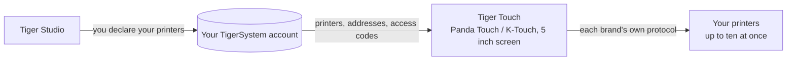

# Tiger Touch

**O seu Panda Touch está numa gaveta. Dê-lhe todas as impressoras que possui.** Um firmware gratuito e de código aberto que transforma o BIGTREETECH Panda Touch e o K-Touch num único ecrã tátil em direto para todas as suas impressoras 3D — sem soldar, sem computador.

*Dois cartões de impressora em direto num só ecrã: uma FlashForge AD5X e uma Bambu Lab X1C.*

<a class="ts-cta-primary" href="https://tigertag-project.github.io/Tiger-Touch/">Instalar a partir do navegador</a>

<a href="https://github.com/TigerTag-Project/Tiger-Touch"> Código-fonte</a>

A BIGTREETECH vende um pequeno ecrã tátil de 5" sob dois nomes: o **Panda Touch**, feito para impressoras Bambu Lab, e o **K-Touch**, feito para impressoras Klipper. A mesma placa, dois firmwares, cada um preso a uma família de máquinas. Mude de impressora e o ecrã vai para uma gaveta.

**O Tiger Touch é um novo firmware para esse mesmo ecrã**, escrito de raiz. Inicia sessão na sua conta TigerTag gratuita, encontra todas as impressoras que declarou lá e fala com cada uma diretamente, pelo seu próprio protocolo, ao mesmo tempo. Se possui um Panda Touch ou um K-Touch que já não corresponde às suas impressoras, é o hardware para o qual o Tiger Touch foi feito.

Código aberto sob **MIT**. Nada para soldar, nada para imprimir, sem Raspberry Pi, sem servidor pelo meio: liga o ecrã a uma porta USB, carrega em **Install** no navegador e dois minutos depois mostra as suas impressoras.

## O que faz

- **Todas as marcas num só ecrã** — Bambu Lab, Creality, Elegoo, Anycubic, Snapmaker, FlashForge, Prusa, mais qualquer máquina Klipper (Moonraker) ou OctoPrint.
- **Nuvem e LAN** — Bambu Lab através da nuvem da Bambu ou em modo LAN, Anycubic através da nuvem da Anycubic ou na LAN, as restantes na sua rede local.
- **Em direto, todas** — estado, progresso, ficheiro, tempo restante e hora de fim, bicos, mesa, câmara e unidades de filamento (AMS, CFS, Station, ACE, vias MMU / AFC), com até **dez impressoras** acompanhadas ao mesmo tempo.
- **Controlos seguros** — pausa, retoma, paragem (um toque longo de 1,5 s, para que um dedo perdido nunca termine uma impressão) e a luz da impressora. **Nada mais é alguma vez enviado**: sem aquecimento, sem movimento, sem iniciar uma impressão.
- **Atualiza-se sozinho** — as novas versões chegam por Wi-Fi, verificadas antes da instalação, e revertem sozinhas se não arrancarem.
- **Onze idiomas** — inglês, francês, alemão, espanhol, italiano, chinês, português (Brasil e Portugal), polaco, russo, neerlandês.

<figure>

<figcaption><strong>Cartões</strong>: um cartão em direto por impressora, deslize para ver mais.</figcaption>
</figure>
<figure>

<figcaption><strong>Lista</strong>: todas as impressoras num relance. Um toque muda a vista.</figcaption>
</figure>
<figure>

<figcaption><strong>Snapmaker U1</strong>: quatro cabeças de ferramenta, a ativa destacada.</figcaption>
</figure>
<figure>

<figcaption><strong>FlashForge AD5X</strong>: bobina externa e estação de materiais.</figcaption>
</figure>

## Onde se encaixa

## O que tem de existir primeiro

O Tiger Touch lê as suas impressoras **a partir da sua conta TigerSystem**, pelo que nunca pede um endereço ou um código de acesso num ecrã de 5". Crie a conta e adicione as suas impressoras no [Tiger Studio](./tiger-studio.md) **de computador** (Windows, macOS, Linux), que as encontra na sua rede — a versão web não consegue adicionar impressoras.

> **Em resumo:** Tiger Studio → criar uma conta → adicionar as suas impressoras → *depois* configurar o ecrã.

## Que impressoras

O Tiger Touch escolhe a ligação pela **marca**, não pelo modelo: qualquer impressora destas famílias que o Tiger Studio consiga adicionar, o Tiger Touch consegue mostrar. O catálogo do Tiger Studio conta mais de 400 modelos de cerca de 60 fabricantes.

| Marca | Ligação | Visto numa máquina real |
|---|---|---|
| [Bambu Lab](../compatibility/bambu-lab.md) (X1, P1, P2S, A1, H2…) | Nuvem da Bambu, ou LAN (MQTT sobre TLS) | **Sim** — a imprimir pela nuvem (P2S), inativa em modo LAN (X1C, A1) |
| [Creality](../compatibility/creality.md) (K2, K1, Hi, Ender-3 V4…) | WebSocket na LAN | **Sim** — a imprimir (K2), inativa com o seu CFS (Ender-3 V4) |
| [Snapmaker](../compatibility/snapmaker.md) U1 | WebSocket do Moonraker | **Sim** — inativa, quatro cabeças de ferramenta |
| [FlashForge](../compatibility/flashforge.md) (AD5X, Adventurer 5M, Creator 5, Creator 5 Pro) | HTTP na LAN | **Sim** — AD5X: pausa, paragem e a luz |
| [Anycubic](../compatibility/anycubic.md) (Kobra 3, Kobra X, Kobra S1…) | Nuvem da Anycubic, ou LAN (MQTT sobre TLS) | **Sim** — pela nuvem (Kobra X), com o seu ACE: a luz, pausa, retoma e paragem |
| [Elegoo](../compatibility/elegoo.md) Centauri Carbon 1 e 2 | MQTT (CC2), SDCP (CC1) | **Sim** — Centauri Carbon 2 e Centauri Carbon: pausa, retoma, paragem, e a luz na CC2 |
| **Prusa** (MK4, Core One, XL, MINI) | PrusaLink | **Sim** — progresso, temperaturas, pausa, retoma, paragem |
| [Klipper](../compatibility/klipper.md) — Voron, Qidi, Sovol, RatRig… | HTTP do Moonraker | **Sim** — numa impressora Klipper real: pausa, retoma, paragem e a luz |
| **OctoPrint** — qualquer impressora Marlin por trás | API REST do OctoPrint | Apenas com a impressora de teste do Tiger Studio |

O OctoPrint só encontrou até agora a impressora de teste do Tiger Studio, e cada marca tem modelos que ninguém experimentou ainda: **um relatório da sua impressora é a coisa mais útil que pode enviar.** Pausa, retoma e paragem funcionam onde quer que a ligação aceite comandos (não pela nuvem da Bambu); a luz funciona em todo o lado exceto na Prusa, no OctoPrint e na Centauri Carbon 1. Cada marca tem a sua própria página, com a configuração e as perguntas, no [site do instalador](https://tigertag-project.github.io/Tiger-Touch/). Cada campo e cada teste estão no [estado por marca](https://github.com/TigerTag-Project/Tiger-Touch/blob/main/docs/PRINTER-COMPATIBILITY.md).

**Uma impressora aparece como «offline»?** Verifique primeiro o seu modo LAN: está desligado por predefinição na Creality, na FlashForge e na Bambu Lab.

## Um ecrã, todas as marcas

Os firmwares com que o ecrã é fornecido conhecem cada um **uma** família de impressoras.

| | **Tiger Touch** | Firmware do Panda Touch | Firmware do K-Touch |
|---|---|---|---|
| Famílias de impressoras num ecrã | **9** | 1 (Bambu Lab) | 1 (Klipper) |
| Impressoras em direto ao mesmo tempo | **até 10**, todas a atualizar em conjunto | várias Bambu Lab, abranda a partir de cerca de 3 na nossa utilização | **1** de cada vez (50 guardadas, alterna entre elas) |
| Impressoras configuradas | a partir da sua conta TigerTag, nada escrito no ecrã | IP, número de série, código de acesso | IP e porta, ou uma pesquisa |
| Atualizações por via aérea | Sim, verificadas, com reversão automática | Não | Não |

Os firmwares da BIGTREETECH dão controlo total sobre a sua única família — iniciar impressões, temperaturas, movimentos — o que o Tiger Touch deliberadamente não faz. Pode voltar a eles em qualquer altura.

*As colunas do Panda Touch e do K-Touch vêm da wiki da própria BIGTREETECH (lida em 2026-10-16); «abranda a partir de cerca de 3» é a experiência da própria equipa TigerTag, não um valor da BIGTREETECH.*

## Instalar em dois minutos

1. **Declare as suas impressoras** no Tiger Studio, como acima.
2. **Grave o ecrã a partir do navegador.** Abra **<https://tigertag-project.github.io/Tiger-Touch/>** no **Chrome ou Edge** num computador (WebSerial: não no Safari, não no Firefox, não num telemóvel), ligue o ecrã com um cabo USB-C de **dados**, carregue em **Install** e escolha a sua porta. Para substituir o firmware da BIGTREETECH: marque **Erase device**. Para atualizar um Tiger Touch por USB: deixe desmarcado, o seu Wi-Fi e a sua conta são mantidos.
3. **Siga o ecrã.** Idioma, Wi-Fi, depois a sua conta TigerTag — e-mail e palavra-passe, ou **Continuar com o Google** com um código QR lido pelo telemóvel. Ative as impressoras que quer acompanhar, e é só. *Mais tarde* é sempre uma resposta: o ecrã arranca de imediato e liga-se em segundo plano.

Depois disso não há nada a fazer: o ecrã procura uma nova versão uma vez por dia e instala-a com dois toques.

É a primeira vez? O [guia de instalação](https://github.com/TigerTag-Project/Tiger-Touch/blob/main/docs/INSTALL.md) cobre o controlador USB (obrigatório no macOS), como guardar uma cópia do firmware da BIGTREETECH para poder voltar atrás, e a única caixa a marcar.

## O hardware

O **BIGTREETECH Panda Touch** e o **K-Touch** são concebidos e fabricados pela **BIGTREETECH** (BIQU): um ecrã tátil IPS de 5" 800×480 em torno de um ESP32-S3 com 8 MB de PSRAM e 16 MB de flash, Wi-Fi, USB-C e bateria. O Tiger Touch corre nele sem modificações, e assenta no suporte de placa que a BIGTREETECH publicou para ele sob a licença MIT. O K-Touch é a mesma placa que o Panda Touch, pelo que a mesma imagem se destina a ele — mas o Tiger Touch só foi executado num Panda Touch até agora: um relatório de um K-Touch é bem-vindo.

O Tiger Touch é um projeto independente, não fabricado nem apoiado pela BIGTREETECH, pela BIQU ou por qualquer fabricante de impressoras aqui mencionado.

Construa-o você mesmo com o ESP-IDF 5.5 — os passos estão no [repositório](https://github.com/TigerTag-Project/Tiger-Touch#build-it-yourself).

---

**▲ [Índice da documentação](../../README.md)** · **Ver também:** [Tiger Studio](./tiger-studio.md), [TigerSpool](./tigerspool.md), [Compatibilidade de impressoras](../compatibility/README.md)
