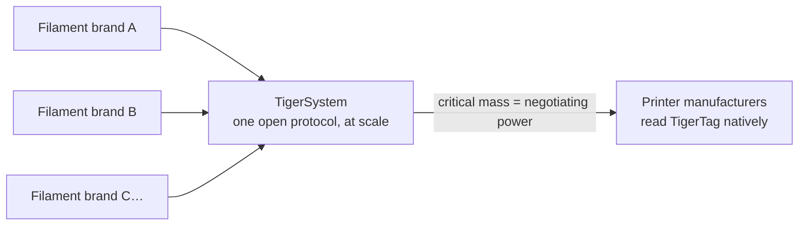

# Para fabricantes de filamento

> **Torne as suas bobinas inteligentes e ligadas.**

## A bobina inteligente está a acontecer — a única forma aberta de a fazer está aqui

As impressoras esperam cada vez mais filamento inteligente: sistemas da classe AMS, deteção de material por slot, definições automáticas. Todos os fabricantes de impressoras respondem com uma **etiqueta fechada, presa às suas máquinas, a alimentar a sua nuvem** — zero interoperabilidade, zero valor para a sua marca fora das paredes deles. E cada etiqueta bloqueada serve um segundo propósito: **encaminhar os seus clientes para o filamento do próprio fabricante da impressora.** O TigerTag foi criado em 2023 precisamente para que as marcas de terceiros tivessem uma resposta melhor — bobinas mais inteligentes do que as proprietárias, sem o jardim murado.

**O TigerTag é o protocolo RFID de terceiros mais implementado do mundo** — e, hoje, a única solução aberta de bobina inteligente viável fornecida em escala: um protocolo aberto, padrão, agnóstico e multiplataforma com mais de **2,5 milhões de chips já produzidos** e integrados de fábrica por marcas como a Rosa3D, a eSun, a Sunlu, a Landu, a Jamg He, a R3D, a Filforme, a Lotactree e a Smart3DPT e a Nanovia.

## Integração na fábrica: dias, não meses

Temos a experiência e a tecnologia para pôr chips TigerTag na sua linha de produção **depressa, com facilidade e a um custo muito baixo — operacional em apenas 5 dias**, escrevendo **cada chip em cerca de 1 segundo** (milhares de bobinas por dia, um clique):

- Hardware NTAG padrão (sem componentes proprietários, sem dependência de ferramentas), obtido numa escala e a um custo escolhidos para um objetivo inegociável: **acrescentar a tecnologia sem acrescentar um cêntimo ao preço final da bobina para o utilizador.**
- Um guia de integração comprovado e já implementado em várias fábricas, assente na suite industrial [TigerTag Factory & Manager](../products/factory-suite.md): a sua base de dados de filamentos de um lado, escrita em massa à velocidade da linha em cada bobina do outro — com a **assinatura de fábrica a provar a origem de cada produto**.
- A base de dados de referência partilhada dá aos seus produtos uma identidade precisa e universal que todas as aplicações compatíveis resolvem de forma idêntica.

As marcas que fornecem TigerTags nos seus produtos podem usar a marca **TigerTag Certified** — um sinal visível para os clientes de que a bobina é inteligente e aberta.

> Contacte-nos em **[tigertag@tigertag.io](mailto:tigertag@tigertag.io)** (ou através da [organização no GitHub](https://github.com/TigerTag-Project)) para iniciar a conversa.

## Obrigado, integradores

As marcas abaixo tornaram a bobina aberta real — cada uma no seu nível de compromisso, e todas merecem o crédito. Os níveis são uma **escada**: quanto mais uma marca se compromete, mais em destaque aparece — aqui e em todas as superfícies do ecossistema. As melhores destacam-se mais.

### Platina — o cume

**TigerTag+ em toda a produção**: todos os formatos de bobina, chips assinados como padrão em cada bobina que sai da fábrica. Nada opcional, nada parcial — a experiência completa de bobina aberta, para todos os clientes, por predefinição. Os integradores Platina têm **destaque máximo em todo o lado**: nomeados em primeiro lugar, o logótipo maior, a sua história contada.

**[Rosa3D](https://rosa3d.pl)** — o **primeiro do mundo** integrador a pôr o TigerTag+ em toda a sua produção. A referência que todos os outros perseguem.

### Ouro — comprometido, em escala

**Integração a pedido na altura da produção**, com grandes quantidades já produzidas, um elevado nível de integração e um **compromisso público oficial**. A um passo do cume: tornar os chips assinados padrão em toda a linha e juntar-se à Platina.

&nbsp;&nbsp;&nbsp;&nbsp;

**[R3D](https://r3dprint.com)** · **[eSun](https://www.esun3d.com)**

### Prata — a bordo

**A tecnologia integrada a pedido** — o primeiro passo, já real: os seus clientes podem comprar hoje bobinas equipadas com TigerTag. O degrau seguinte é o Ouro: aumentar os volumes e tornar o compromisso público.

&nbsp;&nbsp;&nbsp;&nbsp;&nbsp;&nbsp;&nbsp;&nbsp;

**[Sunlu](https://www.sunlu.com)** · **[Landu](https://www.landustore.com)** · **[Jamg He](https://www.jamghe.com)** · **[Filforme](https://www.filforme.com)** · **[Lotactree](https://www.lotactree.com)** · **[Smart3DPT](https://smart3d.pt)**

…e também na linha de produção — [Nanovia](https://nanovia.tech) — com outras a caminho.

**Quer o seu logótipo nesta escada — e maior?** Uma linha de produção executa o TigerTag em apenas 5 dias: [tigertag@tigertag.io](mailto:tigertag@tigertag.io).

## Anunciaram-no eles próprios

Publicações públicas nos canais das próprias marcas — não é o nosso comunicado de imprensa (fontes e anúncios completos: [tigersystem.io/en/manufacturers](https://tigersystem.io/en/manufacturers)). **Clique em qualquer imagem para abrir a publicação original:**

|| | |
|---|---|---|
|  |  |  |

> **ROSA 3D FILAMENTS** — *«integrou oficialmente o protocolo RFID aberto TigerTag em 100 % da nossa produção de filamento.»* Mais de 250 000 bobinas já produzidas com TigerTag. ([publicação original](https://www.instagram.com/p/DVyeOZajZSm/))

> **R3D Filament** — *«iniciou oficialmente a implementação em grande escala do protocolo RFID aberto TigerTag na sua produção de filamento na Europa.»* ([publicação original](https://www.instagram.com/reel/DVoAMqTk5ck/))

> **eSUN** — *«integrou oficialmente a tecnologia RFID TigerTag!»* — em piloto no mercado francês, a expandir-se pela Europa. ([publicação original](https://www.instagram.com/p/DUjydNXkc1W/))

## Como as etiquetas chegam às suas bobinas

<table>
<tr>
<td align="center" width="55%">
<strong>Frente</strong> 
 
<strong>Verso</strong> 

</td>
<td align="center">

</td>
</tr>
</table>

*Frente — os dois chips de marca, com o adesivo industrial 3M (468MP / 200MP) ao meio. Verso — as duas antenas NFC independentes, uma em cada ponta. Colocado no refil: um chip de cada lado, o seu operador descola e cola — nada mais muda na linha.*

## Já nas prateleiras

|| | |
|---|---|---|
|  |  |  |

*Rosa3D, eSun, Sunlu — caixas reais, fornecidas com TigerTag no interior.*

|| | | |
|---|---|---|---|
|  |  |  |  |

*O próprio filamento: Rosa3D, eSUN, Sunlu, R3D — todos estes são fornecidos com chips TigerTag na bobina.*

## O que os seus clientes recebem no primeiro dia

Uma bobina que se identifica a **qualquer telemóvel NFC**, um ecossistema de inventário completo (móvel, computador, web), integração em direto com seis marcas de impressoras, acompanhamento do peso, partilha — uma experiência **muito além do que qualquer ambiente fechado de um só fabricante oferece**, e que funciona com todas as impressoras que os seus clientes possuem, não apenas com as de uma marca.

## Atualize os dados mesmo depois de saírem da sua fábrica

Uma etiqueta impressa fica congelada no dia em que é impressa. Uma bobina TigerTag não: como os chips resolvem a sua identidade contra a **base de dados de referência partilhada**, pode refinar ou corrigir os dados de um produto — definições, descrições, imagens — **mesmo para bobinas já vendidas e que estão nas casas dos seus clientes**. O TigerTag é a única tecnologia neste mercado que mantém os dados do seu produto atualizáveis depois de ele ter saído da fábrica.

## A jogada coletiva

Cada marca de filamento que adere ao TigerSystem reforça todas as outras:

Sozinha, nenhuma marca de filamento consegue convencer os fabricantes de impressoras a ler as suas etiquetas. **Juntas, por trás de um protocolo aberto, conseguimos.** E o pedido é pequeno: um fabricante de impressoras pode acrescentar a leitura de TigerTag ao seu firmware em **menos de 3 dias**. Quantas mais marcas fornecerem TigerTag, mais forte é o argumento a favor de um suporte TigerTag nativo, ao nível do firmware, nas próprias impressoras — e todos os participantes beneficiam dessa alavanca.

---

**▲ [Índice da documentação](../../README.md)** · **Ver também:** [Porque é que o TigerSystem existe](./why-tigersystem.md), [Compatibilidade](../compatibility/README.md), [FAQ — Fabricantes](../faq/README.md)
