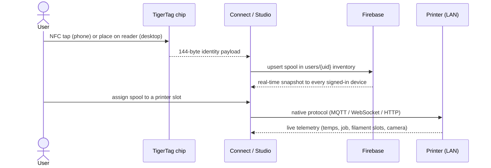
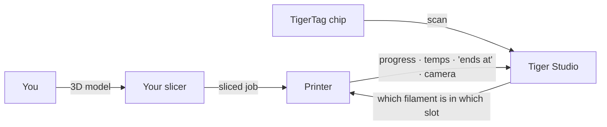

# Fluxo de dados

## Do toque à impressão

A jornada completa de uma bobina pelo sistema:

## Onde fica cada tipo de dado

| Dado | Fica em | Observações |
|---|---|---|
| Identidade da bobina | O chip + o inventário na nuvem do usuário | O chip é a fonte de autoridade para uso offline |
| Banco de dados de referência (marcas, materiais…) | `cdn.tigertag.io` (mesmo projeto Firebase) | Incluído nos aplicativos, atualizado a partir da CDN |
| Imagens das bobinas (inclusive as fotos de produto do TigerTag+) | `cdn.tigertag.io` (mesmo projeto Firebase) | Servidas a todos os aplicativos |
| Inventário, racks, amigos, preferências | Firestore `users/{uid}/…` | Somente o dono, por padrão, garantido por regras |
| Códigos públicos de descoberta | Firestore `publicKeys/{code}` | Busca de amigos em O(1) |
| Credenciais e telemetria da impressora | **Somente local** (desktop) | O tráfego da LAN nunca passa pela nuvem |
| Peso em tempo real (TigerScale) | Dispositivo → Firestore | Aparece ao vivo em todos os clientes |

## Onde o seu fatiador se encaixa

O TigerSystem **não substitui o seu fatiador** — ele completa o quadro ao redor
dele:

- Você fatia e inicia os trabalhos exatamente como antes, com qualquer fatiador.
- O Tiger Studio informa à impressora **qual filamento está em qual slot**
 (AMS / CFS / Canvas / ACE / IFS), para que as informações do lado da máquina
 correspondam à realidade.
- Seja qual for a origem da impressão, o trabalho aparece ao vivo no Tiger Studio —
 progresso, temperaturas, hora de término, câmera.
- O chip carrega as configurações de impressão recomendadas para o filamento; **hoje não há
 importação automática de perfil do fatiador** — você as reproduz por conta própria
 no perfil do seu fatiador.

## Dois planos, deliberadamente separados

- **Plano da nuvem** — identidade, inventário, compartilhamento. Internet, Firebase,
 garantido por regras.
- **Plano da LAN** — controle das impressoras e câmeras. Apenas rede local, protocolos
 nativos dos fabricantes, zero dependência da nuvem (o aplicativo desktop continua
 funcionando com as impressoras quando está offline).

> **Nota:** a exceção é o **modo nuvem** da Anycubic, em que o próprio vínculo com a impressora
> passa pelo MQTT na nuvem do fabricante — veja
> [compatibilidade com a Anycubic](../compatibility/anycubic.md).

---

**◀ Anterior:** [Visão geral da arquitetura](./overview.md) · **▲ [Índice da documentação](../../README.md)** · **Próxima ▶** [Produtos](../products/README.md)

**Veja também:** [Inventário e sincronização na nuvem](../concepts/inventory-and-cloud-sync.md), [Compatibilidade](../compatibility/README.md)
