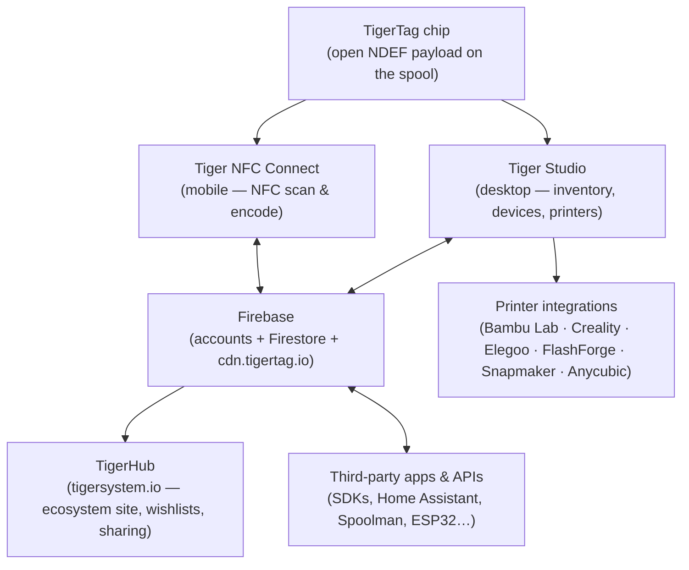
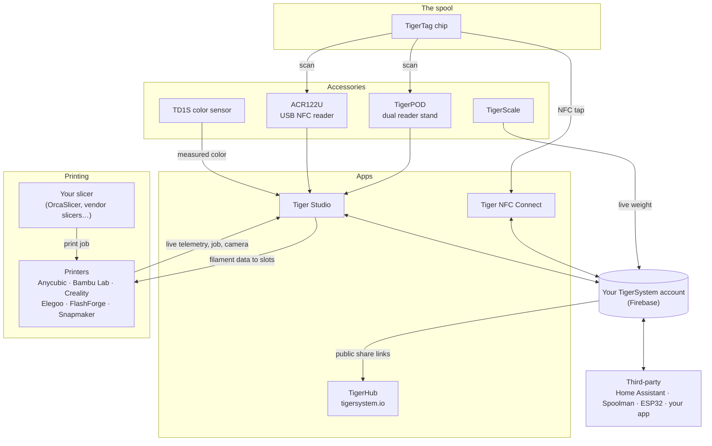

# Visão geral da arquitetura

## A pilha, de cima para baixo

## Camadas

| Camada | Função | Documentação de referência |
|---|---|---|
| **Chip TigerTag** | Identidade portátil e aberta da bobina física | [Formato do chip](../concepts/tigertag-chip.md) |
| **Tiger NFC Connect** | A ponte do smartphone: ler, codificar, navegar | [Página do produto](../products/tiger-nfc-connect.md) |
| **Firebase** | Um banco de dados compartilhado — contas, inventário, sincronização; o ponto de interoperabilidade do ambiente de testes | [Inventário e sincronização na nuvem](../concepts/inventory-and-cloud-sync.md) |
| **TigerHub** | A casa web do ecossistema: vitrine, listas de desejos, amigos, compartilhamento | [Página do produto](../products/tigerhub.md) |
| **Tiger Studio** | Bancada desktop: inventário, racks, sensores, impressoras | [Página do produto](../products/tiger-studio.md) |
| **Integrações de impressoras** | Vínculos ao vivo pela LAN com seis marcas de impressoras | [Compatibilidade](../compatibility/README.md) |
| **APIs de terceiros** | SDKs + superfície documentada do Firestore para qualquer pessoa | [Desenvolvedores](../developers/README.md) |

## O mapa completo — cada elemento e suas conexões

Acessórios, aplicativos, nuvem, impressoras, fatiadores e integrações de terceiros, em
uma única imagem:

Leia da esquerda para a direita: o **chip** identifica a bobina; os **acessórios**
capturam a realidade (leituras, peso, cor); os **aplicativos** e a **nuvem** mantêm tudo
sincronizado; a **impressora** recebe os dados do filamento e responde ao vivo.
O seu **fatiador continua com o trabalho dele** — o TigerSystem não fatia, ele garante que
todos (você, a máquina, os aplicativos) saibam exatamente qual filamento está onde.

## Princípios de projeto

1. **O chip é autossuficiente.** Uma bobina se identifica sem nuvem, sem
 conta, sem rede — o payload é completo e aberto.
2. **A nuvem é do usuário, não do sistema.** Todo o estado fica sob a
 conta do usuário; regras de segurança no servidor — não o código do cliente — garantem
 o acesso.
3. **Toda camada é opcional.** Uso só com o celular, só com o desktop, só com o chip ou só
 com a API, tudo funciona; os componentes agregam valor, mas nunca bloqueiam uns aos outros.
4. **As integrações falam o protocolo nativo da impressora.** Sem modificar firmware, sem
 desvios pela nuvem: o Tiger Studio fala MQTT/WebSocket/HTTP diretamente na LAN
 (veja o [fluxo de dados](./data-flow.md)).

---

**◀ Anterior:** [Inventário e sincronização na nuvem](../concepts/inventory-and-cloud-sync.md) · **▲ [Índice da documentação](../../README.md)** · **Próxima ▶** [Fluxo de dados](./data-flow.md)

**Veja também:** [Produtos](../products/README.md), [Desenvolvedores](../developers/README.md)
