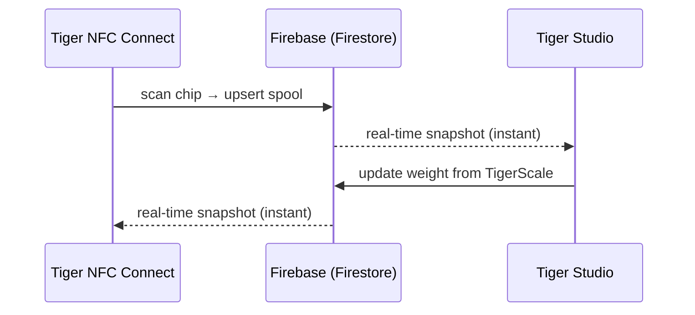

# Inventário e sincronização na nuvem

## Uma conta, todos os dispositivos

O inventário de um usuário vive na **conta TigerSystem dele**, apoiada em um
**Firebase** simples (Auth + Firestore) — infraestrutura deliberadamente sem marca, cuja
função é simples: **um banco de dados compartilhado, em um só lugar**, para que todos os elementos do
ambiente de testes (desktop, celular, balança, web) interoperem sobre os mesmos dados. Todos os clientes — celular, desktop, web — assinam os mesmos
documentos em tempo real:

Não existe "botão de sincronizar": as mudanças se propagam pelos listeners
em tempo real do Firestore, e os clientes mantêm um cache local para leituras offline.

## O que é sincronizado

- **Inventário** — um documento por bobina (identidade, peso, recipiente, imagem…).
- **Racks** — disposições físicas das prateleiras e posicionamento das bobinas.
- **Amigos e compartilhamento** — vínculos de amizade, solicitações recebidas, notificações.
- **Preferências** — idioma, configurações por conta.
- **Backups de chips** — registros de chips [TigerTag+](../products/tigertag-plus.md).

O modelo de dados oficial, campo a campo, está documentado no
[repositório de integração com o Firebase](https://github.com/TigerTag-Project/TigerTag_Firebase_Integration)
(`docs/03-data-model.md`) — a referência para integradores de terceiros.

## O que sai da sua bancada e o que fica

O ecossistema diz em todo lugar que a nuvem é opcional. Veja o que isso
significa de fato e o que custa dizer não.

**A identificação é local por projeto.** Um dispositivo não pergunta a um servidor o que uma tag
é. As tabelas de marcas e materiais ficam no armazenamento dele e são atualizadas a partir do
[repositório de referência](https://github.com/TigerTag-Project/TigerTag-RFID-Guide) **público**
no máximo uma vez por dia. Assim, uma consulta nunca espera pela rede, e funciona com
a internet fora do ar.

**Sem uma conta, você perde exatamente uma coisa: a sincronização entre dispositivos.** Uma
[TigerScale](../products/tigerscale.md) continua pesando, continua lendo tags, continua
identificando marca e material, continua servindo a sua própria interface web na sua LAN. Nada
no chip em si precisa de nós — esse é o ponto central de gravar os dados
[no chip](./tigertag-chip.md).

**Com uma conta, veja o que um dispositivo realmente envia.** Tomando a balança como
exemplo prático, a cada pesagem concluída e em um sinal de vida periódico ela grava,
no seu próprio documento de usuário: os UIDs das tags da bobina, os pesos líquido/bruto/do recipiente,
a versão do firmware, o sinal de WiFi e o IP, o fator de calibração, a hora do último sinal de vida,
o estado da bateria e o estado da tela. Diagnósticos e medições — nada além. Cada
campo está documentado na
[referência da própria balança](https://github.com/TigerTag-Project/Tiger-Scale-V3/blob/main/docs/TELEMETRY.md).

**E veja o que ele armazena localmente, o que importa mais.** Um dispositivo com sessão iniciada
guarda um token de atualização, o seu id de usuário e as suas credenciais de WiFi. Ele nunca guarda
a sua senha — o login a troca por tokens. Mas trate um dispositivo configurado
como **portador de uma credencial**: antes de emprestar, vender ou dar um, saia da conta
*e* esqueça o WiFi. Regravar o firmware simplesmente não apaga nenhum dos dois — esse armazenamento
é preservado de propósito para que uma atualização de firmware não faça você perder a sua configuração.

**Duas escolhas deliberadas que vale conhecer.** A API de LAN de um dispositivo é
**sem autenticação**: qualquer pessoa já conectada à sua rede pode ler o estado dele e
acionar uma tara. É uma simplificação para uma rede doméstica — coloque-o em uma VLAN
de convidados se você não confia na sua. E a chave do Firebase visível no código-fonte é um
**identificador público de projeto**, não um segredo; todo cliente Firebase a inclui, e
o controle de acesso é aplicado por regras no servidor em relação ao usuário conectado,
não por esconder uma sequência de caracteres.

Para a balança, tudo isso está documentado por completo em
[`docs/CLOUD.md`](https://github.com/TigerTag-Project/Tiger-Scale-V3/blob/main/docs/CLOUD.md),
que é a referência oficial.

## Modelo de compartilhamento (resumo)

- Cada usuário tem um **código de descoberta** público (`XXX-XXX`) para busca de amigos em O(1).
- A amizade é **bidirecional e baseada em consentimento**: solicitação → aceite; qualquer
 um dos lados pode desfazê-la. O acesso de leitura ao inventário de um amigo é aplicado
 no servidor pelas regras de segurança do Firestore — nunca pelo cliente.
- Um inventário também pode ser marcado como **público**, ou compartilhado como uma lista web
 somente leitura por links do [TigerHub](../products/tigerhub.md).

## Modelo de segurança (resumo)

- Todos os dados por usuário são exclusivos do dono por padrão; o acesso entre usuários sempre exige
 uma relação prévia (amizade, solicitação), aplicada por regras no servidor.
- A configuração do projeto Firebase é intencionalmente pública (padrão comum);
 **a segurança está nas regras, não no sigilo**. Veja
 [API da conta e integração](../developers/account-api.md).

---

**◀ Anterior:** [O chip TigerTag](./tigertag-chip.md) · **▲ [Índice da documentação](../../README.md)** · **Próxima ▶** [Visão geral da arquitetura](../architecture/overview.md)

**Veja também:** [TigerHub](../products/tigerhub.md), [Desenvolvedores — API da conta](../developers/account-api.md)
