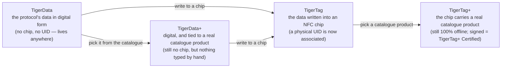

# Identidade universal do filamento

## Uma identidade, legível em qualquer lugar

Um chip TigerTag dá à bobina uma **identidade universal**: um único registro aberto
do que o filamento *é*, independente de quem o fabricou, de quem o vende e de qual
impressora vai derretê-lo.

A identidade abrange (lista não exaustiva):

| Família de campos | Exemplos |
|---|---|
| **Marca** | qualquer fabricante de filamento, a partir de uma lista de referência compartilhada |
| **Material / tipo** | PLA, PETG, ABS, TPU… + subtipo |
| **Aspecto / cor** | valor da cor, acabamento |
| **Geometria** | diâmetro (1,75 / 2,85 mm) |
| **Configurações de impressão** | temperaturas recomendadas |
| **Ciclo de vida** | peso, data de fabricação |

## O banco de dados de referência compartilhado

As identidades não são texto livre: marcas, materiais, aspectos, tipos, diâmetros e
unidades vêm de um **banco de dados de referência compartilhado** servido em `cdn.tigertag.io`
(hospedado no mesmo projeto Firebase das contas). Todo aplicativo resolve os mesmos IDs para o mesmo significado, de modo que um
chip codificado por uma ferramenta é lido de forma idêntica em todas as outras.

> **TODO:** vincular o endpoint público de navegação do banco de dados / o formato de exportação assim que
> o guia RFID o documentar. Os dados de referência vêm incluídos no Tiger Studio
> (`assets/db/tigertag/`) e são atualizados a partir da CDN.

## Uma identidade, quatro estados

A identidade é o *registro*, não o *chip* — e ela passa por quatro
estados:

- **TigerData** é o protocolo *antes* do chip: a mesma identidade, armazenada
 digitalmente — em um inventário, um banco de dados, um arquivo, em qualquer lugar. O protocolo
 TigerTag pode viver inteiramente fora de um chip RFID. Essa noção de **chip
 virtual é uma inovação do TigerSystem — não existe em nenhum outro lugar**: gerencie um inventário
 completo com zero chips NFC, envie uma identidade a um chip depois ou nunca,
 e a interoperabilidade do protocolo é preservada de qualquer forma.
- **TigerData+** é um TigerData que sabe *exatamente qual produto é*. Ainda
 sem chip, ainda sem nada para comprar — mas em vez do que o dono digitou,
 carrega um produto real do catálogo oficial: a marca, a cor,
 o material, as temperaturas, o diâmetro, o SKU e o EAN exatos, direto da fonte. É
 o que você obtém ao escolher um produto em vez de descrever um.
 >Ele **não** é um TigerTag+ e nunca afirma ser: sem chip, sem UID. O `+`
 >significa *identificado*, não *certificado*. Para desenvolvedores: uma bobina é um TigerData+
 >quando não tem chip **e** carrega um id de produto real — esse par é a
 >definição, e ela é espelhada no registro como `protocol: "TigerData+"` para que
 >você possa lê-la diretamente. Veja a
 >[estrutura de dados do Firestore](https://github.com/TigerTag-Project/TigerTag_Firebase_Backend#-firestore-data-structure).
- No momento em que esses dados são **gravados em um chip NFC**, eles se tornam um
 **TigerTag**: um **UID físico passa finalmente a ser associado** à identidade.
- Grave um **produto do catálogo** nesse chip em vez de valores digitados à mão
 e ele é um [**TigerTag+**](../products/tigertag-plus.md) — o mesmo `+` do
 TigerData+, com o mesmo significado: *identificado*. Assinado por um fabricante certificado,
 ele se torna um **TigerTag+ Certified**. Seja como for, o chip continua 100 %
 legível offline.

Um TigerData pode ficar digital para sempre ou ser **promovido a um chip real
de forma atômica** quando você estiver pronto (o Tiger Studio faz isso em uma etapa). E
os quatro estados viajam como arquivos: o
[**formato de intercâmbio `.ttag`**](../developers/ttag-format.md) carrega um ou
mais materiais do inventário — TigerData, TigerData+, TigerTag ou TigerTag+ — em um pen drive
USB, em um e-mail, entre ferramentas.

---

**◀ Anterior:** [Fluxo de trabalho da Segunda Vida](../philosophy/second-life.md) · **▲ [Índice da documentação](../../README.md)** · **Próxima ▶** [O chip TigerTag](./tigertag-chip.md)

**Veja também:** [Página do produto TigerTag](../products/tigertag.md), [Inventário e sincronização na nuvem](./inventory-and-cloud-sync.md)
