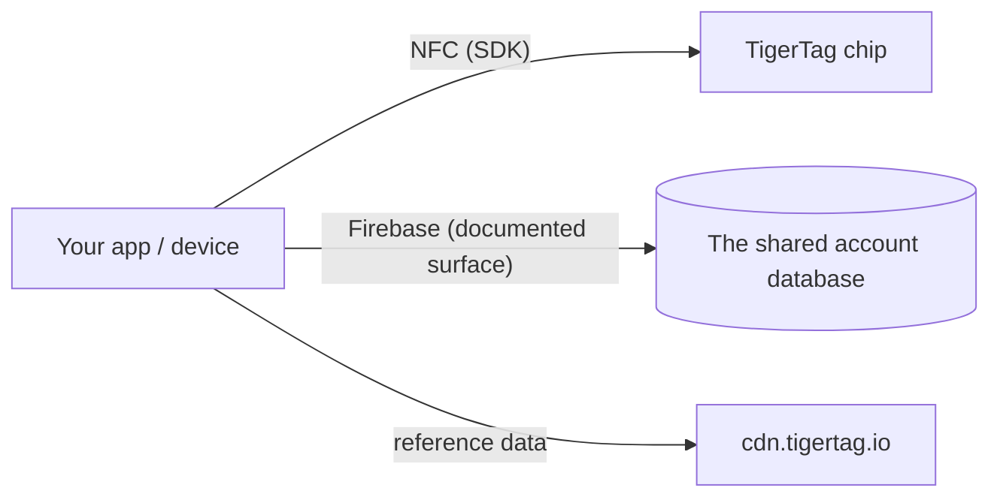

# Documentação para desenvolvedores

Construa sobre o TigerSystem: leia chips, converse com a nuvem ou integre o seu próprio
hardware e software. Nada exige permissão — o protocolo é aberto.

## O que você pode construir?

Ler um TigerTag exige **qualquer smartphone com NFC**, um **leitor USB ACR122U**
conectado a um computador, ou um **dispositivo DIY — um simples ESP32 com um módulo leitor PN532 ou
RC522** (a abordagem que a TigerScale usa). Hardware comum, sem equipamento
proprietário. A partir dessa única leitura, integre onde quer que uma identidade
seja útil:

- **ERP / gestão de estoque** — conecte a identidade e as quantidades das bobinas ao sistema de
 inventário já existente na sua empresa.
- **Acompanhamento de uso** — registre qual material foi para qual trabalho, máquina
 ou pedido de cliente.
- **Painéis e automações personalizados** — monitoramento de fazendas de impressão, alertas de estoque
 baixo, gatilhos de reposição.
- **Sistemas de empréstimo** — fablabs, escolas e makerspaces controlando a entrada e a saída
 de material.
- **Projetos de P&D, privados ou públicos** — um portador de identidade aberto, regravável e
 documentado para experimentar.

Nenhum deles precisa dos nossos aplicativos nem da nossa nuvem: o chip + um SDK bastam. Acrescente a
[superfície de contas](./account-api.md) somente se quiser contas e sincronização.

Construa e ele é **TigerTag Compatible**: gratuito, autodeclarado, sem auditoria e
sem permissão. Submeta-o à auditoria e ele pode se tornar **TigerTag
Certified** — aberto a tudo o que um terceiro constrói, hardware ou software, em
dois escopos (**TigerTag** e **TigerTag+**). A linha entre os níveis não é
o que o seu produto é; é se alguém verificou. Compatible diz *"funciona"*
sob a sua palavra, Certified diz *"nós testamos"* sob a nossa
([critérios](https://github.com/TigerTag-Project/TigerTag-RFID-Guide/blob/main/CERTIFICATION.md), entre em contato pela
[organização no GitHub](https://github.com/TigerTag-Project)).

A governança tem deliberadamente duas portas: **qualquer pessoa** pode implementar o
protocolo e dizer "compatível com o TigerTag" — sem permissão, nunca — e exibir
o logotipo do TigerTag, sem modificações, para dizê-lo: no seu aplicativo, na sua documentação, no seu
anúncio de loja. Esse uso referencial é gratuito. Somente os **parceiros certificados**
(listados no registro de certificação) podem aplicar a marca — logotipo **ou nome** — **em um
chip de qualquer formato (chip, inlay, adesivo, etiqueta, suporte), em uma bobina ou na sua
embalagem**, onde ela deixa de descrever compatibilidade e passa a afirmar
origem; o texto simples *"Compatible with TigerTag"* na caixa de um leitor,
impressora ou aplicativo compatível continua livre, e somente eles podem emitir **assinaturas TigerTag+** (a TigerTag
guarda a chave privada). A porta da marca é comercial; a porta da assinatura
é técnica; **nenhuma das duas restringe o protocolo em uma única linha** — um chip
não certificado funciona perfeitamente, só não consegue provar a sua origem.

Dois detalhes que valem ser exatos. A declaração de compatibilidade cobre também o
**nível `+`**: verificar uma assinatura TigerTag+ é gratuito, offline e
sem restrições — as chaves públicas são publicadas — então um leitor que as verifique pode
dizer *"compatible with TigerTag+"*. O que ele não pode é chamar **uma tag** de
TigerTag+ a menos que essa tag realmente carregue uma assinatura emitida pela TigerTag. E
a palavra **"certified" nunca é autoaplicada**: o TigerSystem a concede, ninguém
a reivindica.

Este é deliberadamente o modelo que Zigbee e Matter usam — um nível *Compatible*
gratuito em que qualquer um pode entrar, e um nível *Certified* concedido que significa algo
para um comprador justamente porque é concedido. Política completa, níveis de certificação
e ativos da marca: [TRADEMARK.md](https://github.com/TigerTag-Project/TigerTag-RFID-Guide/blob/main/TRADEMARK.md) e
[CERTIFICATION.md](https://github.com/TigerTag-Project/TigerTag-RFID-Guide/blob/main/CERTIFICATION.md).

## Comece aqui

| Eu quero… | Leia |
|---|---|
| Ver quem já construiu sobre o TigerTag | [Integrações de terceiros](./integrations.md) |
| Entender as peças | [Visão geral da arquitetura](../architecture/overview.md) |
| Saber qual repositório faz o quê | [Repositórios](./repositories.md) |
| Ler/gravar chips TigerTag | [SDKs](./sdks.md) |
| Trocar inventários como arquivos | [O formato `.ttag`](./ttag-format.md) |
| Mostrar a cor de uma bobina como todos os outros aplicativos fazem | [O swatch do material](./material-swatch.md) — e o seu [renderizador de referência ao vivo](./material-swatch-playground.html) |
| Gerar o id de uma bobina sem chip, imprimir a etiqueta QR de uma bobina ou lê-la de volta | [Ids de bobina e links QR](./spool-ids-and-qr-links.md) |
| Sincronizar com o inventário do usuário na nuvem | [API da conta e integração](./account-api.md) |
| Entender o payload do chip | [O chip TigerTag](../concepts/tigertag-chip.md) |

## Caminhos de integração

1. **Somente chip** — analise e codifique chips com um SDK. Sem conta, sem rede.
2. **Conectado à nuvem** — autentique a *conta do próprio usuário* e leia/grave
 os dados dele dentro das regras de segurança do servidor
 ([contrato de integração](./account-api.md)).
3. **Hardware** — há exemplos funcionais para ESP32/Arduino, Home Assistant e
 uma ponte com o Spoolman (veja os
 [exemplos do repositório de integração](https://github.com/TigerTag-Project/TigerTag_Firebase_Integration/tree/main/examples)).

## Convenções

- **Versionamento** — as versões dos produtos usam SemVer; o payload do chip carrega
 a sua própria versão de formato para compatibilidade retroativa.
- **Nomenclatura** — nomes autoexplicativos em vez de codificados/engenhosos; sem
 valores mágicos de múltiplos estados.
- **IDs, nunca rótulos** — qualquer lógica que dependa de um valor das
 tabelas de referência (`id_aspect`, `id_brand`, `id_material`, `id_type`,
 `id_diameter`, `id_measure_unit`, `id_version`…) compara o seu **ID numérico**,
 nunca o rótulo como texto. Um rótulo é texto de exibição: é traduzido, pode
 ser renomeado ou corrigido no banco de dados de referência e é lido de forma
 diferente em cada idioma — um ID nunca muda. Mantenha o ID junto do
 rótulo, dê nome aos IDs sobre os quais você ramifica (por exemplo, aspecto `Tricolor 24`, `Rainbow 145`,
 `Bicolor 252`) e use os rótulos apenas para exibição.
- **Cor** — a cor de uma bobina é armazenada como dado, não como imagem, então toda
 superfície deve transformar esse dado na mesma imagem:
 [a convenção do swatch do material](./material-swatch.md) é normativa e
 vem com um [renderizador de referência](./material-swatch-playground.html) com o qual você pode comparar a sua
 própria implementação.
- **Contribuições** — cada repositório tem o seu próprio guia; as contribuições para a documentação seguem o
 [CONTRIBUTING.md](../../CONTRIBUTING.md) daqui.

---

**◀ Anterior:** [OpenSpool](../compatibility/openspool.md) · **▲ [Índice da documentação](../../README.md)** · **Próxima ▶** [Repositórios](./repositories.md)
