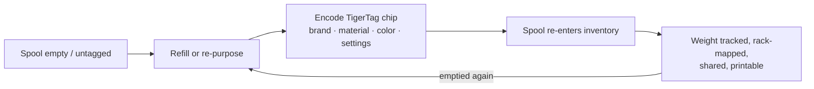

# O fluxo Segunda Vida

## O problema das bobinas "inteligentes" de hoje

Quando a bobina com tag de um fabricante acaba, a tag morre junto: ela descrevia
uma bobina preenchida de fábrica, no formato de um único fabricante, e não pode ser reutilizada. O
carretel é jogado fora ou reenchido "burro".

## Segunda Vida: reidentificar, não descartar

Um chip TigerTag é **gravável e regravável**. Quando uma bobina esvazia e é
reenchida — ou quando uma bobina de qualquer marca não tem nenhuma tag útil —, o usuário
grava um chip TigerTag com o perfil real do novo filamento e o cola. A
bobina ganha uma *segunda vida* como um objeto de primeira classe, que se autoidentifica:

*Até um refil sem carretel carrega a sua identidade — o chip vai no próprio rolo.*

## Como a gravação acontece

- **Tiger NFC Connect** (celular) — programe chips com um toque NFC.
- **Tiger Studio** (desktop) — atualização guiada do chip com um leitor ACR122U /
 [TigerPOD](../products/tigerpod.md): posicione o chip, verificação de correspondência do UID,
 gravação verificada.
- **Digital primeiro** — o *TigerData* do Tiger Studio permite criar agora uma bobina totalmente digital
 (sem chip) e **promovê-la depois a um chip de verdade, de forma atômica**.

> **Nota:** o catálogo de marcas, materiais e cores usado na gravação é
> fornecido pelo [banco de dados de referência](../concepts/universal-filament-identity.md) compartilhado, de modo que
> um chip regravado é tão preciso quanto um de fábrica.

## A segunda vida do próprio chip — zero lixo eletrônico

A bobina não é a única que ganha uma segunda vida: **os chips também.**
Cada bobina leva [dois chips](../concepts/tigertag-chip.md) — então cada quilo
de filamento que você imprime deixa **dois chips NTAG padrão** para aproveitar. Descole-os
e regrave-os como NDEF simples para qualquer coisa: um chaveiro inteligente, um
cartão de visita NFC, um objeto conectado seu — o editor está integrado ao
aplicativo. Ele pode até regravar um chip **no formato que as impressoras Elegoo esperam**:
seu chip, sua escolha.

É exatamente por isso que a produção oficial de chips de marca passou para o **NTAG215**:
mais folga de memória significa mais possibilidades de reutilização depois que a bobina esvazia.
O objetivo é simples — **o chip de uma bobina nunca deve virar lixo eletrônico.**

---

**◀ Anterior:** [Ponte via smartphone](./smartphone-bridge.md) · **▲ [Índice da documentação](../../README.md)** · **Próxima ▶** [Identidade universal do filamento](../concepts/universal-filament-identity.md)

**Veja também:** [TigerTag](../products/tigertag.md), [TigerTag+](../products/tigertag-plus.md)
