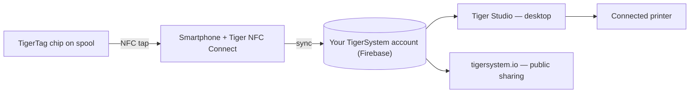

# O conceito da ponte via smartphone

## A sacada

> Na China, não parávamos de perguntar: *"Onde estão os leitores RFID?"* Todos respondiam:
> *"Nas Bambu Lab."* Falso — os leitores da Bambu estão no AMS, não na
> impressora; a máquina não consegue detectar uma bobina de terceiros. **Os leitores
> RFID estão nos seus bolsos** — em todo celular, prontos para usar, sem que você
> nem soubesse.

Todo smartphone moderno tem um leitor NFC. Isso significa que **todo usuário de
impressão 3D já possui hardware TigerTag** — sem leitor proprietário, sem upgrade de
impressora, sem nenhuma compra para começar.

O celular funciona como a **ponte** entre a bobina física e o inventário digital:

1. **Toque** — o perfil do chip (marca, material, cor, parâmetros) é lido em um só gesto.
2. **Sincronização** — a bobina aparece no inventário na nuvem do usuário na hora.
3. **Em todo lugar** — o aplicativo de desktop, a web e as impressoras conectadas passam a conhecer a bobina.

## RFID nativo vs a ponte

Algumas impressoras leem tags nativamente (no seu próprio formato proprietário); a maioria não lê
nada. A ponte torna irrelevantes as capacidades da impressora:

| Caminho | Exige | Funciona com |
|---|---|---|
| **RFID nativo** | Uma impressora que leia a tag bloqueada desse fabricante | Uma única marca |
| **Ponte via smartphone** | Qualquer celular com NFC | **Todas as impressoras**, todas as marcas, até máquinas totalmente offline |

Com a ponte, os dados do filamento chegam à impressora pelas
[integrações de impressoras do Tiger Studio](../compatibility/README.md) (seis marcas
ao vivo hoje) — a bobina se identifica para o *sistema*, e o sistema fala com
a máquina.

A prova pelo exemplo: **as impressoras FlashForge não têm nenhum leitor RFID** —
e, pela ponte, elas funcionam mesmo assim com filamento identificado por NFC. Uma
capacidade inteiramente nova, adicionada às máquinas de outros, **totalmente gratuita para
o usuário** ([o caso da FlashForge](../compatibility/flashforge.md)).

---

**◀ Anterior:** [Ecossistema aberto](./open-ecosystem.md) · **▲ [Índice da documentação](../../README.md)** · **Próxima ▶** [Fluxo Segunda Vida](./second-life.md)

**Veja também:** [Tiger NFC Connect](../products/tigertag-connect.md), [Visão geral da arquitetura](../architecture/overview.md)
