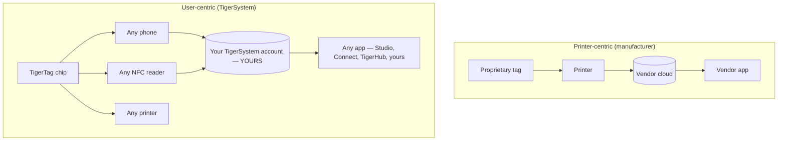

# Centrado no usuário vs centrado na impressora

> **Inteligência a serviço do usuário — não só da impressora.**

## Duas arquiteturas opostas

Em um mundo centrado na impressora, a **impressora** é o centro: a tag existe para servir
à máquina, e os dados fluem para o silo do fabricante.

No TigerSystem, o **usuário** é o centro. O usuário é dono:

- **do filamento** — qualquer marca, qualquer fabricante;
- **dos metadados** — material, cor, parâmetros de impressão, codificados em um chip que ele controla;
- **do inventário** — armazenado na própria conta na nuvem, exportável;
- **do histórico** — pesos, locais, uso ao longo do tempo;
- **da sincronização** — a mesma conta alimenta todos os aplicativos e dispositivos.

O TigerSystem simplesmente **conecta todos os componentes entre si**.

## Por que os fabricantes bloqueiam o RFID

As tags dos fabricantes costumam ser bloqueadas criptograficamente (veja a
[seção de compatibilidade](../compatibility/README.md) para os detalhes de cada fabricante:
chaves derivadas do UID, setores criptografados com AES, assinaturas RSA). O bloqueio serve ao
fabricante: prende a compra de consumíveis à máquina e mantém o fluxo de dados
proprietário. Também significa que **o seu próprio inventário de bobinas não é seu**.

Os chips TigerTag adotam a postura oposta: um payload NDEF aberto em um chip NTAG
padrão, documentado publicamente, com SDKs abertos para ler e gravar.

---

**◀ Anterior:** [Por que o TigerSystem existe](../vision/why-tigersystem.md) · **▲ [Índice da documentação](../../README.md)** · **Próxima ▶** [Ecossistema aberto](./open-ecosystem.md)

**Veja também:** [Identidade universal do filamento](../concepts/universal-filament-identity.md), [Compatibilidade](../compatibility/README.md)
