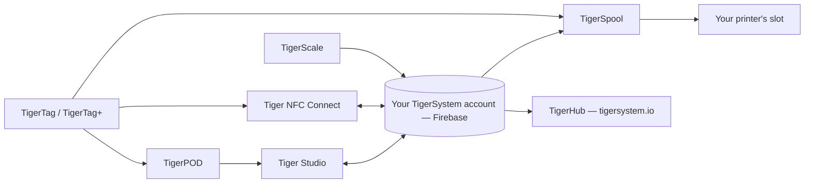

# Produtos

O ecossistema TigerSystem, uma página por produto.

**Estes são os produtos oficiais** — projetados e publicados pelo TigerSystem.
“Oficial” aqui quer dizer *nós o fizemos*, não *você precisa dele*: todos eles
são de código aberto e podem ser bifurcados, e seus nomes (Tiger Studio, TigerHub, TigerScale,
TigerPOD, Tiger NFC Connect) **não são reivindicados como marcas registradas** de propósito.
Somente a marca **TigerTag** em si é reservada, e apenas para o chip.

Qualquer pessoa pode criar e vender uma alternativa — um leitor, um aplicativo, uma balança, um sistema
de inventário completo. Veja o [hardware de terceiros](../compatibility/third-party-hardware.md)
e o [software criado sobre o TigerTag](../developers/integrations.md) para saber o que
já existe. Um produto de terceiros é **TigerTag Compatible** simplesmente por
funcionar; ele só se torna **TigerTag Certified** quando o TigerSystem o concede
([política de marca](../../TRADEMARK.md)).

> **Nota:** todo produto **voltado ao usuário** abaixo — e todo produto futuro — é uma
> **prova de conceito** em funcionamento. O único objetivo deles é mostrar o potencial de um
> protocolo de código aberto, padronizado, agnóstico e multiplataforma, e inspirar
> o que outras pessoas vão criar com ele. (A cadeia de ferramentas de programação de chips
> do lado da fábrica é outra história: de nível industrial, em produção.) Veja
> [Um ambiente de testes, de propósito](../vision/why-tigersystem.md).

| Produto | O que é | Tipo |
|---|---|---|
|  [TigerData](../concepts/universal-filament-identity.md) | O chip virtual — a identidade em forma digital, sem precisar de chip, atualizável a qualquer momento | Conceito |
|  [TigerTag](./tigertag.md) | Chip RFID/NFC aberto + padrão para a identidade da bobina | Hardware + especificação |
|  [TigerTag+](./tigertag-plus.md) | Um TigerTag que carrega o ID de um produto do catálogo e um enriquecimento opcional — continua 100% offline; assinado, é um TigerTag+ Certified | Hardware + especificação |
|  [Tiger NFC Connect](./tigertag-connect.md) | Aplicativo móvel (iOS/Android) — escanear, codificar, navegar | Aplicativo |
|  [Tiger Studio](./tiger-studio.md) | Aplicativo de desktop — inventário, racks, sensores, impressoras | Aplicativo |
|  [TigerHub](./tigerhub.md) | A casa do ecossistema na web — vitrine, listas de desejos, amigos e compartilhamento em `tigersystem.io` | Web |
|  [TigerPOD](./tigerpod.md) | Suporte imprimível em 3D com leitor NFC duplo | Hardware |
|  [TigerScale](./tigerscale.md) | Balança de filamento ESP32 de código aberto | Hardware |
|  [TigerSpool](./tigerspool.md) | Caixa ESP32 de código aberto ao lado da impressora — encoste uma bobina, escolha um slot, qualquer marca | Hardware |
|  [Tiger Touch](./tigertouch.md) | Firmware de código aberto para a tela BIGTREETECH Panda Touch / K-Touch — todas as marcas de impressoras, ao vivo, em uma única tela | Firmware |
|  [TigerTag Factory & Manager](./factory-suite.md) | Ferramentas industriais de programação de chips e de banco de dados de filamentos para fábricas — **não são públicas**, de nível de produção | Industrial |

---

**◀ Anterior:** [Fluxo de dados](../architecture/data-flow.md) · **▲ [Índice da documentação](../../README.md)** · **Próxima ▶** [TigerTag](./tigertag.md)
