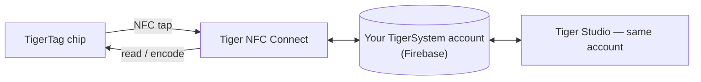

# Tiger NFC Connect (aplicativo móvel)

## Finalidade

**Seu celular já é um leitor TigerTag — o Connect o liga.** O
aplicativo para iOS/Android lê qualquer bobina com um toque, grava chips com a mesma facilidade e
mantém toda a sua coleção no bolso. É a porta de entrada do dia a dia para o
ecossistema e a personificação da
[ponte do smartphone](../philosophy/smartphone-bridge.md).

<strong>iPhone · iPad</strong>
<a class="ts-cta-primary" href="https://apps.apple.com/app/id6745437963">App Store</a>
Escaneie com a câmera ou toque no botão

<strong>Android</strong>
<a class="ts-cta-primary" href="https://play.google.com/store/apps/details?id=com.tigertag.connect">Google Play</a>
Escaneie com a câmera ou toque no botão

<a href="https://tigersystem.io/download">Todos os downloads em tigersystem.io</a>
<a href="https://testflight.apple.com/join/jVHhmK4C">Beta no TestFlight (iOS)</a>
<a href="https://play.google.com/apps/testing/com.tigertag.connect">Beta no Google Play</a>

Grátis, nas duas lojas. O aplicativo lê um chip com o NFC do próprio celular — nada
para comprar, nenhum leitor, nenhuma conta necessária para ler.

## Onde ele se encaixa

## Recursos

- **Escaneamento NFC em qualquer lugar** — encoste em uma bobina e veja o perfil completo dela.
- **Programação de chips** — codifique e recodifique chips TigerTag pelo celular.
- **Navegação pelo catálogo** — o banco de dados de referência compartilhado de marcas/materiais/cores.
- **Conta compartilhada** — o mesmo back-end Firebase do Tiger Studio: inventário,
 amigos e racks ficam sincronizados em tempo real entre os dispositivos.
- **Acessórios USB-C** — suporta o analisador de filamento **TD-1 / TD1s** da AJAX-3D
 por USB-C: meça a Distância de Transmissão (e a
 cor) de um filamento direto do celular
 ([hardware de terceiros compatível](../compatibility/third-party-hardware.md)).

## Como obter

- **Lançado** na **App Store (iOS)** e no **Google Play (Android)** —
 versão 1.0.2 hoje.
- **Betas públicos** também disponíveis (TestFlight no iOS, beta aberto no Android).
- Todos os links de download: **[tigersystem.io/download](https://tigersystem.io/download)**
 — um QR code também fica sempre disponível na barra lateral do Tiger Studio.

> **Nota sobre o nome:** antes publicado como *“TigerTag RFID Connect”* — renomeado
> para **Tiger NFC Connect** para lembrar o leitor NFC que já existe em todo celular.
> O aplicativo é **de uso gratuito, mas proprietário** (não é de código aberto) por enquanto —
> ao contrário do Tiger Studio, dos SDKs e do hardware, que são abertos.

## Arquitetura

Aplicativo Flutter que conversa com o Firebase (Auth + Firestore) — o único banco de dados
de contas compartilhado por trás de todos os aplicativos. A conexão com impressoras no celular é orientada à nuvem quando os fabricantes
permitem.

## Interações

| Com | Como |
|---|---|
| Chips TigerTag | Leitura e gravação por toque NFC |
| Firebase (banco de dados de contas) | Sincronização em tempo real de inventário / amigos / preferências |
| Tiger Studio | Companheiro de desktop — mesma conta, recursos complementares |

## Em imagens

|| | | |
|---|---|---|---|
|  |  |  |  |

---

**◀ Anterior:** [TigerTag+ Certified](./tigertag-plus-certified.md) · **▲ [Índice da documentação](../../README.md)** · **Próxima ▶** [Tiger Studio](./tiger-studio.md)

**Veja também:** [Ponte do smartphone](../philosophy/smartphone-bridge.md), [Inventário e sincronização na nuvem](../concepts/inventory-and-cloud-sync.md)
