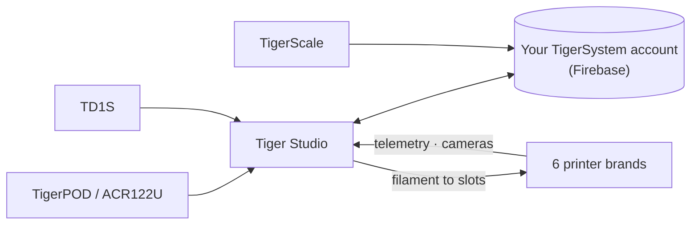

# Tiger Studio (aplicativo de desktop)

## Finalidade

**O Tiger Studio é o centro de controle do seu filamento.** Todas as bobinas, todos os
racks, todas as impressoras em uma única tela — escaneie um chip e a bobina dele abre,
atualize um peso e ele é sincronizado em todo lugar, dê uma olhada em uma impressora e veja o que ela está
fazendo agora. Código aberto, para Windows / macOS / Linux.

*O Tiger Studio na mesa, o aplicativo no bolso, um leitor ao lado — o
mesmo inventário, onde quer que você toque.*

<a class="ts-cta-primary" href="https://tigersystem.io/download">Baixe o Tiger Studio — grátis</a>

<a href="https://github.com/TigerTag-Project/TigerTag-Studio-Manager"> Código-fonte</a>

Ele é de propósito **um laboratório, não o destino** — uma demonstração do que
o protocolo aberto torna possível, legível, bifurcável e livre para copiar
([filosofia](../philosophy/open-ecosystem.md)).

## Onde ele se encaixa

## Recursos (destaques)

- **Inventário** — sincronização do Firestore em tempo real, visualizações em tabela/grade, painel de detalhes,
 controle de peso, calibração de recipientes, bobinas digitais (TigerData) com
 promoção atômica de chip.
- **Impressoras** — integrações ao vivo para **6 marcas** (telemetria, filamento por
 slot, progresso do trabalho, câmeras e, para algumas marcas, painéis de controle completos). Veja a
 [compatibilidade](../compatibility/README.md).
- **Racks** — mapeamento do armazenamento físico por arrastar e soltar.
- **Amigos e compartilhamento** — códigos de descoberta, inventários de amigos somente leitura.
- **Dispositivos** — próprios: o [TigerPOD](./tigerpod.md) e a
 [TigerScale](./tigerscale.md); de terceiros: o leitor NFC ACR122U, os
 analisadores **AJAX-3D TD-1 e TD1s** (TD + cor direto no perfil da bobina) e
 **balanças USB HID** (DYMO série M e qualquer balança compatível) —
 lista completa: [hardware de terceiros compatível](../compatibility/third-party-hardware.md).
- **11 idiomas** — EN · FR · DE · ES · IT · NL · PL · PT-BR · PT-PT · RU · 中文.

O catálogo completo e sempre atualizado fica no
[FEATURES.md](https://github.com/TigerTag-Project/TigerTag-Studio-Manager/blob/main/FEATURES.md) do repositório do aplicativo.

## Arquitetura

Electron + JS puro, sem bundler. As conexões com as impressoras falam diretamente o **protocolo
LAN nativo** de cada fabricante (MQTT / WebSocket / HTTP) — as notas de protocolo de cada marca são
mantidas no repositório do aplicativo (`renderer/printers/<brand>/PROTOCOL.md`).

## Em imagens

## Links

- Repositório + downloads: [TigerTag-Studio-Manager](https://github.com/TigerTag-Project/TigerTag-Studio-Manager) (MIT)
- Catálogo completo de recursos: [FEATURES.md](https://github.com/TigerTag-Project/TigerTag-Studio-Manager/blob/main/FEATURES.md)

---

**◀ Anterior:** [Tiger NFC Connect](./tiger-nfc-connect.md) · **▲ [Índice da documentação](../../README.md)** · **Próxima ▶** [TigerHub](./tigerhub.md)

**Veja também:** [Compatibilidade](../compatibility/README.md), [Arquitetura](../architecture/overview.md)
