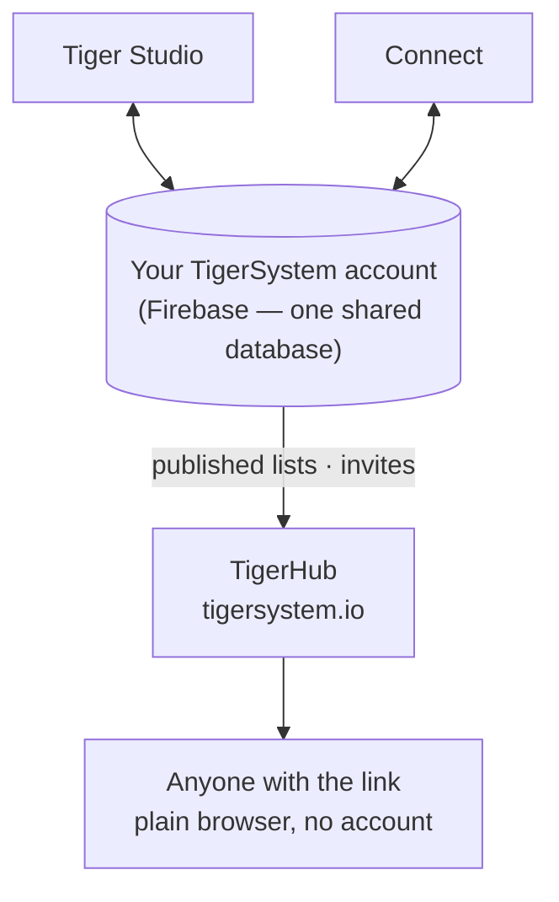

# TigerHub

## Finalidade

**O TigerHub é a casa do ecossistema na web** — o site
**[tigersystem.io](https://tigersystem.io)**. Ele apresenta o ambiente de testes do TigerSystem
e o que o protocolo aberto TigerTag torna possível, e hospeda o
**lado social** do ambiente de testes: compartilhar uma lista de desejos, convidar alguém para virar
amigo, publicar uma lista somente leitura que qualquer pessoa abre no navegador.

## Onde ele se encaixa

## Recursos — todos ao vivo hoje

- **Vitrine do ecossistema** — a página inicial conta toda a história: como funciona,
 as seis marcas de impressoras, os componentes e os três níveis (TigerData —
 controle só por software · TigerTag — o chip offline · TigerTag+ — autenticidade
 verificada).
- **Sua conta na web** (`/account`) — entre na sua conta TigerSystem
 por um navegador.
- **Listas de desejos** — públicas e só para amigos, ambas implantadas.
- **Códigos de amigo e convites** — adicionem-se como amigos pela web.
- **Links de listas públicas** — compartilhe um inventário ou uma lista de desejos somente leitura como
 `https://tigersystem.io/list/<token>`; quem vê não precisa de aplicativo nem de
 conta.
- **Catálogo de materiais e banco de dados de referência** (`/materials`, `/database`) —
 navegue pelo catálogo compartilhado com o qual todos os aplicativos trabalham.
- **Impressoras e recursos** (`/printers`, `/features`) — o que funciona com o quê.
- **Modelos 3D** (`/models`) — modelos imprimíveis (TigerPOD e companhia).
- **Para fabricantes, desenvolvedores e imprensa** (`/manufacturers`, `/developers`,
 `/press`) — a história B2B, indicações de integração, materiais de mídia.
- **Brindes** (`/goodies`) — o boné e a camisa polo oficiais. Comprar um é uma das
 formas de [apoiar o projeto](../support.md).

## O TigerHub não é o banco de dados

As contas de usuário e os dados por trás de todos os aplicativos ficam no **Firebase puro**
(Auth + Firestore) — uma infraestrutura deliberadamente sem marca: **um único banco de dados
compartilhado, em um único lugar**, para que o Tiger Studio, o Tiger NFC Connect, a TigerScale
e a conta TigerSystem interoperem sobre os mesmos dados. O TigerHub é a
**superfície web** construída sobre ele. Veja
[Inventário e sincronização na nuvem](../concepts/inventory-and-cloud-sync.md).

## Interações

| Com | Como |
|---|---|
| Tiger Studio / Connect | Gerar e revogar links de compartilhamento, enviar convites de amizade |
| Firebase (banco de dados das contas) | Fonte dos dados publicados |
| Visitantes | Navegador comum, sem precisar de conta |

---

**◀ Anterior:** [Tiger Studio](./tiger-studio.md) · **▲ [Índice da documentação](../../README.md)** · **Próxima ▶** [TigerPOD](./tigerpod.md)

**Veja também:** [Inventário e sincronização na nuvem](../concepts/inventory-and-cloud-sync.md), [Arquitetura](../architecture/overview.md)
