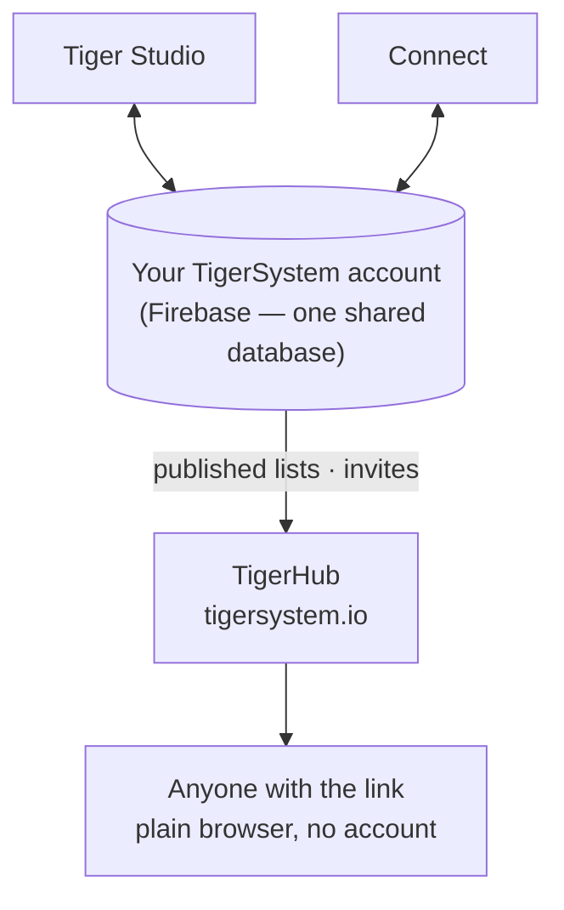

# TigerHub

## Finalidade

**O TigerHub é a casa do ecossistema na web** — o site
**[tigersystem.io](https://tigersystem.io)**. Ele apresenta o ambiente de testes do TigerSystem
e o que o protocolo aberto TigerTag torna possível, e hospeda o
**lado social** do ambiente de testes: compartilhar uma lista de desejos, convidar alguém para virar
amigo, publicar uma lista somente leitura que qualquer pessoa abre no navegador.

## Onde ele se encaixa

## Recursos — todos ao vivo hoje

- **Vitrine do ecossistema** — a página inicial conta toda a história: como funciona,
 as seis marcas de impressoras, os componentes e os três níveis (TigerData —
 controle só por software · TigerTag — o chip offline · TigerTag+ — autenticidade
 verificada).
- **Sua conta na web** (`/account`) — entre na sua conta TigerSystem
 por um navegador.
- **Listas de desejos** — públicas e só para amigos, ambas implantadas.
- **Códigos de amigo e convites** — adicionem-se como amigos pela web.
- **Links de listas públicas** — compartilhe uma lista somente leitura como
 `https://tigersystem.io/wishlist/<token>`; quem vê não precisa de aplicativo nem de
 conta.
- **Catálogo de materiais e banco de dados de referência** (`/materials`, `/database`) —
 navegue pelo catálogo compartilhado com o qual todos os aplicativos trabalham.
- **Impressoras e recursos** (`/printers`, `/features`) — o que funciona com o quê.
- **Modelos 3D** (`/models`) — modelos imprimíveis (TigerPOD e companhia).
- **Para fabricantes, desenvolvedores e imprensa** (`/manufacturers`, `/developers`,
 `/press`) — a história B2B, indicações de integração, materiais de mídia.
- **Brindes** (`/goodies`) — o boné e a camisa polo oficiais. Comprar um é uma das
 formas de [apoiar o projeto](../support.md).

## Um link de lista pública, na prática

Um link de lista pública é `https://tigersystem.io/wishlist/<token>`. Três
coisas para saber antes de colar um em algum lugar:

- **O token é a chave inteira.** Qualquer pessoa com o link abre a lista — sem
  conta, sem aplicativo, nada a provar. Trate-o como uma senha que você decidiu
  compartilhar: tudo bem para um post em fórum ou para um amigo, não para uma
  lista que você não gostaria de ver copiada adiante.
- **Tornar uma lista pública é o que cria o link.** No aplicativo, definir uma
  lista como *pública* gera o seu token e publica uma cópia da lista; voltá-la
  para privada apaga essa cópia e o token. Torne-a pública de novo e ela recebe
  um token **novo**, então um link distribuído antes não volta a funcionar. O
  TigerHub só exibe o que o aplicativo publica.
- **Somente leitura, e a página diz quem compartilhou.** Quem vê enxerga apenas
  essa lista — os itens, e a ocasião ou a mensagem se você definiu uma — nunca o
  seu inventário nem as suas outras listas. A página mostra, sim, o seu **nome
  de exibição**, os seus **links de redes sociais** e um botão *adicionar como
  amigo* que leva o seu **código de descoberta**.

Um link é uma de duas formas de compartilhar; a outra é um amigo:

| | Link de lista pública | Amigo |
|---|---|---|
| Quem vê | qualquer pessoa com o link | uma pessoa que você aceitou |
| Precisa de conta | não | sim |
| Como | tornar uma lista pública | trocar códigos de descoberta |
| Desfazer | tornar a lista privada | remover o amigo |

A parte dos amigos é resumida aqui só para ficar ao lado do link; as regras de
pedido e remoção, e a aplicação de ambas no servidor, pertencem a
[Inventário e sincronização na nuvem](../concepts/inventory-and-cloud-sync.md).

## O TigerHub não é o banco de dados

As contas de usuário e os dados por trás de todos os aplicativos ficam no **Firebase puro**
(Auth + Firestore) — uma infraestrutura deliberadamente sem marca: **um único banco de dados
compartilhado, em um único lugar**, para que o Tiger Studio, o Tiger NFC Connect, a TigerScale
e a conta TigerSystem interoperem sobre os mesmos dados. O TigerHub é a
**superfície web** construída sobre ele. Veja
[Inventário e sincronização na nuvem](../concepts/inventory-and-cloud-sync.md).

## Interações

| Com | Como |
|---|---|
| Tiger Studio / Connect | Tornar uma lista pública ou privada — o que cria ou apaga o seu link — e enviar convites de amizade |
| Firebase (banco de dados das contas) | Fonte dos dados publicados |
| Visitantes | Navegador comum, sem precisar de conta |

---

**◀ Anterior:** [Tiger Studio](./tiger-studio.md) · **▲ [Índice da documentação](../../README.md)** · **Próxima ▶** [TigerPOD](./tigerpod.md)

**Veja também:** [Inventário e sincronização na nuvem](../concepts/inventory-and-cloud-sync.md), [Arquitetura](../architecture/overview.md)
