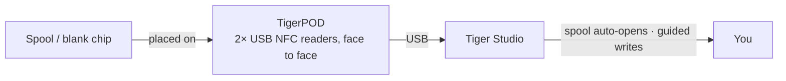

# TigerPOD

## Finalidade

**O primeiro “toca-discos” para bobinas de filamento inteligentes.** O TigerPOD coloca um scanner
de bobinas na sua mesa — e você mesmo o imprime.
Um suporte gratuito, de código aberto e imprimível em 3D que abriga **dois** leitores NFC USB **de frente
um para o outro**: coloque uma bobina e ela se identifica no Tiger Studio; coloque um chip
em branco e codifique-o. Tão natural quanto encostar um celular, mas com as mãos livres na mesa.

*Apoie a bobina; ela se apresenta sozinha.*

<a class="ts-cta-primary" href="https://tigersystem.io/tigerpod">Obtenha um TigerPOD</a>
<a href="https://makerworld.com/fr/models/1289152-tigerpod-for-openspool-tigertag-rfid-filament#profileId-1318958">Imprima você mesmo — STL grátis</a>

<a href="https://github.com/TigerTag-Project/TigerPOD"> Código-fonte</a>

## Por que dois leitores, de frente um para o outro

Este é o ponto central da carcaça, e a única coisa que precisa ficar certa. **Recomendamos
dois leitores, sempre.** Um leitor tecnicamente funciona, mas degrada
a experiência de duas formas concretas:

- **Leitura.** Uma bobina carrega
 [**dois chips, em faces opostas**](../concepts/tigertag-chip.md). Com um único
 leitor, uma bobina que cai do lado “errado” precisa ser levantada e
 virada antes de ser vista. Com um leitor de cada lado, não importa como você largue
 a bobina, sempre há um chip diante de um leitor. Nada para virar, nada
 para apontar.
- **Gravação.** Quando você etiqueta uma bobina por conta própria, grava **os dois** chips. Um
 leitor significa duas passadas e duas chances de eles ficarem diferentes. Dois leitores gravam
 o par **de uma só vez**, e o Tiger Studio pode conferi-los um contra o outro.

O Pod existe para manter essa geometria: dois leitores, na vertical, frente a frente, na
distância da bobina. Todo o resto é uma carcaça em volta disso.

## Onde ele se encaixa

## Duas carcaças para imprimir — ambas grátis

| | **TigerPOD Mini** — *recomendado* | **TigerPOD (original)** |
|---|---|---|
| |  |  |
| Impressão | Mais rápida, menos filamento | Mais demorada, mais filamento |
| Espaço na mesa | Menos | Mais |
| Cabos | Passam **dentro** da carcaça | Externos |
| Tags | TigerTag **e** OpenSpool (NDEF) | TigerTag **e** OpenSpool (NDEF) |
| Download | **[MakerWorld — TigerPOD Mini](https://makerworld.com/fr/models/3190348-tigerpod-mini-for-openspool-tigertag-rfid-filament#profileId-3609236)** | **[MakerWorld — TigerPOD original](https://makerworld.com/fr/models/1289152-tigerpod-for-openspool-tigertag-rfid-filament#profileId-1318958)** |

Ambas abrigam os mesmos dois leitores da classe ACR122U de frente um para o outro. O Mini é um
redesenho do original e é simplesmente o melhor Pod: comece por ele, a menos que você
queira especificamente o berço maior.

Licenciado sob **CC BY 4.0** — remixe e adapte livremente.

## Do que ele é feito

O STL é a carcaça; estas são as peças que vão dentro dela. Nada aqui é
exclusivo — qualquer leitor da classe ACR122U e qualquer hub USB-C servem — mas esta é
a combinação em torno da qual a carcaça foi projetada:

| Peça | Quantidade | O que é |
|---|---|---|
| **TigerTag Player** | **2** | O leitor NFC USB — um dispositivo da classe ACR122U. Um de cada lado, para alcançar os dois chips da bobina em uma única passada. |
| **TigerTag Spliter** | 1 | USB-C para 2× USB-A, para que os dois leitores cheguem ao computador por uma só porta e possam ser programados em paralelo. |
| **A carcaça impressa** | 1 | **Mini** ou original — veja acima. |

### Como obter as peças

A carcaça é um download gratuito; os dois leitores e o splitter são a parte que você
compra. Eles são vendidos em um kit, que é a forma mais barata de ficar com
o par certo:

- **[TigerTag Player Bundle — 2 leitores + Spliter](https://www.atome3d.com/products/tigertag-player-bundle-2pcs-spliter)** (Atome3D)
- Também disponível em **[tigertag.io](https://shop.tigertag.io/collections/tigertag-rfid-maker)**

> **Nota:** montar um você mesmo e comprar um já montado resultam
> exatamente no mesmo dispositivo. Quaisquer dois leitores da classe ACR122U servem — o kit
> só poupa o trabalho de procurá-los separadamente.

## Monte um

1. **Imprima uma carcaça** — a Mini ou a original, acima.
2. **Consiga dois leitores compatíveis com ACR122U**, em qualquer loja que preferir, e um pacote de
 chips NTAG 213 / 215 / 216 em branco para gravar.
3. **Deslize um leitor em cada encaixe** — sem parafusos, sem cola, sem fiação.
4. **Conecte os dois ao computador.** Um splitter deixa tudo em um só cabo; duas portas
 USB funcionam igualmente bem.
5. **Instale o [Tiger Studio](./tiger-studio.md)** — ele reconhece os leitores
 sozinho.

Orçamento aproximado, com peças compradas separadamente — os preços variam conforme a loja e a região:

| Peça | Qtd. | Aprox. | Onde |
|---|---|---|---|
| Leitor NFC compatível com ACR122U | 2 | € 15–25 cada | [Amazon](https://amzn.to/4vok3d7) · ou qualquer loja |
| Chips NTAG 213 / 215 / 216 em branco | 1 pacote | € 10–20 — dois chips por bobina, então um pacote etiqueta muitas | [Amazon](https://amzn.to/3TzxGc7) · [chips oficiais](./tigertag.md) |
| A carcaça impressa | 1 | só o filamento | MakerWorld, acima |
| Hub USB (2× USB-A fêmea → 1× USB-A macho) | 1 | € 5–10, opcional | [Amazon](https://amzn.to/4plgsv8) |

> Alguns links desta tabela são **links de afiliado da Amazon**: como Associado
> da Amazon, o TigerTag ganha com compras qualificadas, **sem custo adicional para
> você**. Isso ajuda a financiar o protocolo aberto. Comprar as mesmas peças em qualquer outro lugar
> funciona exatamente igual.

Comprar o [kit](https://shop.tigertag.io/collections/tigertag-rfid-maker)
custa menos do que reunir as mesmas peças uma a uma, os leitores chegam
com o logotipo oficial do projeto, e isso financia o padrão — uma das
várias formas de [apoiar o projeto](../support.md). Mas montar um com
peças genéricas **não é um caminho inferior — é o mesmo Pod**. É isso que um protocolo
aberto significa.

### Compatibilidade de leitores

O ACR122U fala **PC/SC**, o padrão de cartões inteligentes em nível de sistema operacional que todo leitor
dessa classe implementa. Como o Pod se baseia em PC/SC, e não em um driver do fabricante,
a mesma configuração roda em **Windows, macOS e Linux**, e qualquer biblioteca PC/SC
pode controlá-lo.

## Recursos

- Carcaça imprimível em 3D — **STLs grátis no MakerWorld**, nos tamanhos **Mini** e
 **original**.
- Abriga dois leitores USB da classe ACR122U, frente a frente (estações de leitura + gravação).
- Plug and play com o [Tiger Studio](./tiger-studio.md): escanear um chip
 abre automaticamente a bobina correspondente; o fluxo guiado de atualização de chip o usa para
 gravações com verificação de UID.
- Não é preso ao TigerTag: os mesmos dois leitores lidam também com tags **OpenSpool** (NDEF).

## Mais do que TigerTag — uma estação NFC universal

O Pod **não é preso ao protocolo TigerTag**. Ele é, literalmente, dois
leitores PC/SC padrão em um suporte em forma de bobina: **tudo o que um ACR122U faz,
o Pod faz.**

Você controla o chip por completo — ler o que há nele, gravar algo novo,
alterar o que está lá, apagá-lo até ficar em branco. Os quatro, nos dois sentidos. Sem
gravação única, sem mão única, sem dependência de fabricante. E, para filamento, isso acontece em
**Dual NFC**, com os dois chips de uma bobina tratados juntos, em bobinas de qualquer marca.

O ACR122U lida com muito mais do que NTAG: **ISO 14443 Tipo A e B**, **MIFARE**
(Classic 1K/4K, Ultralight, DESFire), **FeliCa**, **Topaz/Jewel** e **tipos 1–4 de tags do NFC
Forum**. Tudo o que você pode ler ou gravar com um ACR122U, você pode
ler ou gravar no Pod — incluindo tags [OpenSpool](../compatibility/openspool.md).

É isso também que torna real a [segunda vida](../philosophy/second-life.md). Um
TigerTag nunca é protegido contra gravação, então, quando uma bobina acaba, você pode apagar seus
chips e regravá-los como TigerTags novos — ou transformá-los em outra coisa
completamente diferente: uma tag **NDEF** simples para automação residencial, uma transferência de Wi-Fi, um URL, um
cartão de visita. E de volta a um TigerTag quando quiser. O chip é um ativo
reutilizável, não uma embalagem descartável.

## Interações

| Com | Como |
|---|---|
| Chips TigerTag | Ler / codificar / verificar — os dois chips de uma bobina de uma vez |
| Tiger Studio | Identificação instantânea da bobina, promoção e atualização do chip |

## Em imagens

## Links

- Repositório: [TigerPOD](https://github.com/TigerTag-Project/TigerPOD)
- STL — **[TigerPOD Mini](https://makerworld.com/fr/models/3190348-tigerpod-mini-for-openspool-tigertag-rfid-filament#profileId-3609236)** · [TigerPOD original](https://makerworld.com/fr/models/1289152-tigerpod-for-openspool-tigertag-rfid-filament#profileId-1318958)
- Leitores: [TigerTag Player Bundle (2 unid. + Spliter)](https://www.atome3d.com/products/tigertag-player-bundle-2pcs-spliter)

---

**◀ Anterior:** [TigerHub](./tigerhub.md) · **▲ [Índice da documentação](../../README.md)** · **Próxima ▶** [TigerScale](./tigerscale.md)

**Veja também:** [Fluxo de Segunda Vida](../philosophy/second-life.md)
