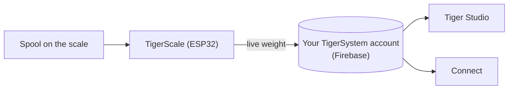

# TigerScale

## Finalidade

**A TigerScale responde à eterna pergunta: quanto filamento ainda resta?** Coloque uma
bobina na balança ESP32 de código aberto e o peso ao vivo vai direto para
o seu inventário — sem digitar nada, sem sacudir a bobina perto do ouvido.

*A bobina vai por cima, e a balança já sabe o que ela é: o chip informa a
marca, o material e a cor, a célula de carga informa os gramas. Nada
digitado, nada adivinhado.*

<a class="ts-cta-primary" href="https://tigertag-project.github.io/Tiger-Scale-V3/">Instale pelo navegador</a>

<a href="https://tigersystem.io/tigerscale">TigerScale em tigersystem.io</a>
<a href="https://makerworld.com/en/models/3161869-tigerscale-v3-best-smart-filament-scale-with-nfc#profileId-3573543">Imprima a caixa</a>
<a href="https://github.com/TigerTag-Project/Tiger-Scale-V3"> Código-fonte</a>

> **O chip sabe o que o filamento *é*; a balança sabe quanto *resta*.**
> Juntos, eles tornam o inventário realmente verdadeiro: a identidade vem do
> [TigerTag](./tigertag.md), a quantidade ao vivo vem da TigerScale.

## TigerScale V3 — a geração atual

[Tiger-Scale-V3](https://github.com/TigerTag-Project/Tiger-Scale-V3), MIT.
Esta é a que você deve montar.

- **Ela sabe qual bobina está sobre ela**: **dois leitores NFC PN532**, um de cada
 lado — uma [bobina com tag dupla](../concepts/tigertag-chip.md) é identificada
 não importa de que lado você a apoie. Ler a tag, pesar, subtrair o peso da
 bobina vazia, sincronizar — sem digitar, sem adivinhar.
- **ESP32-S3** (16 MB de flash, PSRAM), **tela sensível ao toque colorida de 3,5″ 480×320**
 (LVGL) com configuração completa na tela: seletor de WiFi + teclado, assistente
 de calibração, autoteste de hardware, atualizações OTA.
- **Alimentada por bateria** (PMIC AXP2101, estado de carga na tela), codec de áudio.
- Pesagem de precisão: HX711 + célula de carga, filtragem por mediana + EMA adaptativa —
 ajustada para a sensação de uma balança de cozinha.
- **8 idiomas no firmware**, interface web em 9 idiomas.
- **Acompanhamento de peso ao vivo** — as atualizações aparecem em tempo real no Tiger Studio e
 no Tiger NFC Connect via Firestore.
- Funciona com a **calibração de peso de recipientes** do Tiger Studio, para que o peso
 líquido do filamento continue preciso para cada tipo de recipiente.
- **Funciona offline.** A identificação de marca e material vem de um banco de dados
 guardado na própria flash do dispositivo, atualizado no máximo uma vez por dia — a consulta de uma tag
 nunca espera pela rede.
- **A sincronização na nuvem é opcional.** A balança é totalmente utilizável sem uma conta.
- **Sua própria interface web**, servida pelo dispositivo, adaptada a celulares, ao vivo por
 WebSocket a 10 Hz — sem aplicativo para instalar para controlá-la pelo celular.
- **Sem blobs binários**: tudo é compilado a partir do código-fonte.

*Na bancada: apoie a bobina, ela se identifica e se pesa sozinha.*

## Como montar uma

> **Não curte eletrônica?** Uma balança USB e um [TigerPOD](./tigerpod.md) fazem o
> mesmo trabalho sem nada para ligar ou gravar — a
> [alternativa oficial sem eletrônica](#uma-balança-usb-e-um-tigerpod-sem-eletrônica).

A balança é uma montagem caseira, e as etapas que as pessoas esperam que sejam difíceis não são:

1. **Imprima a caixa.** Um projeto `.3mf` do Bambu Studio com as mesas
 já organizadas — [no MakerWorld](https://makerworld.com/en/models/3161869-tigerscale-v3-best-smart-filament-scale-with-nfc#profileId-3573543).
 Abra-o no Bambu Studio ou no Orca e pressione Fatiar: nada para orientar, nenhum
 suporte para posicionar.
2. **Ligue os componentes.** Conecte a célula de carga, o HX711, o alto-falante e os dois
 leitores PN532 à placa seguindo o [diagrama de fiação](#diagrama-de-fiação)
 abaixo — a mesma pinagem para qualquer uma das variantes de placa.
3. **Grave o firmware pelo navegador.** O
 [instalador web](https://tigertag-project.github.io/Tiger-Scale-V3/) sempre
 serve a versão atual; depois disso a balança se atualiza sozinha pelo ar.

As peças são comuns:

| Qtd. | Componente | Onde |
|---|---|---|
| 1 | Waveshare **ESP32-S3-Touch-LCD-3.5B** — IPS touch 480×320 (a **-3.5** sem o B também serve) | [-3.5B](https://link.amazon/B0gaANfF5) · [-3.5](https://link.amazon/B0dpgOlOQ) |
| 2 | Módulo NFC **PN532 V3** — são necessários o conector de pinos **e** a chave de modo | [Amazon](https://link.amazon/B0iTXrhjd) |
| 1 | Célula de carga de 5 kg + HX711 | [Amazon](https://link.amazon/B09LOUuI1) |
| 1 | Cabo USB-C de 4 pinos + conector | [cabo](https://link.amazon/B0aoW8qQx) · [conector](https://link.amazon/B0aiEyjLx) |
| 1 | Bateria de íon de lítio — **opcional**, a balança funciona por USB | [Amazon](https://link.amazon/B0etKlE1i) |
| — | Fios Dupont, parafusos autoatarraxantes M3 | [fios](https://link.amazon/B0bl6jvMs) · [parafusos](https://link.amazon/B0ekzxx1E) |
| — | 2× M4×30 e 2× M5×30 (célula de carga), 4× M2×6 (display) | qualquer loja de ferragens |
| 1 | Um pequeno alto-falante | vem com a placa ESP32-S3 |

<figure>

<figcaption><strong>As duas variantes funcionam, mas precisam de firmwares diferentes.</strong> Leia a serigrafia: <strong>-3.5B</strong> ou <strong>-3.5</strong>. O instalador web pergunta qual você tem; a fiação e a caixa são as mesmas nos dois casos. Se gravar a versão errada, a balança inicia perfeitamente, mas nunca enxerga uma tag, sem nada na tela para explicar o motivo.</figcaption>
</figure>
<figure>

<figcaption><strong>Aviso:</strong> a célula de carga deve ter 2 furos roscados M4 e 2 M5, e a placa HX711 deve ser idêntica à mostrada — caso contrário, não caberá no encaixe previsto.</figcaption>
</figure>

> Alguns links desta tabela são **links de afiliado da Amazon**: como Associado
> da Amazon, o TigerTag ganha com compras qualificadas, **sem custo adicional para
> você**. Isso ajuda a financiar o protocolo aberto. Comprar as mesmas peças em qualquer outro lugar
> funciona exatamente igual.

A lista completa de materiais, com custos, está no
[repositório](https://github.com/TigerTag-Project/Tiger-Scale-V3).

### Montagem

<figure>

<figcaption>Três quartos frontal</figcaption>
</figure>
<figure>

<figcaption>Três quartos traseiro</figcaption>
</figure>
<figure>

<figcaption>Três quartos traseiro, de perto</figcaption>
</figure>
<figure>

<figcaption>Vista lateral</figcaption>
</figure>

<figure>

<figcaption>Posição e orientação da balança</figcaption>
</figure>
<figure>

<figcaption>PN532 encaixado no seu lugar</figcaption>
</figure>

### Diagrama de fiação

*[Esquema interativo no Cirkit Designer](https://app.cirkitdesigner.com/project/c6aa6c0a-9462-498f-8923-9ad4454e0e69)*

### Solução de problemas

**Nenhuma porta COM detectada para o ESP32-S3 no [instalador web](https://tigertag-project.github.io/Tiger-Scale-V3/)?**

Pode estar faltando um driver para o seu sistema. [Siga o guia de instalação do driver](../tutorials/tigerscale-serial-port-driver.md).

**Um peso travado em 0 g ou negativo, uma leitura que deriva, leitores não
detectados, Wi-Fi perdido depois de regravar o firmware?**

O próprio repositório da balança mantém a lista completa, sintoma por sintoma:
[solução de problemas do Tiger-Scale-V3](https://github.com/TigerTag-Project/Tiger-Scale-V3/blob/main/docs/TROUBLESHOOTING.md).

## Para você fazer e vender

**Qualquer pessoa pode fabricar e vender hardware TigerScale. Sem taxa de licença, sem
royalties, sem registro.** Monte, grave o firmware oficial, venda.

A única condição para chamar seu produto de **TigerScale** é executar esse
firmware oficial **sem modificações**, para que todas as unidades se comportem de forma idêntica dentro do
ecossistema. Faça um fork se quiser mudá-lo — e dê ao fork um nome
diferente. Esse é todo o acordo.

## Onde ela se encaixa

## A história até aqui

Três gerações, e a forma da coisa mudou a cada uma:

| | Leitura | Tela | Placa | Formato |
|---|---|---|---|---|
| **V1** — nunca lançada publicamente | **um** PN532 | mini OLED | ESP32 | um **suporte de bobina**: um apoio central passando pelo meio da bobina |
| **V2** — [Tiger-Scale](https://github.com/TigerTag-Project/Tiger-Scale), MIT | 2× RC522 | OLED de 0,96″ | ESP32-WROOM, alimentada por USB | uma balança plana |
| **V3** — [Tiger-Scale-V3](https://github.com/TigerTag-Project/Tiger-Scale-V3), MIT | 2× PN532 | tela sensível ao toque colorida de 3,5″ | ESP32-S3, bateria | uma balança plana, autônoma |

A V1 já levava essencialmente a eletrônica da V2 — ESP32, mini OLED,
uma placa HX711 com célula de carga de 5 kg — mas com um **único** leitor e um
corpo completamente diferente.

> **A V3 é um hardware diferente, não uma atualização de firmware.** As duas não são
> intercambiáveis: uma V2 que você já montou mantém o próprio repositório e continua
> funcionando. Ela simplesmente não é mais desenvolvida.

As três são totalmente de código aberto (MIT) e usam peças comuns — a prova viva
de que um ESP32 e um módulo leitor NFC (da classe PN532 / RC522) bastam para
criar um dispositivo que lê TigerTag.

## Uma balança USB e um TigerPOD, sem eletrônica

A **alternativa oficial para quem não quer montar uma balança**. Uma
balança USB padrão e um [TigerPOD](./tigerpod.md), ambos ligados ao
computador, e o Tiger Studio faz o resto — nada para soldar, ligar ou gravar.

1. **Conecte a balança ao computador** por USB.
2. **Coloque o TigerPOD em cima dela** — o Mini ou o original.
3. **Tare a balança**, com o TigerPOD sobre ela.
4. **Abra o Tiger Studio.**
5. **Coloque uma bobina no TigerPOD.** Ele lê os chips da bobina e o Tiger
 Studio abre a ficha dela.
6. **A balança a pesa**, e o Tiger Studio atualiza o peso da bobina
 sozinho.

### Quais balanças funcionam

O Tiger Studio lê dispositivos padrão **USB “HID Scale”** (página de uso HID
`0x8D`, uso `0x20`): começando pela **DYMO M5** e o restante da série DYMO M
(M10, M25… mesmo protocolo), e **qualquer HID Scale compatível**, seja qual for a
marca. A balança é hardware de terceiros, não um produto Tiger; a configuração em torno
dela é oficial e tem suporte.

Protocolo, validado em hardware real — *Scale Data Reports* de 6 bytes a ~1 Hz:

| Byte | Significado |
|---|---|
| `[0]` | id do relatório `0x03` |
| `[1]` | status: 1 falha · 2 estável no zero · 3 em movimento · 4 estável · 5 negativo · 6 acima da capacidade |
| `[2]` | unidade (códigos HID PoS): `0x02` grama · `0x0B` onça · `0x0C` libra |
| `[3]` | expoente de potência de dez com sinal aplicado ao valor bruto |
| `[4..5]` | peso, LE16 (LSB, MSB) |

ID de fabricante da DYMO `0x0922`; a M5 é pid `0x8009`. Particularidade: o primeiro quadro
logo após uma tara informa a unidade `0x00`.

> **A DYMO M2 não é suportada** — ela não tem nenhuma porta USB, então não há
> nada para conectar a um computador. O protocolo é irrelevante.

## Interações

| Com | Como |
|---|---|
| Firebase (banco de dados de contas) | Grava o peso ao vivo na conta do usuário |
| Tiger Studio / Connect | Exibem o peso ao vivo; monitoramento de saúde |

## Links

- **V3 (atual)**: [Tiger-Scale-V3](https://github.com/TigerTag-Project/Tiger-Scale-V3) (MIT)
- Grave pelo navegador: [instalador web](https://tigertag-project.github.io/Tiger-Scale-V3/)
- Imprima a caixa: [MakerWorld](https://makerworld.com/en/models/3161869-tigerscale-v3-best-smart-filament-scale-with-nfc#profileId-3573543)
- V2, sem desenvolvimento: [Tiger-Scale](https://github.com/TigerTag-Project/Tiger-Scale) (MIT)

---

**◀ Anterior:** [TigerPOD](./tigerpod.md) · **▲ [Índice da documentação](../../README.md)** · **Próxima ▶** [Compatibilidade](../compatibility/README.md)

**Veja também:** [Inventário e sincronização na nuvem](../concepts/inventory-and-cloud-sync.md)
