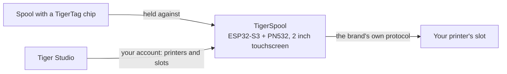

# TigerSpool

**Uma pequena caixa ao lado da impressora. Toque em um slot, encoste uma bobina nela, e o
filamento é gravado nesse slot — em qualquer marca de impressora.**

*A caixa, uma bobina e os próprios slots da impressora na tela — cada um mostrando
o que está carregado nele. Escolha um slot, encoste a bobina na caixa, pronto.*

<a class="ts-cta-primary" href="https://tigertag-project.github.io/TigerSpool-RFID/">Instale pelo navegador</a>

<a href="https://github.com/TigerTag-Project/TigerSpool-RFID"> Código-fonte</a>

Sua impressora já mantém uma lista de slots. Sua bobina já carrega a própria
[identidade](../concepts/universal-filament-identity.md). O TigerSpool são os trinta
centímetros entre as duas: nenhum aplicativo para abrir, nenhum teclado, nada redigitado
que o chip já saiba.

Código aberto sob **MIT**, ESP32-S3, cerca de **40 €** em peças comuns.

## O que ele faz

1. **Toque no slot** que você quer na tela sensível ao toque — com os mesmos nomes de slot que a
 própria impressora usa.
2. **Encoste a bobina na caixa.** O [chip TigerTag](../concepts/tigertag-chip.md)
 é lido ao contato, e a atribuição segue para a impressora na hora, pelo
 protocolo próprio daquela marca: material, marca, cor e temperaturas, no
 slot certo. Não há nada para confirmar.
3. **Carregue a bobina.** A caixa informa em qual slot ela foi.

Ele fala nove idiomas, pergunta qual antes de qualquer outra coisa e se atualiza
sozinho pelo ar.

:::caution[Aviso]
Escanear um TigerTag em um slot na tela não carrega
nada — apenas informa à impressora o que a bobina *é*. **Você ainda precisa
colocar fisicamente a bobina nesse slot** — o CFS, o AMS, a
unidade ACE ou como quer que aquela impressora chame o próprio compartimento. Se pular isso,
a impressora informa que não há filamento, porque realmente não há nenhum carregado.
:::

## Onde ele se encaixa

O TigerSpool não é um gravador de chips — esse é o trabalho do [TigerPOD](./tigerpod.md),
na mesa. O TigerSpool pega uma identidade que já existe e a coloca onde
a impressora espera.

## O que precisa existir antes

**É nisso que as pessoas tropeçam, por isso vem antes do hardware.**

A caixa não tem teclado nem forma de digitar o endereço de uma impressora, de propósito.
Ela lê suas impressoras **da sua conta TigerSystem**, o que significa que duas
coisas precisam existir para ela ser útil:

1. **Uma conta, criada no [Tiger Studio](./tiger-studio.md).** A caixa entra
 nela — por e-mail, ou com o Google por meio de um QR code, de modo que nenhuma senha
 seja digitada em uma tela de duas polegadas.
2. **Suas impressoras, adicionadas no Tiger Studio.** Endereço, código de acesso, marca e
 modelo ficam todos lá.

Se você pular isso, a lista de impressoras na caixa ficará **vazia**. Isso não é uma
falha e não há nada para consertar no dispositivo: ele está mostrando exatamente
o que a sua conta contém. Adicione a impressora no Tiger Studio e ela aparece na
próxima sincronização.

> **Em resumo:** Tiger Studio → crie uma conta → adicione suas impressoras →
> *depois* configure a caixa.

## Quais impressoras

**As seis marcas que o Tiger Studio integra estão cobertas** — escritas e testadas
em hardware. Isso não são todas as impressoras do mercado, e *“qualquer impressora”*
continua sendo o objetivo; são todas as marcas com que este ecossistema conversa hoje:

| Marca | Firmware | Transporte |
|---|---|---|
| [Creality](../compatibility/creality.md) | implementado, comprovado | WebSocket |
| [FlashForge](../compatibility/flashforge.md) | implementado, comprovado | HTTP |
| [Bambu Lab](../compatibility/bambu-lab.md) | implementado, comprovado | MQTT sobre TLS |
| [Snapmaker](../compatibility/snapmaker.md) | implementado, comprovado | Moonraker sobre WebSocket |
| [Elegoo](../compatibility/elegoo.md) | implementado, leitura comprovada — gravação ainda não confirmada em uma impressora | MQTT |
| [Anycubic](../compatibility/anycubic.md) | implementado, leitura comprovada — gravação ainda não confirmada; somente modo LAN | MQTT sobre TLS |

Os nomes dos slots seguem os da própria impressora: `Ext.` e `1A`–`1D` na Creality e na
FlashForge, `A1`–`A4` e depois `B1`–`B4` na Bambu Lab, `E1`–`E4` na Snapmaker, `S1`–`S4` no
Canvas da Elegoo, e uma letra por unidade ACE na Anycubic — `A1`, `A2`… depois
`B1`… para uma segunda caixa.

Confira o [status por marca](https://github.com/TigerTag-Project/TigerSpool-RFID/blob/main/docs/PRINTER-COMPATIBILITY.md)
antes de comprar peças para uma máquina específica.

## Monte um

Três coisas para comprar, quatro fios, uma carcaça impressa — mais dois extras que valem
a consideração. **A eletrônica é idêntica para todas as marcas de impressoras** — só
a carcaça muda, o que mantém um único firmware e uma única lista de peças.

| Qtd. | Componente | Onde |
|---|---|---|
| 1 | Placa de desenvolvimento Waveshare **ESP32-S3-Touch-LCD-2** — IPS capacitiva touch de 2,0" 240×320, ESP32-S3**R8**, 16 MB de flash, 8 MB de PSRAM octal. Tela, painel de toque e MCU em uma única placa, e os 16 MB é que tornam confortáveis dois slots de OTA | [Amazon](https://link.amazon/B0c5hr3uf) |
| 1 | Módulo NFC **PN532 V3** — chaves DIP, deve suportar **HSU/UART**, as duas chaves em `0` / OFF. Um pacote com dois custa pouco mais que um | [Amazon](https://link.amazon/B0dyEfwKa) |
| 1 | Um cabo USB-C **que transmita dados** — a velocidade é irrelevante, qualquer cabo de dados USB 2.0 serve | [Amazon](https://link.amazon/B00Xg3WT4) |
| 1 | Conector USB-C magnético — **recomendado**: a porta é a peça manuseada todos os dias, e o cabo se solta em vez do soquete | [Amazon](https://link.amazon/B0bWVIBa0) |
| 1 | Bateria LiPo de 3,7 V 1000 mAh, PH1.25 — **opcional**, carregada por USB; a caixa então funciona sem cabo. A placa não consegue detectar uma bateria, então você a declara em Configurações › Bateria. Confira a polaridade | [Amazon](https://link.amazon/B0fL0jjf3) |

> Alguns links desta tabela são **links de afiliado da Amazon**: como Associado
> da Amazon, o TigerTag ganha com compras qualificadas, **sem custo adicional para
> você**. Isso ajuda a financiar o protocolo aberto. Comprar as mesmas peças em qualquer outro lugar
> funciona exatamente igual.

Os **quatro fios jumper vêm com o PN532** — 3V3, GND, TX, RX, e esse é todo
o chicote. Sem conversores de nível: o PN532 funciona a 3V3, igual à placa.
A bateria é **opcional** — a caixa normalmente fica ao lado de uma impressora que já está
ligada na tomada, e a bateria acima é para as vezes em que não está.

*O chicote inteiro. No PN532, os dois pinos de dados estão serigrafados como `SDA` e
`SCL` — no modo HSU eles carregam a UART: o **TX da placa vai em `SCL`**, o
**RX em `SDA`**, e as duas chaves DIP ficam em `0` / OFF.
[Esquema interativo](https://app.cirkitdesigner.com/project/5b546f4e-70b8-4735-afff-be6bd36bc10c).*

**A gravação do firmware é feita pelo navegador** — conecte a placa, clique em Instalar, espere
um minuto. Chrome, Edge ou Opera em um desktop; o Safari e o Firefox não
implementam WebSerial, e nenhum navegador móvel implementa.

**[Instale pelo navegador →](https://tigertag-project.github.io/TigerSpool-RFID/)**

### Três armadilhas que vale conhecer antes de fazer o pedido

- **O leitor vai nos GPIO43/44, nunca nos GPIO6/7.** Esse par é um barramento I²C
 com pull-ups nesta placa: um PN532 ligado ali liga, responde e
 devolve UIDs aleatórios com leituras falhando. Parece uma tag ruim. Não é,
 e custa um dia.
- **`TXD` cruza para o RX da placa, `RXD` para o TX dela.** Transmitir fala com
 receber. Se o leitor informar firmware versão 0 na inicialização, troque esses dois
 antes de mudar qualquer outra coisa.
- **Um cabo USB só de carga faz uma placa que funciona parecer morta.** A tela
 acende e nenhuma porta serial aparece, então o instalador web não encontra nada
 onde instalar. Use um cabo que você saiba que transfere arquivos.

A Waveshare vende várias placas parecidas; as de 1,28", 1,69" e 3,5" da
mesma família têm controladores de painel e pinagens diferentes, e este firmware
não funcionará corretamente nelas. Confira a serigrafia, não o título do anúncio.

Lista completa de peças, diagrama de fiação e lista de verificação da primeira ligação:
[TigerSpool-RFID](https://github.com/TigerTag-Project/TigerSpool-RFID).

## Em que pé estamos hoje

Escrito, em vez de descoberto:

- **A primeira carcaça impressa foi publicada**: um suporte de mesa independente,
 com a bobina à esquerda ou à direita, em
 [Model3D/](https://github.com/TigerTag-Project/TigerSpool-RFID/tree/main/Model3D).
 Estojos que se montam em uma impressora específica seguem a mesma regra — mesma placa, mesmo
 leitor, mesmos quatro fios, mesma entrada USB-C — de modo que uma única imagem de firmware roda em
 todos os modelos e qualquer pessoa pode contribuir com um sem mexer em código.
- **O firmware não é assinado.** A conexão de atualização dele é verificada com o
 repositório de certificados raiz, então a caixa sabe com quem está falando — mas não quem
 produziu a imagem.
- **No máximo dez impressoras conectadas ao mesmo tempo** — das 24 que uma conta pode
 entregar a ela — e no máximo três que falem TLS (Bambu Lab, Anycubic), que custam
 mais memória.

---

**▲ [Índice da documentação](../../README.md)** · **Veja também:** [TigerPOD](./tigerpod.md), [Tiger Studio](./tiger-studio.md), [O chip TigerTag](../concepts/tigertag-chip.md), [Compatibilidade de impressoras](../compatibility/README.md)
