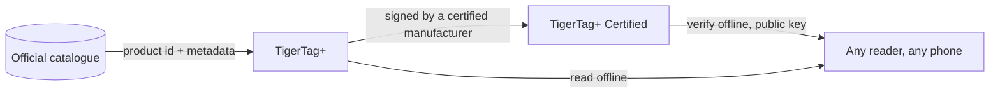

# TigerTag+ Certified

## Finalidade

**Certified é o nível capaz de provar de onde um chip veio.** Um
[TigerTag+](./tigertag-plus.md) que carrega também uma **assinatura
criptográfica** é um **TigerTag+ Certified**. A assinatura é gravada por um fabricante que possui a
[certificação TigerTag+](../developers/README.md), que recebe
as ferramentas de assinatura como parte dela; a chave privada fica com o TigerTag.

É o único dos três níveis que não é aberto a todos, e o único
que responde a uma pergunta que os outros dois não respondem: *esta bobina é genuína?*

## Os três níveis, lado a lado

| | TigerTag | TigerTag+ | TigerTag+ Certified |
|---|---|---|---|
| Dados de impressão, **no chip** | ✅ | ✅ | ✅ |
| Funciona totalmente offline | ✅ | ✅ | ✅ |
| ID do produto do catálogo, **no chip** | — | ✅ | ✅ |
| Metadados de enriquecimento, **pela Web API, opcional** | — | ✅ | ✅ |
| Assinatura de origem, **no chip** | — | — | ✅ |
| Quem pode produzir um | todos | todos | **um fabricante certificado** |

Leia com atenção a coluna da esquerda: os metadados de enriquecimento são a única linha que
**não** fica no chip. Eles são consultados no catálogo quando você
está online, e podem melhorar depois que o chip é gravado — e é justamente por isso que
nunca podem ser algo de que o chip precise. Tudo o que a impressora
exige está nas linhas marcadas como *no chip*, o que mantém os três
níveis 100% offline.

## Verificar é grátis — emitir é o que a certificação concede

**Verificar** uma assinatura é grátis, offline e sem restrições: as chaves
públicas são publicadas, e qualquer leitor pode conferir uma sem conta nem rede.
**Emitir** uma é o que a certificação concede.

A mensagem assinada cobre de propósito o **próprio UID** do chip, de modo que um conteúdo assinado
copiado para outro chip deixa de corresponder a ele: uma etiqueta clonada falha na
verificação, no próprio celular do cliente. É a mesma propriedade que faz os dois
chips de uma mesma bobina carregarem duas assinaturas *diferentes*
([como os dois chips são vinculados](../concepts/tigertag-chip.md)).

## Onde ele se encaixa

O layout em nível de bytes — IDs de tipo de chip, a área de assinatura de 64 bytes nas páginas
`0x18`–`0x27` — é especificado no
[TigerTag-RFID-Guide](https://github.com/TigerTag-Project/TigerTag-RFID-Guide).

## Quem é certificado

A lista oficial dos fabricantes autorizados a colocar a marca em um produto é
o [registro de parceiros certificados](../certified-partners.md). O logotipo ou o nome TigerTag
em um chip de qualquer formato, em um suporte, em uma bobina ou na embalagem só é
autorizado para os fabricantes dessa página.

---

**◀ Anterior:** [TigerTag+](./tigertag-plus.md) · **▲ [Índice da documentação](../../README.md)** · **Próxima ▶** [Tiger NFC Connect](./tigertag-connect.md)

**Veja também:** [O chip TigerTag](../concepts/tigertag-chip.md), [Parceiros certificados](../certified-partners.md), [Documentação para desenvolvedores](../developers/README.md)
